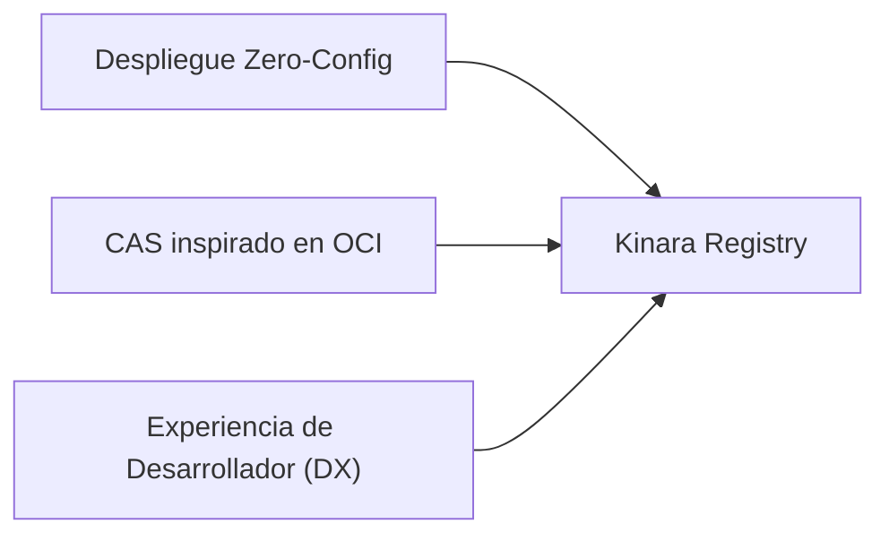

# 01. Visión del Producto, Pilares y Alcance Técnico

## 1. Visión General y Propuesta de Valor

El proyecto **Kinara Registry** nace de la necesidad de contar con un registro privado y multifacético de artefactos moderno, autohosteable (*self-hosted*), altamente eficiente y diseñado específicamente para entornos nativos de la nube (*cloud-native*).

En el ecosistema tecnológico actual, soluciones consagradas como **JFrog Artifactory** o **Sonatype Nexus** presentan barreras significativas para equipos y organizaciones medianas:

* **Consumo excesivo de recursos:** Dependencias pesadas basadas en la JVM que requieren múltiples gigabytes de memoria RAM sólo para arrancar en reposo.
* **Sobrecarga de configuración y mantenimiento:** Dificultad para desplegar rápidamente instancias efímeras para pruebas, CI/CD o entornos *edge*.
* **Modelos de licenciamiento restrictivos:** Características esenciales como la deduplicación, réplicas globales o alta disponibilidad suelen estar bloqueadas tras costosas licencias empresariales.

**Kinara Registry** propone una alternativa moderna construida sobre estándares abiertos, con una huella mínima de recursos, despliegue inmediato en contenedores y compatibilidad nativa con almacenamiento de objetos (compatible con la API de S3).

---

## 2. Pilares Fundamentales

La ingeniería del sistema se sustenta sobre tres principios rectores innegociables:

### 2.1. Despliegue Zero-Config (*Zero-Friction Operations*)
El sistema debe estar listo para operar en cuestión de segundos mediante comandos estándar:
* **Entornos locales o pequeños:** `docker compose up -d` arranca una única instancia con SQLite embebido y almacenamiento en un volumen local (o un bucket S3-compatible como Garage, MinIO o SeaweedFS). Disponible desde la **Fase 1** del roadmap.
* **Entornos de producción:** `helm install kinara ./deploy/helm/kinara` aprovisiona los pods, servicios, escalado horizontal (HPA), PostgreSQL y conectividad con buckets S3 (AWS S3, Cloudflare R2, Google Cloud Storage vía interoperabilidad S3, Garage, MinIO).
* La autoconfiguración inicial ejecuta las migraciones de base de datos, crea los repositorios base y genera las claves de firma de tokens. Las claves se persisten cifradas en la base de datos (con una clave maestra aportada por variable de entorno o *Secret*), de modo que todas las réplicas comparten el mismo material criptográfico.

### 2.2. CAS Inspirado en el Modelo OCI (*Open Container Initiative*)
En lugar de crear motores de almacenamiento propietarios para cada gestor de dependencias:
* Se adopta el **modelo de la OCI Distribution Spec** como referencia: blobs inmutables identificados por su *digest* SHA-256 y metadatos separados del contenido binario.
* Los artefactos OCI (imágenes, Helm charts OCI, OCI Artifacts) se almacenan de forma nativa como manifests, índices y blobs.
* Los paquetes de otros ecosistemas (wheels, crates, nupkgs, zips de Go) **no se traducen a manifests OCI**: se almacenan byte a byte, exactamente como los recibe el cliente, en el mismo CAS, y su catálogo (paquetes, versiones, ficheros) se gestiona en el modelo relacional ([`06-modelo-datos-y-esquema-db.md`](file:///home/cesar/Projects/Kinara-Registry/Planification/06-modelo-datos-y-esquema-db.md)).
* Resultado: un único motor de almacenamiento, deduplicación de ficheros idénticos entre repositorios y formatos, y verificación de integridad uniforme.

### 2.3. Experiencia de Desarrollador Limpia (*DX First*)
Una infraestructura es tan buena como la facilidad con la que los desarrolladores pueden adoptarla:
* **Asistentes "Set Me Up":** Generadores de configuración listos para copiar y pegar (`pip.conf`, `.docker/config.json`, `nuget.config`, `.cargo/config.toml`, variables `GOPROXY`/`GONOSUMDB` y `.netrc`), disponibles vía API y `kinara-cli setup`, y en el Dashboard web.
* **Autenticación transparente:** Personal Access Tokens (PAT) de expiración configurable compatibles con los mecanismos nativos de cada CLI.
* **Telemetría visual clara:** Métricas de espacio ahorrado por deduplicación, tasa de aciertos de caché (*cache hit ratio*) y latencias en tiempo real.

---

## 3. Alcance Técnico y Formatos Soportados (MVP)

Para el Producto Mínimo Viable (MVP), Kinara Registry se enfoca en los ecosistemas de mayor impacto en infraestructuras y pipelines de ingeniería de software:

| Formato / Ecosistema | Especificación / Protocolo CLI | Tipos de Artefactos | Casos de Uso Típicos |
| :--- | :--- | :--- | :--- |
| **Contenedores Docker / OCI** | OCI Distribution Spec v1.1+ / Docker Registry v2 | Imágenes de contenedores (incl. índices multi-arquitectura), OCI Artifacts, Helm Charts v3+ **vía OCI** | Despliegue en Kubernetes, CI/CD, base images empresariales |
| **Python (pip / PyPI)** | PEP 503 / PEP 691 (Simple Repository API), PEP 658 (metadatos), API de subida `legacy` (twine) | Wheels (`.whl`), Source Distributions (`.tar.gz`) | Microservicios en FastAPI/Django, pipelines de ML / Data Science |
| **.NET (NuGet)** | NuGet Server API v3 (Service Index, Registration, Package Content, Push) | Paquetes `.nupkg`, `.snupkg` (símbolos) | Librerías compartidas en C#, servicios backend corporativos |
| **Golang (Go Modules)** | Go Module Proxy Protocol (`@v/list`, `.info`, `.mod`, `.zip`) + paso a través de *checksum DB* | Módulos de Go (proxy) y módulos internos publicados vía API de Kinara | Microservicios Go y CLIs internas |
| **Rust (Cargo / Crates)** | Cargo **Sparse** Registry Protocol + Web API de publicación (`cargo publish`, `yank`) | Crates (`.crate`) y ficheros de índice JSON | Sistemas embebidos, utilidades CLI nativas, motores de cálculo |

> [!NOTE]
> Quedan fuera del MVP: el protocolo de índice Git de Cargo, los repositorios Helm clásicos basados en `index.yaml` (`helm repo add`), y los ecosistemas npm, Maven, RPM, Debian y RubyGems.

### 3.1. Definición de MVP y v1.0
* **MVP = Fases 1 a 3** del roadmap ([`08-roadmap-y-fases-desarrollo.md`](file:///home/cesar/Projects/Kinara-Registry/Planification/08-roadmap-y-fases-desarrollo.md)): repositorios Local, Proxy y Virtual para los 5 formatos, operable en modo simple.
* **v1.0 (GA) = Fase 4:** alta disponibilidad en Kubernetes, Dashboard web completo, SSO, URLs prefirmadas y Hot Tier.

---

## 4. Decisiones de Diseño y Justificación Técnica (Trade-Offs)

### Decisión 1: CAS con Modelo OCI como Referencia
* **Alternativa Evaluada A:** Motor de almacenamiento independiente con directorios por lenguaje (`/pypi`, `/nuget`, `/docker`).
* **Alternativa Evaluada B:** Traducir todos los paquetes a manifests OCI (estilo ORAS).
* **Decisión Adoptada:** Content-Addressable Storage (CAS) basado en SHA-256 siguiendo el modelo OCI (contenido inmutable direccionado por digest + metadatos separados), con almacenamiento nativo OCI sólo para artefactos OCI.
* **Justificación:** Todos los formatos soportados identifican sus artefactos por el hash del fichero completo (`blobs/<digest>` en OCI, `#sha256=` en PyPI, `cksum` en Cargo, `go.sum` en Go, hash del paquete en NuGet). Un CAS por digest de fichero completo encaja con todos ellos sin traducción, permite deduplicación entre repositorios y formatos, y evita la complejidad de mapear wheels o crates a manifests OCI que ningún cliente nativo consumiría.

### Decisión 2: Enfoque de 5 Formatos en el MVP
* **Alternativa Evaluada:** Incluir soporte para Maven (Java), npm (Node.js), RPM, Debian y RubyGems desde la versión 1.0.
* **Decisión Adoptada:** Limitar el MVP a Docker/OCI, Python, NuGet, Go y Rust.
* **Justificación:** Cubrir de inmediato el espectro de contenedores, el lenguaje líder de Cloud Native (Go), el lenguaje dominante en IA/Scripting (Python), el entorno empresarial tradicional (.NET) y el lenguaje moderno de alto rendimiento (Rust). Permite consolidar la arquitectura de adaptadores sin saturar la deuda técnica inicial.

### Decisión 3: Desacoplamiento Estricto entre Backend y UI
* **Decisión:** La interfaz de administración web es una SPA (*Single Page Application*) que consume exclusivamente la API pública y privada de Kinara, sin acoplamiento con plantillas generadas en el servidor (*server-side rendering* monolítico).
* **Justificación:** Garantiza que el 100% de las funcionalidades disponibles en la interfaz web sean automatizables vía API por pipelines de CI/CD, scripts de Terraform o herramientas CLI.

### Decisión 4: Optimizaciones Avanzadas Fuera del MVP
* **Decisión:** La deduplicación por bloques variables (FastCDC), el Cold Tier archivístico, la recompresión `zstd:chunked` y los Filtros de Bloom en el camino crítico se trasladan al backlog de investigación post-MVP ([`05-algoritmos-y-optimizaciones.md`](file:///home/cesar/Projects/Kinara-Registry/Planification/05-algoritmos-y-optimizaciones.md) §7).
* **Justificación:** Los formatos soportados ya vienen comprimidos y se verifican por digest de fichero completo, por lo que el chunking aporta poca ganancia y rompe las URLs prefirmadas. El Cold Tier no es compatible con clientes que no toleran rehidratación asíncrona. Los filtros de Bloom replicados por proceso pueden introducir falsos negativos que debilitan la protección contra *Dependency Confusion*. Priorizar corrección y simplicidad operativa sobre optimizaciones no medidas.
