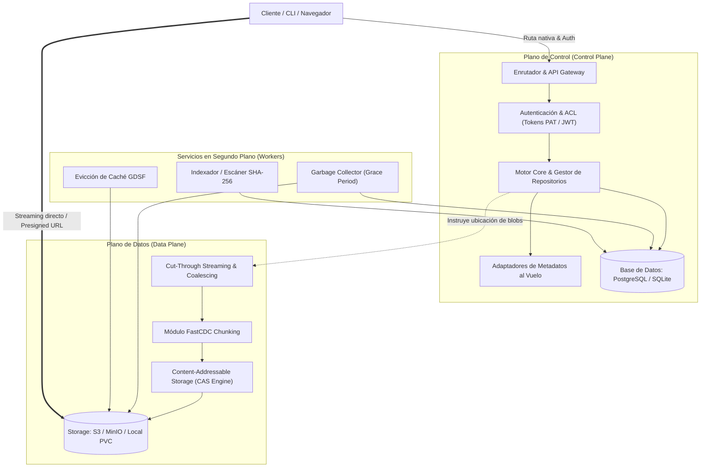
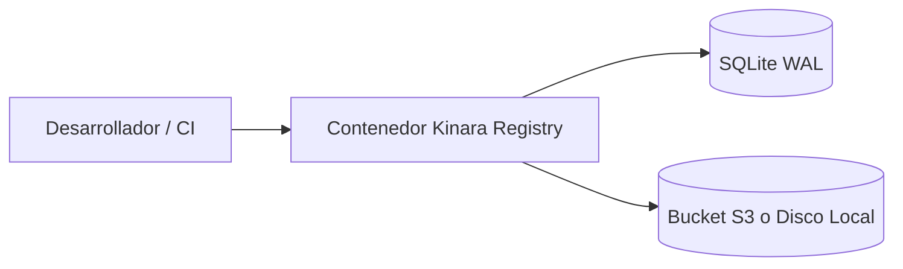

# 02. Arquitectura del Sistema y Separación de Planos

## 1. Principio Rector: Separación de Planos

Uno de los principales problemas de escalabilidad en los servidores de artefactos tradicionales es el cuello de botella generado cuando la gestión de metadatos (búsquedas, permisos, autenticación) compite por recursos de CPU y ancho de banda de red con la transferencia masiva de archivos binarios pesados (imágenes de Docker de varios gigabytes, builds de Rust o modelos de ML).

Kinara Registry desacopla taxativamente sus responsabilidades en dos planos operativos independientes:

* **Plano de Control (*Control Plane*):** Opera con tráfico ligero (JSON/HTTP headers) y alta concurrencia. Gestiona la autenticación, resolución de nombres de paquetes, versiones, listas de control de acceso (ACL) y catálogo de repositorios.
* **Plano de Datos (*Data Plane*):** Optimizado para I/O intensivo, streaming continuo con baja huella de memoria RAM (*zero-copy* o *cut-through*) y almacenamiento de bloques inmutables indexados por su hash SHA-256.

---

## 2. Componentes Principales

| Componente | Tipo | Responsabilidad Técnica |
| :--- | :--- | :--- |
| **Clientes y Consumidores** | Entrada | Navegador Web (Dashboard SPA) y clientes CLI oficiales (`docker`, `podman`, `pip`, `nuget`, `cargo`, `go`, `helm`, `curl`). |
| **Enrutador & API Gateway** | Control | Intercepta peticiones entrantes, detecta el protocolo del gestor según la URI (ej. `/v2/` para OCI, `/simple/` para PyPI, `/index/` para Cargo) y valida credenciales (PAT, Bearer JWT o Basic Auth). |
| **Motor Core del Registro** | Control | Resuelve la semántica de repositorios (Local, Proxy, Virtual). Incorpora adaptadores especializados para extraer metadatos al vuelo de archivos como `Cargo.toml`, `setup.py`, `pom.xml`, o `manifest.json`. |
| **Trabajadores (*Workers*)** | Servicio | Procesos asíncronos en segundo plano encargados de la recolección de basura (*Garbage Collector* con período de gracia), cálculo y verificación de sumas de verificación SHA-256, políticas de cuotas y evicción de caché. |
| **Base de Datos de Metadatos** | Estado | PostgreSQL (para producción y clústeres Kubernetes) o SQLite embebido en modo WAL (para despliegues ligeros con Docker). Almacena cuentas, permisos, repositorios, paquetes, versiones y punteros a bloques. |
| **Almacenamiento CAS** | Datos | Capa de abstracción de almacenamiento direccionable por contenido (*Content-Addressable Storage*). Persiste los bloques binarios en buckets S3 (AWS, MinIO, Cloudflare R2) o volúmenes locales persistentes (PVC). |

---

## 3. Modalidades de Despliegue

Para adaptarse tanto a un desarrollador individual en su estación de trabajo como a una corporación con clústeres distribuidos, Kinara Registry define dos modalidades arquitectónicas:

### 3.1. Modalidad Simple (*Standalone / Edge Deployment*)
Diseñada para despliegues rápidos en desarrollo, entornos de CI/CD efímeros o servidores pequeños donde no se requiere una jerarquía compleja:
* **Metadatos:** SQLite embebido con modo WAL (*Write-Ahead Logging*) activado para permitir lecturas concurrentes sin bloquear escrituras.
* **Almacenamiento de Binarios:** Un volumen local persistente o un único bucket compatible con S3 (ej. MinIO local o AWS S3).
* **Topología:** Un único contenedor Docker ejecutable con `docker compose up -d`.

### 3.2. Modalidad Avanzada (*High Availability & Multi-Tier*)
Diseñada para entornos empresariales y clústeres de Kubernetes con alta demanda de tráfico:
* **Metadatos:** PostgreSQL con réplicas de lectura y pool de conexiones (PgBouncer).
* **Almacenamiento de Binarios:** Estrategia multinivel (*Multi-Tier*):
  * **Hot Tier:** Caché de lectura rápida sobre discos NVMe locales del nodo para artefactos de acceso ultra-frecuente (<10ms de latencia).
  * **Warm Tier:** Object Storage primario (S3/MinIO) con réplica de datos y durabilidad de 11 nueves (99.999999999%).
  * **Cold Tier:** Almacenamiento archivístico (AWS Glacier / GCS Coldline) gestionado por políticas de ciclo de vida para artefactos sin descargas en más de 180 días.
* **Topología:** Despliegue en Kubernetes mediante Helm Chart con réplicas horizontales (*HPA*) para el API Gateway y workers separados.

---

## 4. Decisiones de Diseño y Justificación Técnica

### Decisión 1: Streaming Directo y URLs Prefirmadas (*Presigned URLs*)
* **Decisión:** Cuando el cliente solicita un artefacto grande y el almacenamiento subyacente es compatible con S3, Kinara Registry puede generar un HTTP 302 Redirection con una URL prefirmada temporal hacia el bucket S3 (o servirlo mediante *Cut-Through Streaming* si el cliente CLI no tolera redirecciones).
* **Justificación:** Libera completamente a los nodos del servidor de artefactos de gestionar el ancho de banda masivo de subida y bajada, delegándolo a la infraestructura de red de los proveedores de almacenamiento de objetos.

### Decisión 2: Compatibilidad Dual de Base de Datos (PostgreSQL + SQLite)
* **Decisión:** Mantener una capa de acceso a datos agnóstica compatible con PostgreSQL y SQLite.
* **Justificación:** Obligar a un desarrollador a levantar una instancia de PostgreSQL sólo para probar el registro en su portátil destruye el pilar de **Despliegue Zero-Config**. SQLite permite un arranque en 1 segundo sin configuración previa, mientras que PostgreSQL brinda la robustez transaccional y concurrencia requerida en producción.

### Decisión 3: Workers Asíncronos Desacoplados del Ciclo HTTP
* **Decisión:** Operaciones como recálculos de cuotas, limpieza de capas huérfanas, evicción de cachés frías e indexación de metadatos profundos nunca se ejecutan de manera síncrona dentro del ciclo de vida de la petición HTTP del cliente.
* **Justificación:** Garantiza que las operaciones de `push` y `pull` de los clientes CLI respondan con latencia mínima predecible, evitando timeouts en pipelines de integración continua.
