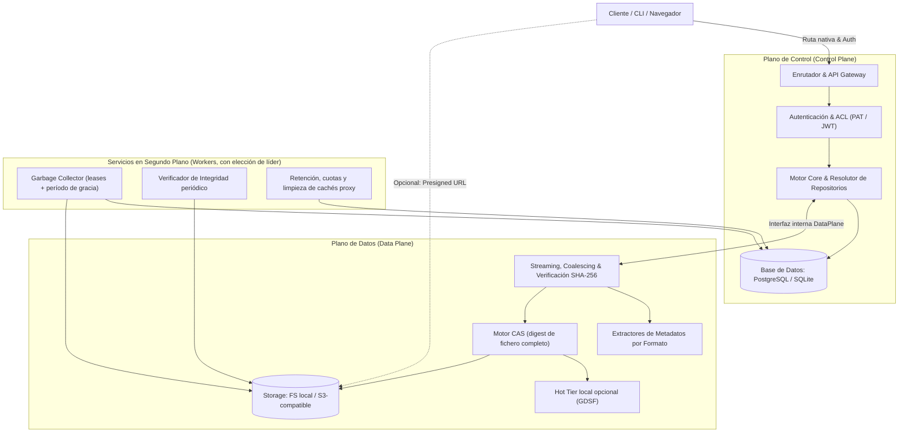
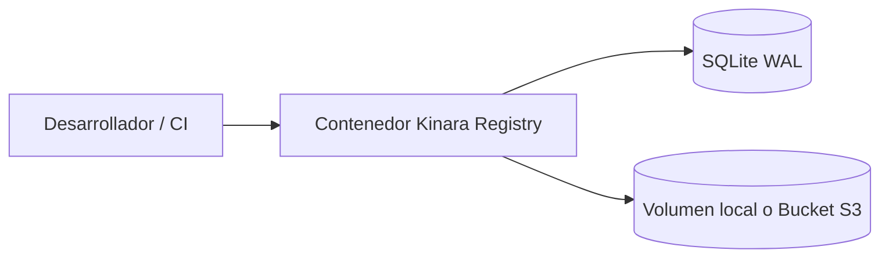

# 02. Arquitectura del Sistema y Separación de Planos

## 1. Principio Rector: Separación de Planos

Uno de los principales problemas de escalabilidad en los servidores de artefactos tradicionales es el cuello de botella generado cuando la gestión de metadatos (búsquedas, permisos, autenticación) compite por recursos de CPU y ancho de banda de red con la transferencia masiva de archivos binarios pesados (imágenes de Docker de varios gigabytes, builds de Rust o modelos de ML).

Kinara Registry desacopla sus responsabilidades en dos planos operativos con una **interfaz interna explícita** entre ambos, más un conjunto de trabajadores en segundo plano:

* **Plano de Control (*Control Plane*):** Opera con tráfico ligero (JSON/HTTP headers) y alta concurrencia. Gestiona la autenticación, resolución de nombres de paquetes, versiones, listas de control de acceso (ACL) y catálogo de repositorios.
* **Plano de Datos (*Data Plane*):** Optimizado para I/O intensivo y streaming con baja huella de memoria RAM (sin cargar ficheros completos en memoria). Calcula y verifica digests SHA-256, extrae metadatos del flujo de bytes y persiste blobs inmutables en el CAS.

### 1.1. Interfaz Interna entre Planos
Los clientes nativos (`docker`, `pip`, `cargo`…) envían autenticación y datos a la misma URL, por lo que la separación es interna:
* Desde la **Fase 1** existe una interfaz Go explícita (`DataPlane`: abrir sesión de subida, escribir bytes, confirmar con digest esperado, leer blob con rangos, extraer metadatos). El Control Plane nunca accede directamente al backend de almacenamiento.
* En `--mode=all` la interfaz se invoca en proceso. En modo dividido (`--mode=api` + `--mode=storage`) la misma interfaz se expone mediante una API interna (HTTP/2 o gRPC) autenticada con mTLS o tokens de servicio; el Control Plane autoriza la petición y, o bien reenvía el flujo, o bien redirige al cliente a un nodo de datos con una URL firmada de corta duración.
* Los extractores de metadatos (que necesitan leer el contenido del fichero) se ejecutan en el Data Plane sobre el flujo de subida y devuelven al Control Plane un documento de metadatos estructurado.

---

## 2. Componentes Principales

| Componente | Tipo | Responsabilidad Técnica |
| :--- | :--- | :--- |
| **Clientes y Consumidores** | Entrada | Navegador Web (Dashboard SPA) y clientes CLI oficiales (`docker`, `podman`, `pip`, `twine`, `nuget`/`dotnet`, `cargo`, `go`, `helm`, `curl`) además de `kinara-cli`. |
| **Enrutador & API Gateway** | Control | Intercepta peticiones, identifica formato y repositorio según el esquema de rutas (§2.1) y valida credenciales (PAT, Bearer JWT o Basic Auth con PAT). |
| **Motor Core del Registro** | Control | Resuelve la semántica de repositorios (Local, Proxy, Virtual), versiones, etiquetas y políticas *Local-First*. Persiste los metadatos que entregan los extractores. |
| **Extractores de Metadatos** | Datos | Leen los metadatos declarativos del artefacto sin ejecutar código: `METADATA`/`PKG-INFO` (wheel/sdist), `Cargo.toml` (crate), `.nuspec` (nupkg), `go.mod`, manifest/config OCI. |
| **Trabajadores (*Workers*)** | Servicio | Procesos asíncronos: recolección de basura con *leases* y período de gracia, verificación periódica de integridad, políticas de retención y cuotas. Se ejecutan en una única instancia activa gracias a elección de líder. |
| **Base de Datos de Metadatos** | Estado | PostgreSQL (obligatorio con más de una réplica) o SQLite embebido en modo WAL (sólo instancia única). Almacena cuentas, permisos, repositorios, paquetes, versiones, referencias a blobs y sesiones de subida. |
| **Almacenamiento CAS** | Datos | Abstracción de almacenamiento direccionable por contenido con dos backends desde la Fase 1: sistema de ficheros local (volumen/PVC) y S3-compatible (AWS S3, Cloudflare R2, GCS interop, Garage, MinIO, SeaweedFS). |

### 2.1. Esquema de Rutas
Docker y Podman siempre consultan `https://host/v2/`, por lo que OCI no puede ubicarse bajo un prefijo. El resto de formatos se agrupan bajo `/<formato>/<repositorio>/`:

| Formato | Rutas | Notas |
| :--- | :--- | :--- |
| OCI | `/v2/<repo>/<imagen>/...`, `/v2/token` | El primer segmento del nombre de imagen identifica el repositorio Kinara (opcionalmente, un subdominio por repositorio). |
| PyPI | `/pypi/<repo>/simple/`, `/pypi/<repo>/legacy/` | Índice simple (PEP 503/691) y subida de twine. |
| NuGet | `/nuget/<repo>/v3/index.json` | Service Index v3 y recursos derivados. |
| Go | `/go/<repo>/<module>/@v/...`, `/go/<repo>/sumdb/...` | Protocolo GOPROXY y paso a través de la checksum DB. |
| Cargo | `/cargo/<repo>/index/`, `/cargo/<repo>/api/v1/crates/...` | El `config.json` del índice apunta `api` al prefijo del repositorio, evitando colisiones con la API de Kinara. |
| Kinara | `/api/v1/...` | API REST de administración consumida por la SPA y `kinara-cli`. |

---

## 3. Modalidades de Despliegue

Para adaptarse tanto a un desarrollador individual en su estación de trabajo como a una corporación con clústeres distribuidos, Kinara Registry define dos modalidades arquitectónicas:

### 3.1. Modalidad Simple (*Standalone / Edge Deployment*)
Diseñada para despliegues rápidos en desarrollo, entornos de CI/CD efímeros o servidores pequeños:
* **Metadatos:** SQLite embebido con modo WAL (lecturas concurrentes con un único escritor).
* **Almacenamiento de Binarios:** Un volumen local persistente o un único bucket S3-compatible.
* **Topología:** Un único contenedor (`kinara server --mode=all`) ejecutable con `docker compose up -d`. **Siempre una sola réplica** (limitación de SQLite).

### 3.2. Modalidad Avanzada (*High Availability*)
Diseñada para entornos empresariales y clústeres de Kubernetes con alta demanda de tráfico:
* **Metadatos:** PostgreSQL con pool de conexiones (PgBouncer) y réplicas de lectura opcionales.
* **Almacenamiento de Binarios:**
  * **Almacenamiento primario (obligatorio):** Object Storage S3-compatible. La durabilidad depende del proveedor (p. ej. 11 nueves en AWS S3; en Garage/MinIO depende de la replicación configurada).
  * **Hot Tier (opcional, Fase 4):** Caché de lectura en discos NVMe locales de cada nodo del Data Plane, gestionada por el propio nodo con GDSF.
  * **Cold Tier:** fuera del MVP (ver [`03-estrategia-almacenamiento-cas.md`](file:///home/cesar/Projects/Kinara-Registry/Planification/03-estrategia-almacenamiento-cas.md) §2.3).
* **Topología:** Helm Chart con réplicas horizontales (*HPA*) del rol API/Gateway, nodos de datos opcionalmente separados y workers con elección de líder.

---

## 4. Requisitos para Múltiples Réplicas

Todo estado que viva en un proceso debe resolverse explícitamente cuando hay más de una réplica:

| Estado | Solución adoptada |
| :--- | :--- |
| Sesiones de subida OCI fragmentadas (POST → PATCH… → PUT) | Staging en el backend compartido (S3 multipart upload) y estado incremental del hash SHA-256 serializado en la tabla `upload_sessions`; cualquier réplica puede continuar la subida. |
| Claves de firma JWT | Persistidas cifradas en la base de datos (o aportadas vía *Secret*) con identificador `kid` para rotación. |
| Coalescing de descargas proxy | Por réplica (máximo N descargas upstream con N réplicas). Opcionalmente, *advisory lock* de PostgreSQL por clave para coalescing global. |
| Hot Tier | Índice local por nodo (no en la base de datos); la evicción la ejecuta el nodo dueño del disco. |
| Workers (GC, retención, verificación) | Elección de líder mediante *advisory lock* de PostgreSQL; en SQLite hay una única instancia por definición. |
| Contadores de acceso | Agregados en memoria y volcados por lotes a la base de datos. |

---

## 5. Decisiones de Diseño y Justificación Técnica

### Decisión 1: URLs Prefirmadas Opcionales (*Presigned URLs*)
* **Decisión:** Para repositorios con backend S3 y la opción `presigned_redirects` activada (desactivada por defecto), Kinara responde a las descargas de blobs con un HTTP 307 hacia una URL prefirmada de corta duración. En caso contrario sirve el blob mediante streaming.
* **Requisitos:** El endpoint S3 debe ser alcanzable por los clientes (`public_endpoint` configurable, distinto del endpoint interno) y los blobs se almacenan byte a byte sin recompresión en el servidor.
* **Trade-offs asumidos:** La descarga redirigida no pasa por el Hot Tier; el acceso se contabiliza en el momento de emitir la redirección. La capacidad de seguir redirecciones no se detecta en tiempo de ejecución: se configura por repositorio/formato.
* **Justificación:** Libera a los nodos de Kinara del ancho de banda masivo cuando la topología de red lo permite, sin imponerlo donde el almacenamiento es interno.

### Decisión 2: Compatibilidad Dual de Base de Datos (PostgreSQL + SQLite)
* **Decisión:** Capa de acceso a datos con dos conjuntos de migraciones (`postgres/` y `sqlite/`) y consultas JSON abstraídas en la capa de repositorio.
* **Restricción:** SQLite sólo se soporta en instancia única; cualquier despliegue con más de una réplica exige PostgreSQL.
* **Justificación:** Obligar a un desarrollador a levantar PostgreSQL sólo para probar el registro destruye el pilar **Zero-Config**, mientras que PostgreSQL brinda la concurrencia transaccional requerida en producción.

### Decisión 3: Workers Asíncronos Desacoplados del Ciclo HTTP
* **Decisión:** Operaciones como recálculo de cuotas, limpieza de blobs huérfanos, retención de cachés proxy y verificación de integridad nunca se ejecutan de manera síncrona dentro de la petición HTTP del cliente.
* **Justificación:** Garantiza que `push` y `pull` respondan con latencia predecible, evitando timeouts en pipelines de integración continua.

### Decisión 4: Interfaz DataPlane desde la Fase 1
* **Decisión:** Toda interacción con el almacenamiento pasa por la interfaz interna `DataPlane` (§1.1) aunque inicialmente se ejecute en el mismo proceso.
* **Justificación:** Permite separar el Data Plane en procesos independientes en la Fase 4 sin rediseñar los adaptadores ni el Control Plane.
