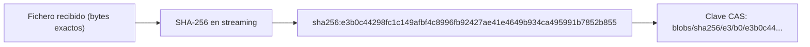
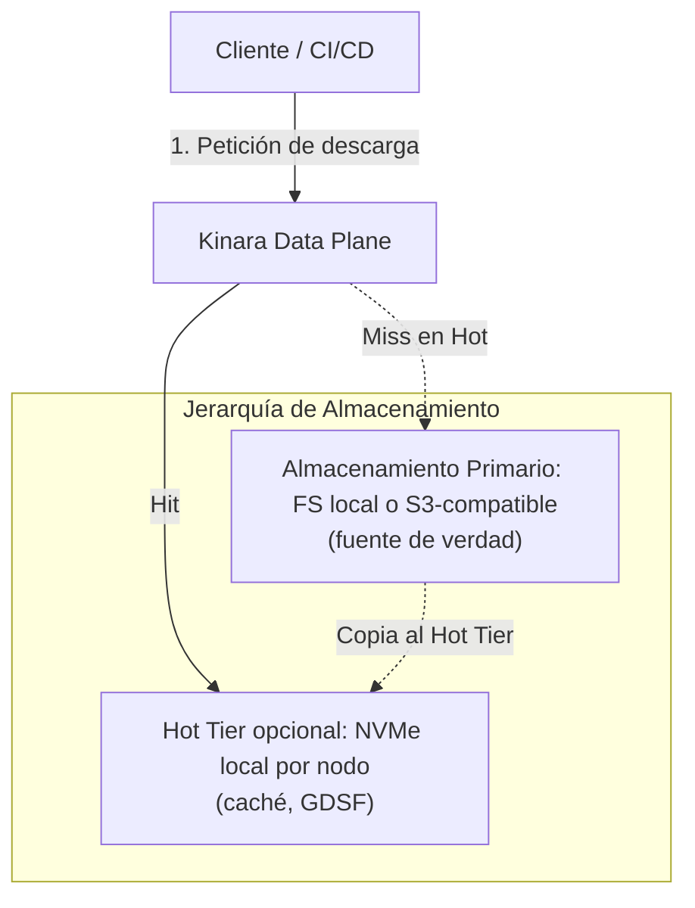

# 03. Estrategia de Almacenamiento CAS y Jerarquía de Almacenamiento

## 1. Fundamentos de Content-Addressable Storage (CAS)

En los sistemas tradicionales de almacenamiento de paquetes, los archivos suelen guardarse con rutas jerárquicas atadas al nombre y versión del paquete (ejemplo: `/repositorio/mi-libreria/1.0.0/mi-libreria-1.0.0.whl`).

Este modelo presenta graves deficiencias:
1. **Redundancia:** Si dos repositorios o dos paquetes contienen ficheros idénticos (la misma capa base de Docker, el mismo wheel replicado en varios repositorios), se almacenan duplicados.
2. **Riesgo de Corrupción:** Es difícil garantizar que el contenido del archivo no haya sido alterado o dañado silenciosamente en el disco.
3. **Inconsistencia de Estados:** Modificar un paquete en el mismo directorio puede provocar condiciones de carrera (*race conditions*) durante descargas simultáneas.

**Kinara Registry** adopta un modelo estricto de **Content-Addressable Storage (CAS)** a nivel de **fichero completo**:

### Principios del CAS en Kinara:
* **Identidad = digest del fichero completo:** El identificador de un blob es el SHA-256 de los bytes exactos que el cliente sube o descarga. Coincide con el digest que verifican los clientes nativos (`blobs/<digest>` en OCI, `#sha256=` en PyPI, `cksum` en Cargo, hash de paquete en NuGet), por lo que nunca hay que traducir identificadores.
* **Almacenamiento byte a byte:** Kinara no recomprime ni transforma blobs. Lo que se sube es exactamente lo que se descarga.
* **Inmutabilidad Absoluta:** Un blob nunca se edita. Si el contenido cambia en un solo bit, su hash cambia y se convierte en un nuevo objeto independiente.
* **Deduplicación Intrínseca:** Si cinco repositorios o diez desarrolladores suben la misma capa de imagen Docker o el mismo binario, el almacenamiento físico guarda una única copia y la base de datos registra múltiples referencias lógicas.
* **Particionamiento por Sharding:** Para evitar directorios con millones de entradas en sistemas de ficheros locales y repartir prefijos en S3:
  $$\text{Clave} = \text{blobs/sha256/} + \text{hash}[0..1] + \text{/} + \text{hash}[2..3] + \text{/} + \text{hash}$$
  *(Ejemplo: `blobs/sha256/4f/9a/4f9a712...`)*

### 1.1. Deduplicación Global y Autorización por Repositorio
La deduplicación es global a la instancia, pero el **acceso es por repositorio**:
* Cada vez que un blob se sube, se cachea o se monta en un repositorio, se crea un vínculo en la tabla `repository_blobs` ([`06-modelo-datos-y-esquema-db.md`](file:///home/cesar/Projects/Kinara-Registry/Planification/06-modelo-datos-y-esquema-db.md)).
* Antes de servir un blob o de confirmar su existencia (`HEAD /v2/<name>/blobs/<digest>`, montaje entre repositorios de OCI), Kinara exige que el blob esté vinculado a un repositorio que el solicitante pueda leer. La mera existencia física del digest nunca se revela.
* El montaje OCI entre repositorios (`?mount=<digest>&from=<repo>`) sólo se acepta si el solicitante tiene permiso de lectura en el repositorio origen; en caso contrario se responde como una subida normal.

---

## 2. Jerarquía de Almacenamiento

Kinara separa el almacenamiento **primario** (obligatorio, fuente de verdad) de las capas de optimización (opcionales):

### 2.1. Almacenamiento Primario (FS local o S3-compatible)
* **Objetivo:** Persistencia duradera de la totalidad de los blobs. Disponible desde la **Fase 1** con dos backends: sistema de ficheros (volumen local/PVC) y S3-compatible (AWS S3, Cloudflare R2, GCS interop, Garage, MinIO, SeaweedFS).
* **Durabilidad:** Depende del backend: 11 nueves en AWS S3; en un volumen local o un clúster Garage/MinIO depende de la replicación y las copias de seguridad configuradas.

### 2.2. Hot Tier (Caché Local NVMe / SSD) — Fase 4, opcional
* **Objetivo:** Reducir la latencia y el tráfico hacia S3 para los blobs más demandados (imágenes base, dependencias raíz).
* **Naturaleza:** Es una **copia** del blob, nunca un movimiento; el blob sigue en el almacenamiento primario.
* **Gestión:** Cada nodo del Data Plane mantiene su propio índice local (en memoria con persistencia en disco), fuera de la base de datos compartida. Al alcanzar la cuota de disco local, el propio nodo aplica **GDSF** (*GreedyDual-Size with Frequency*, ver [`05-algoritmos-y-optimizaciones.md`](file:///home/cesar/Projects/Kinara-Registry/Planification/05-algoritmos-y-optimizaciones.md) §2).
* **Incompatibilidad:** Las descargas redirigidas mediante URL prefirmada no pasan por el Hot Tier; en cada repositorio se elige una u otra estrategia.

### 2.3. Cold Tier — Fuera del MVP
El diseño original (migrar a Glacier tras 180 días sin descargas con rehidratación asíncrona) se descarta por:
* Las *Lifecycle Rules* de S3 actúan sobre la **antigüedad** del objeto, no sobre el último acceso.
* Un blob deduplicado puede estar compartido por versiones activas e inactivas; no se puede archivar "una versión".
* Ningún cliente nativo (`docker`, `pip`, `cargo`, `go`, `nuget`) entiende un estado de "rehidratación en curso": simplemente falla.
* Las clases archivísticas tienen cargos por duración mínima de almacenamiento que interfieren con el GC.

Si en el futuro se aborda, deberá: operar a nivel de **blob**, basarse en `blobs.last_accessed_at` agregado por Kinara (o en S3 Intelligent-Tiering), y usar únicamente clases con **recuperación instantánea** (p. ej. Glacier Instant Retrieval).

---

## 3. Modalidades de Configuración de Almacenamiento

| Característica | Modalidad Simple | Modalidad Avanzada |
| :--- | :--- | :--- |
| **Casos de uso** | Desarrollo, CI/CD efímero, pequeñas empresas | Producción empresarial, clústeres Kubernetes con alto volumen |
| **Almacenamiento de Binarios** | Un volumen persistente o un bucket S3-compatible | Bucket S3-compatible + Hot Tier NVMe opcional por nodo |
| **Almacenamiento de Metadatos** | SQLite local en modo WAL (instancia única) | PostgreSQL con pool de conexiones |
| **Mantenimiento Operativo** | Cero configuración; GC y retención con valores por defecto | Políticas de retención, cuotas y evicción configurables |

---

## 4. Estrategia de Subida y Descarga de Binarios

### 4.1. Flujo de Subida (Push Atómico)
Para garantizar la integridad, permitir subidas reanudables y evitar blobs corruptos por cortes de red:

1. **Apertura de sesión:** Se crea una fila en `upload_sessions` con el repositorio destino, el usuario y una caducidad.
2. **Recepción en Staging según backend:**
   * **FS local:** fichero temporal en un directorio de staging **del mismo volumen** que el CAS (`<data>/uploads/{session_id}`), lo que permite un `rename` atómico al final.
   * **S3:** *multipart upload* hacia la clave `uploads/{session_id}`. Ninguna réplica depende de su disco local, por lo que las subidas OCI fragmentadas (POST → PATCH… → PUT) pueden atenderse por réplicas distintas.
3. **Hash en Streaming reanudable:** El SHA-256 se calcula de forma incremental durante la recepción. Tras cada fragmento, el estado interno del hash (serializable en Go mediante `encoding.BinaryMarshaler`) se guarda en `upload_sessions.hash_state`, de modo que la subida puede continuar en cualquier réplica sin releer los bytes previos.
4. **Verificación de Integridad:** Se compara el digest calculado con el que aporta el protocolo del cliente (parámetro `?digest=` en el PUT final de OCI, campo `sha256_digest` de twine, etc.). Ante discrepancias se aborta la sesión y se elimina el staging.
5. **Commit Atómico:**
   * Si el blob **ya existe** en el CAS: se descarta el staging y, **en la misma transacción** que crea las referencias (`repository_blobs`, `version_files` o referencias OCI), se actualiza `blobs.last_referenced_at` (*lease*). Esto impide que el GC elimine un blob huérfano antiguo que acaba de reutilizarse (ver [`05`](file:///home/cesar/Projects/Kinara-Registry/Planification/05-algoritmos-y-optimizaciones.md) §6).
   * Si **no existe**: FS → `rename` atómico a la clave final; S3 → copia en el servidor (`CopyObject`, o `UploadPartCopy` para objetos > 5 GB) a la clave final y borrado de la clave de staging. Como la clave final es el propio digest, una copia duplicada concurrente es idempotente.
6. **Limpieza:** Las sesiones caducadas (y sus multipart uploads incompletos) las elimina el worker de GC.

### 4.2. Flujo de Descarga
* **Autorización previa:** Comprobación de ACL y del vínculo `repository_blobs` (§1.1).
* **Cut-Through Streaming (por defecto):** Kinara transmite los bytes conforme los lee del Hot Tier o del almacenamiento primario, sin cargarlos por completo en RAM.
* **Range Requests (RFC 9110):** Soportadas para cualquier blob, independientemente del formato o la compresión del artefacto.
* **URL Prefirmada (opcional por repositorio):** Si el repositorio tiene `presigned_redirects` activado y el backend es S3 con un endpoint público configurado, Kinara responde con `307 Temporary Redirect` hacia una URL prefirmada con caducidad corta (p. ej. 5–15 minutos). El acceso se contabiliza al emitir la redirección.
