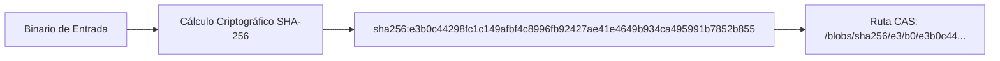
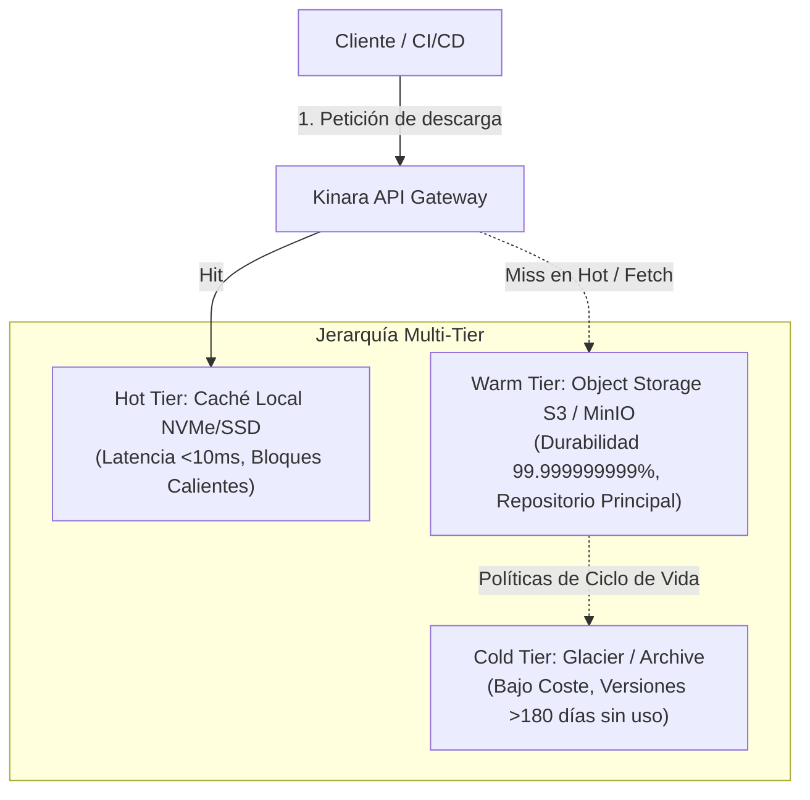

# 03. Estrategia de Almacenamiento CAS y Modelo Multi-Tier

## 1. Fundamentos de Content-Addressable Storage (CAS)

En los sistemas tradicionales de almacenamiento de paquetes, los archivos suelen guardarse con rutas jerárquicas atadas al nombre y versión del paquete (ejemplo: `/repositorio/mi-libreria/1.0.0/mi-libreria-1.0.0.whl`). 

Este modelo presenta graves deficiencias:
1. **Redundancia Masiva:** Si dos paquetes distintos o dos versiones consecutivas comparten capas o archivos binarios idénticos, se almacenan duplicados.
2. **Riesgo de Corrupción:** Es difícil garantizar que el contenido del archivo no haya sido alterado o dañado silenciosamente en el disco.
3. **Inconsistencia de Estados:** Modificar un paquete en el mismo directorio puede provocar condiciones de carrera (*race conditions*) durante descargas simultáneas.

**Kinara Registry** adopta un modelo estricto de **Content-Addressable Storage (CAS)**:

### Principios del CAS en Kinara:
* **Identidad Inmutable:** El identificador unívoco de cualquier fragmento o binario completo es su resumen criptográfico SHA-256 en formato hexadecimal.
* **Inmutabilidad Absoluta:** Un blob nunca se edita. Si el contenido cambia en un solo bit, su hash cambia y se convierte en un nuevo objeto independiente.
* **Deduplicación Intrínseca:** Si cinco repositorios o diez desarrolladores suben la misma capa de imagen Docker o el mismo binario estático, el almacenamiento físico almacena una única copia, creando múltiples referencias lógicas en la base de datos.
* **Particionamiento por Sharding:** Para evitar cuellos de botella en sistemas de archivos locales o prefijos S3, los blobs se estructuran con los primeros bytes del hash:
  $$\text{Ruta} = \text{blobs/sha256/} + \text{hash}[0..1] + \text{/} + \text{hash}[2..3] + \text{/} + \text{hash}$$
  *(Ejemplo: `blobs/sha256/4f/9a/4f9a712...`)*

---

## 2. Estrategia Multinivel (Multi-Tier Storage)

Para optimizar al máximo tanto el coste económico del almacenamiento como la latencia de entrega a los clientes, Kinara Registry implementa una jerarquía de almacenamiento multinivel:

### 2.1. Hot Tier (Caché Local NVMe / SSD)
* **Objetivo:** Entregar descargas de ultra-baja latencia ($< 10\text{ ms}$) para compilaciones continuas y despliegues automáticos.
* **Contenido:** Metadatos calientes, índices de paquetes consultados frecuentemente y bloques binarios en constante demanda (imágenes base de Docker, dependencias raíz de pip o Cargo).
* **Gestión:** Limitado por una cuota fija de disco local. Cuando la cuota se alcanza, se aplica el algoritmo de evicción **GDSF** (*GreedyDual-Size with Frequency*) para eliminar los bloques menos prioritarios.

### 2.2. Warm Tier (Object Storage S3 / MinIO / Cloudflare R2)
* **Objetivo:** Persistencia duradera, segura y elástica de la totalidad de los artefactos.
* **Contenido:** Todos los blobs registrados en el sistema, asegurando una durabilidad de 11 nueves (99.999999999%).
* **Protocolo:** Conectividad estándar S3 API con soporte para almacenamiento multi-región o buckets distribuidos.

### 2.3. Cold Tier (Almacenamiento Archivístico / Glacier)
* **Objetivo:** Reducción drástica de costes para proyectos históricos o versiones deprecadas.
* **Comportamiento:** Artefactos o versiones que no registran descargas en más de 180 días son marcados para migración hacia almacenamiento en frío mediante políticas de ciclo de vida del bucket de objetos (*Lifecycle Rules*). Si un cliente solicita un paquete en Cold Tier, se genera un estado de rehidratación asíncrona informado al usuario.

---

## 3. Modalidades de Configuración de Almacenamiento

El sistema permite alternar entre dos modalidades según los recursos de infraestructura disponibles:

| Característica | Modalidad Simple | Modalidad Avanzada (Multi-Tier) |
| :--- | :--- | :--- |
| **Casos de uso** | Desarrollo, CI/CD efímero, pequeñas empresas | Producción empresarial, clústeres Kubernetes con alto volumen |
| **Almacenamiento de Binarios** | Un único bucket S3 o un Volumen Persistente (PVC) | Jerarquía activa Hot Tier (NVMe) + Warm Tier (S3) + Cold Tier |
| **Almacenamiento de Metadatos** | SQLite local en modo WAL | PostgreSQL con replicación y pool de conexiones |
| **Mantenimiento Operativo** | Cero configuración; autogestionado | Políticas automáticas de ciclo de vida, evicción y retención |

---

## 4. Estrategia de Entrega y Subida de Binarios

### 4.1. Flujo de Subida (Push Atómico)
Para garantizar la integridad y evitar blobs huérfanos o corruptos por cortes de red:
1. **Recepción en Staging:** El cliente sube el archivo a un búfer temporal (`/tmp/uploads/{upload_id}`).
2. **Cálculo de Hash en Streaming:** Durante la subida, se calcula de forma incremental el hash SHA-256 sin requerir segundas pasadas por disco.
3. **Verificación de Integridad:** Si el cliente proveyó un hash de validación (ej. header `Content-Digest`), se compara con el calculado. Ante discrepancias, se cancela la operación inmediatamente.
4. **Commit Atómico:** Si el blob ya existe en el CAS, se descarta el archivo temporal de staging y se vincula la versión existente (deduplicación instantánea). Si no existe, se traslada de forma atómica a la ruta final en el CAS.

### 4.2. Flujo de Descarga: Presigned URLs vs Cut-Through
* **Descarga Vía Presigned URLs:** Cuando el cliente lo soporta y el almacenamiento es S3/MinIO, Kinara responde con un `302 Found` conteniendo una URL prefirmada con caducidad corta (ej. 15 minutos). El cliente descarga directamente desde el bucket, reduciendo a cero el consumo de red en la instancia de Kinara.
* **Descarga Vía Cut-Through Proxy:** Si el cliente CLI no admite redirecciones (o si el artefacto se encuentra en el Hot Tier local), Kinara realiza *Cut-Through Streaming*, transmitiendo los bytes conforme los lee del backend sin cargarlos por completo en la memoria RAM del servidor.
