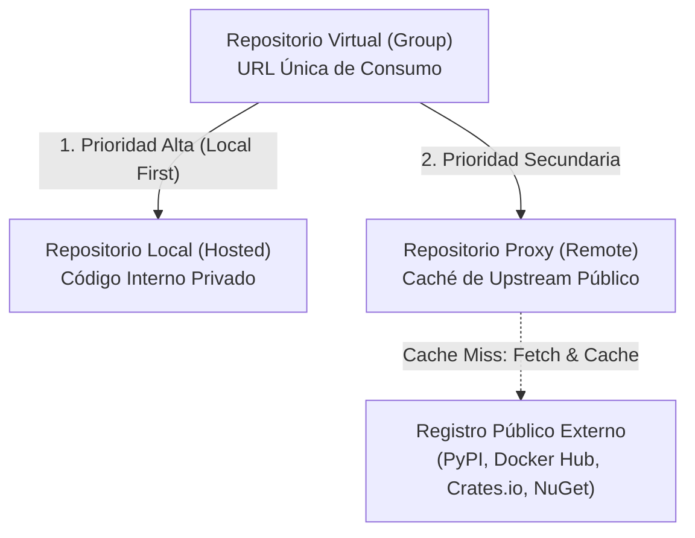
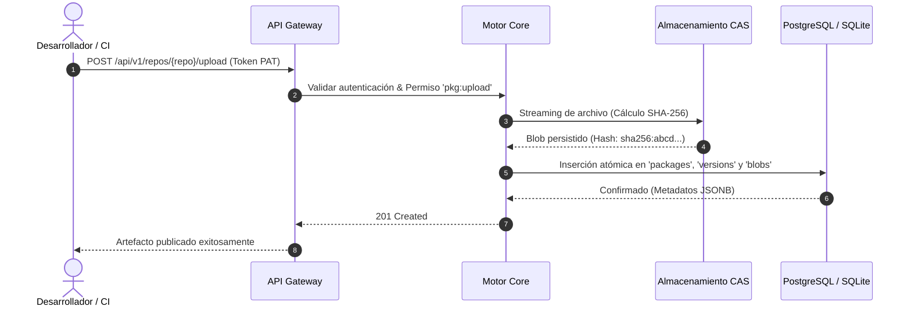
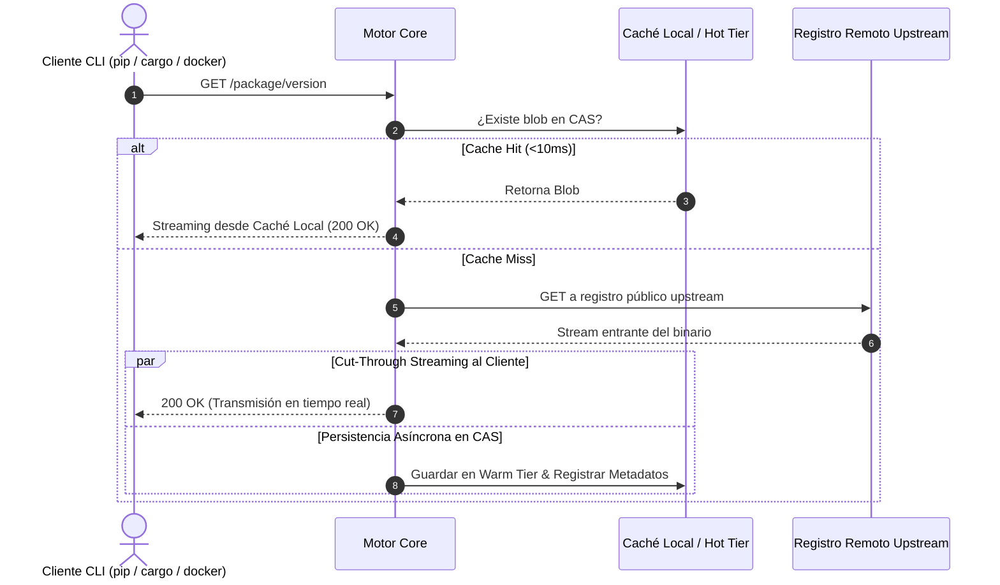
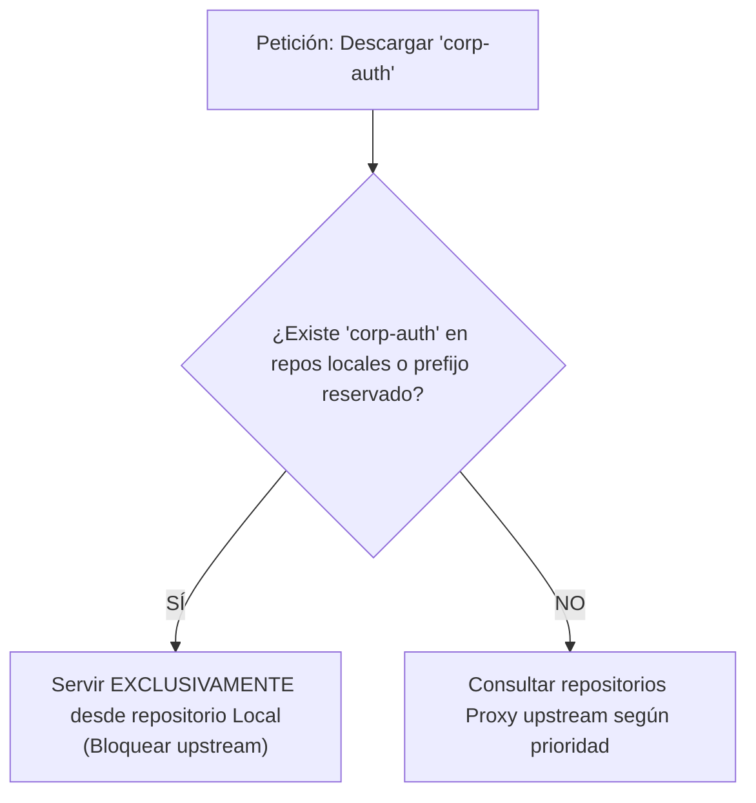

# 04. Tipos de Repositorios y Flujos Operativos

## 1. Clasificación y Lógica de Repositorios

Kinara Registry organiza el almacenamiento y distribución de artefactos en tres tipos fundamentales de repositorios, cubriendo desde el desarrollo interno hasta el consumo seguro de librerías de terceros de código abierto:

---

## 2. Comportamiento Detallado por Tipo

| Tipo de Repositorio | Permisos Cliente | Flujo de Operación y Manejo de Datos |
| :--- | :--- | :--- |
| **Local (Hosted)** | Lectura y Escritura | Destinado a los artefactos propietarios de la organización. Ante un `push`, fragmenta el binario, calcula el SHA-256, almacena los bloques en el CAS y guarda los metadatos estructurados en la base de datos relacional. |
| **Proxy (Remote)** | Solo Lectura (*Pull*) | Actúa como un proxy caché transparente de un registro público upstream (Docker Hub, PyPI, crates.io, NuGet, Golang Proxy). Ante un *Cache Hit*, sirve el archivo localmente; ante un *Cache Miss*, lo descarga del upstream, lo indexa en el CAS y lo retransmite al cliente. |
| **Virtual (Group)** | Lectura y Escritura | Expone un único punto de entrada (*endpoint*) que combina múltiples repositorios locales y proxies en una jerarquía ordenada. Las subidas se enrutan automáticamente al repositorio local designado, y las descargas evalúan la lista en orden de precedencia. |

---

## 3. Flujos Operativos y Diagramas de Secuencia

### 3.1. Flujo de Subida en Repositorio Local (*Push*)

### 3.2. Flujo de Descarga en Repositorio Proxy (*Cache Hit vs Miss*)

---

## 4. Repositorios Virtuales y Mitigación de Dependency Confusion

### 4.1. El Vector de Ataque de "Dependency Confusion"
El ataque de confusión de dependencias (*Dependency Confusion*) ocurre cuando una organización utiliza un paquete privado (ejemplo: `mi-empresa-core` versión `1.2.0`) y un atacante malintencionado registra un paquete público con el mismo nombre exacto en un registro upstream (como PyPI o npm) con una versión artificialmente superior (ejemplo: `99.9.9`).

Si un repositorio virtual o una herramienta CLI resuelve de manera ingenua el paquete buscando la versión más alta sin distinguir procedencias, descargará y ejecutará el paquete malicioso externo.

### 4.2. Estrategia de Protección Nativa en Kinara Registry
Para neutralizar de forma matemática y arquitectónica este vector de ataque, los repositorios virtuales de Kinara implementan dos barreras obligatorias:

1. **Aislamiento Estricto "Local-First" (*Namespace Hijack Block*):**
   * Antes de consultar cualquier repositorio Proxy upstream, el repositorio Virtual consulta el inventario local.
   * Si el nombre del paquete existe registrado en cualquier repositorio **Local** interno, el repositorio virtual **bloquea inmediatamente cualquier consulta hacia los proxies externos** para ese nombre de paquete, sin importar si el upstream posee versiones más modernas.
2. **Espacios de Nombres Reservados (*Reserved Scopes / Namespaces*):**
   * Los administradores pueden definir patrones de prefijos exclusivos (ejemplo: `@mi-empresa/*`, `corp-*`, `internal-*`).
   * Ningún repositorio proxy permitirá consultar o cachear artefactos que coincidan con estos patrones, garantizando que sólo puedan originarse en repositorios locales autorizados.

---

## 5. Decisiones de Diseño y Trade-offs

### Decisión 1: Endpoint Virtual Unificado vs Múltiples Configs en Clientes
* **Decisión:** Promover el uso de repositorios Virtuales como el endpoint por defecto para los desarrolladores.
* **Justificación:** Los desarrolladores sólo necesitan configurar un único endpoint en sus archivos de configuración (`.npmrc`, `pip.conf`). La adición o eliminación de mirrors de respaldo o repositorios internos adicionales se gestiona centralizadamente en Kinara sin obligar a actualizar la configuración de cientos de estaciones de trabajo o agentes de CI/CD.

### Decisión 2: Separación Estricta de Escritura en Grupos Virtuales
* **Decisión:** Un repositorio virtual permite comandos de subida (`docker push`, `cargo publish`), pero requiere que el repositorio virtual tenga configurado explícitamente un repositorio local designado como "Default Deployment Target".
* **Justificación:** Previene ambigüedades sobre en qué sub-repositorio debe alojarse el paquete, manteniendo la inmutabilidad y la trazabilidad de los artefactos internos.
