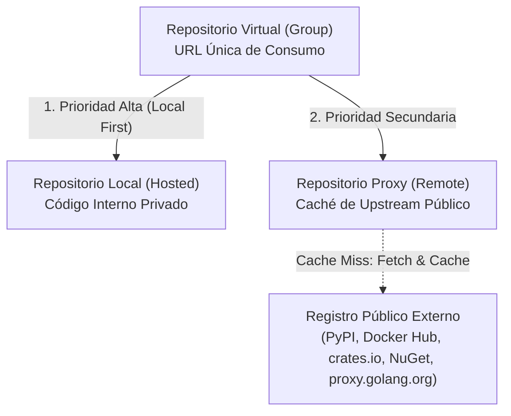
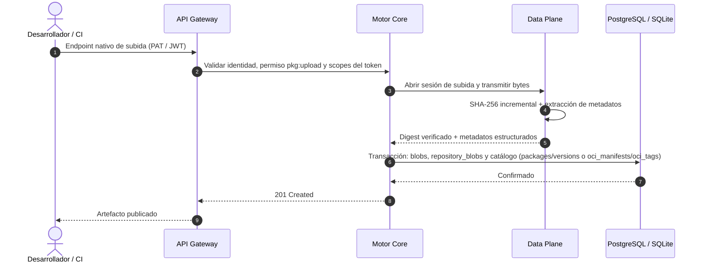
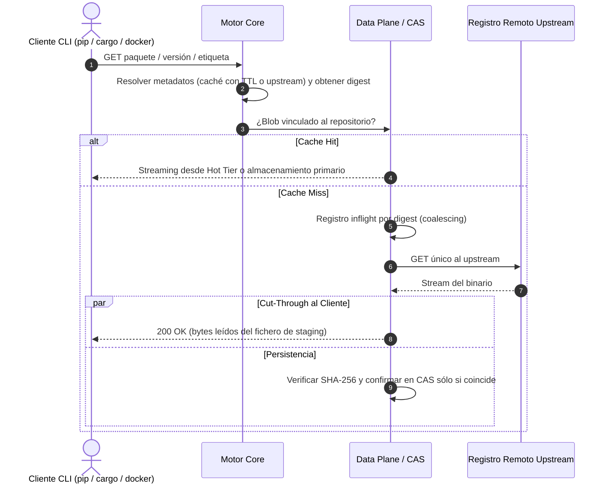
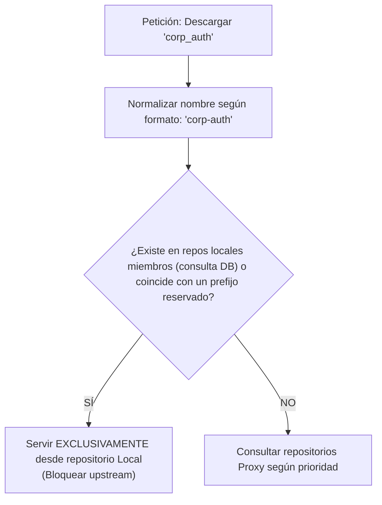

# 04. Tipos de Repositorios y Flujos Operativos

## 1. Clasificación y Lógica de Repositorios

Kinara Registry organiza el almacenamiento y distribución de artefactos en tres tipos fundamentales de repositorios, cubriendo desde el desarrollo interno hasta el consumo seguro de librerías de terceros de código abierto:

Cada repositorio pertenece a un único formato (OCI, PYPI, NUGET, CARGO, GO) y se expone bajo el esquema de rutas definido en [`02-arquitectura-del-sistema.md`](file:///home/cesar/Projects/Kinara-Registry/Planification/02-arquitectura-del-sistema.md) §2.1.

---

## 2. Comportamiento Detallado por Tipo

| Tipo de Repositorio | Permisos Cliente | Flujo de Operación y Manejo de Datos |
| :--- | :--- | :--- |
| **Local (Hosted)** | Lectura y Escritura | Destinado a los artefactos propietarios de la organización. Ante un `push`, el Data Plane recibe el fichero en streaming, verifica su SHA-256, extrae sus metadatos, lo almacena en el CAS y el Control Plane registra paquete, versión y ficheros en la base de datos. |
| **Proxy (Remote)** | Solo Lectura (*Pull*) | Proxy caché de un registro público upstream (Docker Hub, PyPI, crates.io, NuGet, proxy.golang.org). Cachea tanto los **metadatos** (índices, listas de versiones, etiquetas) con TTL como los **blobs** inmutables. |
| **Virtual (Group)** | Lectura (y Escritura si tiene destino de despliegue) | Expone un único endpoint que combina repositorios locales y proxies **del mismo formato** en una lista ordenada. Las subidas se enrutan al repositorio local designado como destino de despliegue; las descargas se resuelven por orden de precedencia. |

> [!NOTE]
> **Go hosted:** el ecosistema Go no define un protocolo de publicación. Los repositorios Go locales aceptan módulos mediante la API de Kinara (`PUT /api/v1/repos/{repo}/go/{module}/@v/{version}` con `.zip`, `.mod` e `.info`) y el comando `kinara-cli go publish`; la descarga usa el protocolo GOPROXY estándar.

---

## 3. Flujos Operativos y Diagramas de Secuencia

### 3.1. Flujo de Subida en Repositorio Local (*Push*)
Los clientes usan siempre su endpoint nativo (p. ej. `POST /pypi/{repo}/legacy/` para twine, `PUT /cargo/{repo}/api/v1/crates/new` para cargo, la secuencia de subida de blobs + `PUT` de manifest para OCI).

### 3.2. Flujo de Descarga en Repositorio Proxy (*Cache Hit vs Miss*)
Las peticiones llegan por **nombre/versión/etiqueta**, por lo que primero se resuelven los metadatos y después el blob:

* Si el digest calculado no coincide con el esperado, el blob **no** se confirma en el CAS y la conexión con el cliente se aborta (los clientes nativos también verifican el digest).
* Si el cliente se desconecta, la descarga hacia la caché continúa por defecto (configurable), para que la siguiente petición sea un *hit*.

### 3.3. Caché de Metadatos y Configuración Upstream
Los metadatos upstream son **mutables** (nuevas versiones en `/simple/<pkg>/`, `@v/list`, ficheros del índice sparse de Cargo, páginas de registro de NuGet, etiquetas Docker como `latest`). Cada repositorio proxy define en su configuración:

| Parámetro | Descripción |
| :--- | :--- |
| `metadata_ttl` | Tiempo durante el cual los metadatos cacheados se sirven sin revalidar (revalidación con `ETag`/`If-Modified-Since`). |
| `negative_ttl` | Tiempo durante el cual se recuerda un 404 upstream para no repetir la consulta. |
| `upstream_auth` | Referencia a credenciales del upstream (p. ej. cuenta de Docker Hub para mitigar sus límites de descargas). |
| `offline` | Modo sin conexión: sirve exclusivamente lo cacheado, aunque los metadatos hayan caducado. |
| `stale_if_error` | Servir metadatos caducados si el upstream falla o devuelve límite de tasa (429). |
| `retention` / `quota_bytes` | Políticas de limpieza de la caché (p. ej. eliminar blobs no accedidos en N días) ejecutadas por el worker de retención. |

Para Go, el proxy también expone `/go/<repo>/sumdb/` como paso a través hacia `sum.golang.org`, de forma que `go` pueda verificar `go.sum` sin acceso directo a internet.

---

## 4. Repositorios Virtuales y Mitigación de Dependency Confusion

### 4.1. El Vector de Ataque de "Dependency Confusion"
El ataque de confusión de dependencias (*Dependency Confusion*) ocurre cuando una organización utiliza un paquete privado (ejemplo: `mi-empresa-core` versión `1.2.0`) y un atacante registra un paquete público con el mismo nombre exacto en un registro upstream (como PyPI) con una versión artificialmente superior (ejemplo: `99.9.9`).

Si un repositorio virtual o una herramienta CLI resuelve el paquete buscando la versión más alta sin distinguir procedencias, descargará y ejecutará el paquete malicioso externo.

### 4.2. Estrategia de Protección en Kinara Registry
Los repositorios virtuales de Kinara implementan dos barreras obligatorias:

1. **Aislamiento Estricto "Local-First" (*Namespace Hijack Block*):**
   * El nombre solicitado se normaliza con las reglas de su formato antes de cualquier comprobación (PEP 503 para PyPI, equivalencia `-`/`_` y minúsculas en Cargo, minúsculas en NuGet y ruta canónica sensible a mayúsculas en Go; ver [`06`](file:///home/cesar/Projects/Kinara-Registry/Planification/06-modelo-datos-y-esquema-db.md) §5).
   * Antes de consultar ningún proxy, el repositorio virtual consulta **en la base de datos** (fuente autoritativa, nunca una caché en memoria) si el nombre existe en alguno de los **repositorios locales miembros de ese virtual**.
   * Si existe, se **bloquea cualquier consulta a los proxies** para ese nombre, aunque el upstream tenga versiones más modernas, y aunque el solicitante no tenga permiso de lectura en ese repositorio local (en ese caso recibe 403/404, nunca el paquete externo).
   * La comprobación se limita a los miembros del virtual para que un equipo no pueda bloquear un paquete público (p. ej. `requests`) para toda la organización creando un homónimo en un repositorio local ajeno.
2. **Espacios de Nombres Reservados (*Reserved Namespaces*):**
   * Los administradores definen, por formato, patrones exclusivos (ejemplo: `corp-*`, `internal-*`, `github.com/mi-empresa/*`), almacenados en la tabla `reserved_namespaces`.
   * Ningún repositorio proxy consulta ni cachea artefactos que coincidan con estos patrones, garantizando que sólo puedan originarse en repositorios locales.

### 4.3. Reglas de Resolución en Repositorios Virtuales
* **Primera coincidencia por paquete:** El paquete se sirve desde el primer miembro (por prioridad) que lo contiene; no se mezclan versiones del mismo paquete procedentes de distintos miembros.
* **ACL por miembro:** El solicitante necesita permiso en el repositorio virtual **y** en el miembro que finalmente sirve el artefacto ([`07`](file:///home/cesar/Projects/Kinara-Registry/Planification/07-seguridad-autenticacion-y-acl.md) §3.2).
* **Configuración cliente:** El asistente "Set Me Up" genera siempre configuraciones con un **único** índice (el virtual). Configuraciones como `pip --extra-index-url` apuntando a la vez a Kinara y a PyPI reintroducen el ataque en el cliente y Kinara no puede impedirlo; la documentación lo advierte explícitamente.

---

## 5. Decisiones de Diseño y Trade-offs

### Decisión 1: Endpoint Virtual Unificado vs Múltiples Configs en Clientes
* **Decisión:** Promover el uso de repositorios Virtuales como el endpoint por defecto para los desarrolladores.
* **Justificación:** Los desarrolladores sólo necesitan configurar un único endpoint (`pip.conf`, `nuget.config`, `.cargo/config.toml`, `GOPROXY`). La adición o eliminación de mirrors o repositorios internos se gestiona centralizadamente en Kinara sin actualizar cientos de estaciones de trabajo o agentes de CI/CD.

### Decisión 2: Separación Estricta de Escritura en Grupos Virtuales
* **Decisión:** Un repositorio virtual permite comandos de subida (`docker push`, `cargo publish`) sólo si tiene configurado explícitamente un repositorio local como "Default Deployment Target".
* **Justificación:** Previene ambigüedades sobre en qué sub-repositorio debe alojarse el paquete, manteniendo la inmutabilidad y la trazabilidad de los artefactos internos.

### Decisión 3: Comprobación Local-First Autoritativa en Base de Datos
* **Decisión:** La comprobación *Local-First* se realiza con una única consulta indexada (`WHERE normalized_name = ? AND repo_id IN (<miembros locales>)`) y no mediante filtros de Bloom u otras cachés en memoria.
* **Justificación:** Una caché por réplica puede quedar desactualizada tras una publicación atendida por otra réplica y producir un falso negativo, que enviaría la petición al upstream y reabriría el ataque. La consulta indexada cuesta del orden de 1 ms y es siempre consistente.
