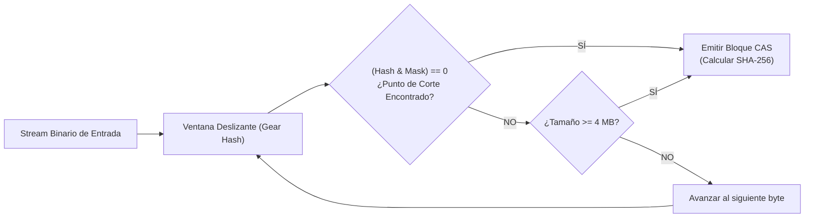
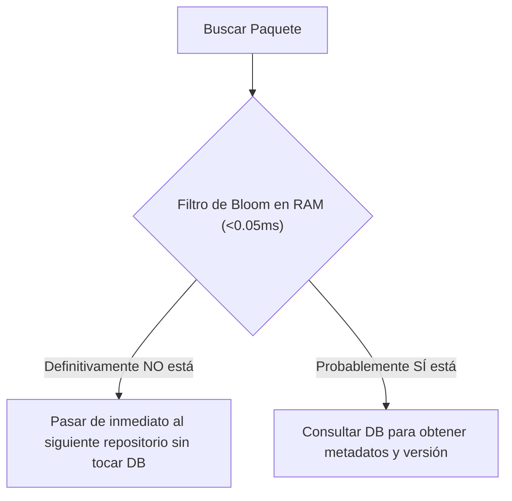
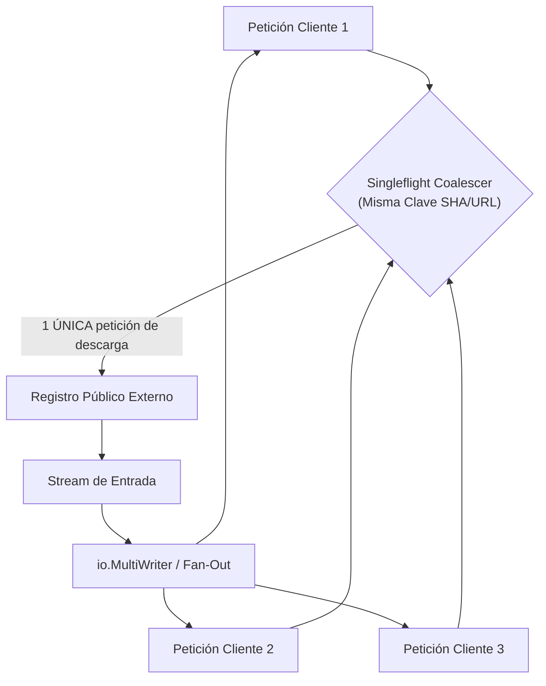
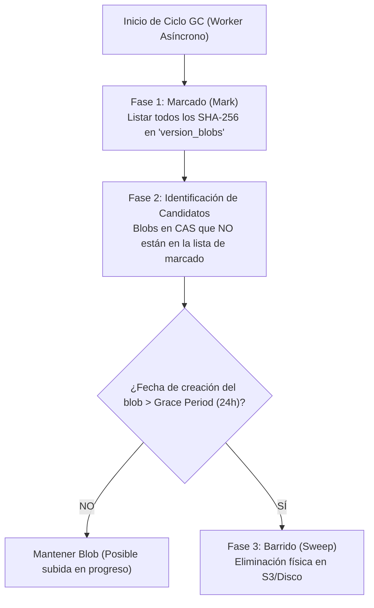

# 05. Algoritmos Núcleo, Fórmulas Matemáticas y Concurrencia

Este documento detalla los algoritmos, modelos matemáticos y mecanismos de concurrencia que permiten a Kinara Registry operar con alto rendimiento, baja latencia y máxima eficiencia de almacenamiento.

---

## 1. Deduplicación por Bloques Variables (FastCDC)

### 1.1. Limitaciones del Fixed-Size Chunking
El particionamiento en bloques de tamaño fijo tradicional sufre del problema del *desplazamiento de bytes* (*Byte-Shift Problem*): si se inserta un solo byte al inicio de un binario de 500 MB, todos los bloques posteriores cambian su hash, anulando por completo la deduplicación.

### 1.2. Algoritmo FastCDC con Rolling Hash de Gear
Kinara Registry implementa **FastCDC** (*Fast Content-Defined Chunking*), que utiliza una ventana deslizante con una tabla estática precomputada de números pseudoaleatorios de 64 bits (Rolling Hash de Gear):

* **Rango de Tamaño de Bloque:**
  * Tamaño mínimo ($S_{\min}$): $64\text{ KB}$ (evita sobrecarga de metadatos con fragmentos diminutos).
  * Tamaño objetivo promedio ($S_{\text{avg}}$): $1\text{ MB}$.
  * Tamaño máximo ($S_{\max}$): $4\text{ MB}$ (evita bloques gigantes indivisibles).
* **Condición Matemática de Corte:**
  $$(H_i \ \& \ \text{Mask}) == 0$$
  donde $H_i$ es el Gear Hash acumulado en el byte $i$, y $\text{Mask}$ es una máscara de bits ajustada al tamaño promedio objetivo ($\text{Mask} = 2^{\lceil \log_2(S_{\text{avg}}) \rceil} - 1$).

### 1.3. Fórmulas de Rendimiento y Ahorro de Almacenamiento
Para cuantificar la ganancia neta de espacio en disco/S3:

$$\text{Ratio}_{\text{dedup}} = \frac{\sum_{j=1}^{N} \text{Tamaño Lógico Reportado}_j}{\sum_{k=1}^{M} \text{Bytes Físicos Únicos en S3}_k}$$

$$\% \text{ Ahorro de Almacenamiento} = \left(1 - \frac{1}{\text{Ratio}_{\text{dedup}}}\right) \times 100$$

*Ejemplo:* Si los desarrolladores han publicado un total lógico de $1.2\text{ TB}$ en artefactos, pero el CAS físico en S3 sólo almacena $300\text{ GB}$ únicos:
$$\text{Ratio}_{\text{dedup}} = \frac{1200}{300} = 4.0 \implies \% \text{ Ahorro} = \left(1 - \frac{1}{4}\right) \times 100 = 75\%$$

---

## 2. Evicción Inteligente de Caché (GDSF)

### 2.1. Insuficiencia de LRU y LFU
Los algoritmos estándar como **LRU** (*Least Recently Used*) o **LFU** (*Least Frequently Used*) fallan en registros de artefactos porque ignoran dos variables críticas:
1. El **tamaño** del archivo (expulsar un archivo de $2\text{ GB}$ libera mucho más espacio que expulsar uno de $200\text{ KB}$).
2. El **coste de red** que representó descargarlo desde el upstream público.

### 2.2. Formulación Matemática de GDSF
Kinara implementa **GreedyDual-Size with Frequency (GDSF)** ponderado con decaimiento temporal exponencial:

$$\text{Prioridad }(P_i) = L + F_i \times \left(\frac{C_i}{S_i}\right) \times e^{-\lambda \cdot \Delta t}$$

Donde:
* **$P_i$**: Valor de prioridad asignado al artefacto $i$ en la cola de prioridad (*Priority Queue / Min-Heap*). El elemento con menor $P_i$ es el primero en ser expulsado de la caché local (*Hot Tier*).
* **$L$**: Reloj base de envejecimiento (*Aging factor*). Cuando un elemento $k$ es evicto, $L$ se actualiza al valor de prioridad del elemento expulsado ($L \leftarrow P_k$), garantizando que los objetos recién ingresados no sean penalizados injustamente.
* **$F_i$**: Frecuencia o contador acumulado de accesos al artefacto.
* **$C_i$**: Coste de recuperación de red del upstream (por defecto $C_i = 1.0$; configurable a valores más altos para registros upstream lentos o de pago).
* **$S_i$**: Tamaño en bytes del artefacto.
* **$\lambda$**: Coeficiente de decaimiento temporal (obsolescencia por desuso).
* **$\Delta t$**: Tiempo transcurrido desde el último acceso registrado.

---

## 3. Enrutamiento O(1) con Filtros de Bloom

### 3.1. Problema de Latencia en Repositorios Virtuales
Cuando un repositorio virtual agrupa 15 repositorios internos y externos, consultar la base de datos o hacer peticiones HTTP en cascada para verificar si un paquete existe introduce latencias inaceptables ($> 150\text{ ms}$).

### 3.2. Filtros de Bloom en Memoria RAM
Kinara Registry mantiene un **Filtro de Bloom** en memoria por cada sub-repositorio:
* Operación en tiempo constante $O(1)$: Responde en menos de **$0.05\text{ ms}$** si un paquete **definitivamente NO existe** en el repositorio.
* Si el filtro responde positivamente, se realiza la consulta a la base de datos (con una tasa de falsos positivos inferior al $1\%$).

### 3.3. Fórmulas de Dimensionamiento Óptimo
Dado un número esperado de paquetes $n$ y una probabilidad admisible de falsos positivos $p = 0.01$ ($1\%$):

$$\text{Tamaño óptimo del vector de bits }(m) = -\frac{n \times \ln(p)}{(\ln 2)^2}$$

$$\text{Número óptimo de funciones hash }(k) = \left(\frac{m}{n}\right) \times \ln(2)$$

*Para $n = 100,000$ paquetes y $p = 0.01$:*
$$m = -\frac{100,000 \times \ln(0.01)}{(0.6931)^2} \approx 958,506\text{ bits} \approx 117\text{ KB de RAM}$$
$$k = \left(\frac{958,506}{100,000}\right) \times 0.6931 \approx 6.64 \implies 7\text{ funciones hash}$$

Con solo **$117\text{ KB}$ de memoria RAM**, Kinara filtra 100,000 paquetes con una precisión del $99\%$.

---

## 4. Supresión de Estampidas y Streaming Directo

### 4.1. Request Coalescing (Patrón Singleflight)
En entornos de integración continua (CI/CD), decenas de trabajadores en paralelo pueden solicitar simultáneamente el mismo paquete no cacheado (ejemplo: `node:20-alpine` o `torch-2.0.whl`), provocando una caída por estampida (*Cache Stampede* o *Thundering Herd*).

* Solo se abre **una única conexión hacia el upstream externo**.
* Las demás peticiones se encolan en memoria escuchando el mismo canal de lectura (*Fan-Out*), reduciendo el consumo de ancho de banda upstream en un $(N - 1) / N \times 100\%$.

### 4.2. Cut-Through Streaming
En lugar del modelo anticuado *descargar todo a disco $\rightarrow$ verificar $\rightarrow$ entregar al cliente*:
* Se utiliza una tubería concurrente con `io.TeeReader` en streaming.
* El primer byte recibido del upstream se transmite de inmediato al cliente HTTP, mientras en paralelo se computa el hash SHA-256 y se bifurca la escritura hacia el almacenamiento de objetos CAS.

---

## 5. Compresión Adaptativa (zstd:chunked)

Para paquetes grandes y capas OCI, se utiliza el formato **`zstd:chunked`**:
* **Descompresión Paralela:** Divide el binario comprimido en marcos independientes que pueden descomprimirse concurrentemente en múltiples hilos de CPU.
* **Compatibilidad con HTTP Range Requests (RFC 7233):** Permite a los clientes solicitar rangos específicos de bytes sin necesidad de descomprimir el archivo desde el byte cero, acelerando el arranque de contenedores bajo demanda.

---

## 6. Zero-Downtime Garbage Collection (GC)

### 6.1. El Riesgo de las Carreras en Tiempo de Ejecución
Un recolector de basura ingenuo que borre inmediatamente los bloques que no figuren en la tabla `version_blobs` puede corromper subidas en curso: si un desarrollador está subiendo una capa que ya llegó al almacenamiento pero la versión aún no se ha guardado en la base de datos, el GC podría eliminarla por error.

### 6.2. Algoritmo Mark-and-Sweep con Período de Gracia (*Grace Period*)

1. **Fase de Marcado (*Mark*):** Se genera un conjunto en memoria de todos los hashes referenciados en `version_blobs`.
2. **Fase de Barrido (*Sweep*) con Ventana de Seguridad:** Solo se eliminan físicamente aquellos blobs huérfanos cuya marca de tiempo de creación sea superior al período de gracia (por defecto, $24\text{ horas}$).
3. **Cero Bloqueo de Tablas:** La consulta de marcado se realiza con aislamiento de lectura `READ COMMITTED` sin bloqueos de tabla (`LOCK TABLE`), permitiendo lecturas y escrituras ininterrumpidas.
