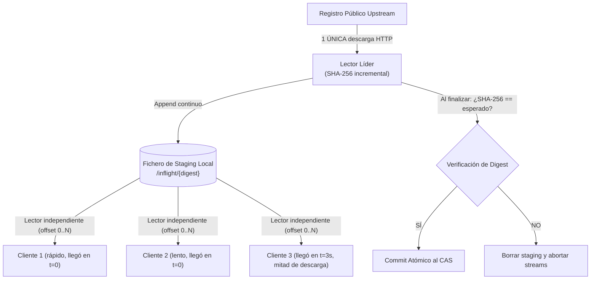
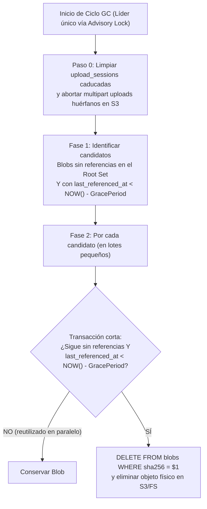

# 05. Algoritmos Núcleo, Fórmulas Matemáticas y Concurrencia

Este documento detalla los algoritmos, modelos matemáticos y mecanismos de concurrencia que permiten a Kinara Registry operar con alto rendimiento, baja huella de memoria RAM y garantías estrictas de integridad y consistencia.

---

## 1. Deduplicación en CAS por Digest de Fichero Completo

### 1.1. Por Qué Deduplicar por Fichero Completo y No por Sub-Bloques (Chunking)
Todos los protocolos soportados en el MVP identifican y verifican cada artefacto mediante el hash SHA-256 del **fichero completo**:
* **OCI / Docker:** `GET /v2/<repo>/<name>/blobs/sha256:<digest>`
* **PyPI (PEP 503 / 691):** enlaces con fragmento `#sha256=<digest>`
* **Cargo (Sparse Index):** campo `"cksum"` en cada línea JSON del índice
* **Go Modules:** hashes verificados contra `go.sum` y `sum.golang.org`
* **NuGet v3:** hash de paquete publicado en el recurso de registro

Además, estos artefactos (`.tar.gz`/`.tar.zst` en capas OCI, `.whl`, `.crate`, `.nupkg`, `.zip` de Go) **ya están comprimidos en origen**. Un cambio mínimo en el código fuente altera la práctica totalidad del flujo comprimido, por lo que algoritmos de corte variable como FastCDC encuentran muy pocos bloques compartidos entre versiones distintas y, a cambio, rompen las redirecciones mediante *Presigned URLs* (al no existir un único objeto S3 por artefacto) y obligan a reensamblar cada descarga en el servidor.

Por ello, Kinara aplica deduplicación exacta a nivel de **blob completo**:
* Las capas base de contenedores (`alpine`, `debian`, `cuda`, runtimes de lenguaje) compartidas entre decenas de imágenes se almacenan una sola vez.
* Las dependencias cacheadas o promovidas entre múltiples repositorios (`dev`, `staging`, `prod`) comparten el mismo objeto físico en el CAS.

### 1.2. Métricas de Ahorro de Almacenamiento
Para cuantificar la ganancia neta de espacio en el almacenamiento primario ( expuesta en la API y el Dashboard):

$$\text{Ratio}_{\text{dedup}} = \frac{\sum_{j=1}^{N} \text{Tamaño Lógico Referenciado}_j}{\sum_{k=1}^{M} \text{Bytes Físicos Únicos en el CAS}_k}$$

$$\% \text{ Ahorro de Almacenamiento} = \left(1 - \frac{1}{\text{Ratio}_{\text{dedup}}}\right) \times 100$$

*Ejemplo:* Si los repositorios referencian un total lógico de $600\text{ GB}$ en capas OCI y paquetes, pero el CAS físico sólo almacena $240\text{ GB}$ únicos:
$$\text{Ratio}_{\text{dedup}} = \frac{600}{240} = 2.5 \implies \% \text{ Ahorro} = \left(1 - \frac{1}{2.5}\right) \times 100 = 60\%$$

---

## 2. Evicción Inteligente del Hot Tier (GDSF)

### 2.1. Ámbito de Aplicación
El algoritmo **GDSF** (*GreedyDual-Size with Frequency*) gestiona exclusivamente el **Hot Tier opcional** (caché de lectura en disco NVMe local de cada nodo del Data Plane frente a un almacenamiento primario S3, introducido en la Fase 4).
* **No** gestiona el almacenamiento primario (que es la fuente de verdad y sólo se limpia mediante Garbage Collection o políticas de retención).
* El índice y la cola de prioridad viven en la memoria del propio nodo dueño del disco NVMe (con snapshot en disco local para reinicios), sin contención en la base de datos compartida.

### 2.2. Insuficiencia de LRU y LFU
Los algoritmos estándar como **LRU** (*Least Recently Used*) o **LFU** (*Least Frequently Used*) ignoran dos variables críticas en un registro de artefactos:
1. El **tamaño** del blob (expulsar una imagen de $2\text{ GB}$ libera mucho más espacio que expulsar un wheel de $200\text{ KB}$).
2. El **coste** de volver a recuperar el blob desde el almacenamiento primario remoto.

### 2.3. Formulación Matemática de GDSF
Cada blob $i$ presente en el Hot Tier recibe una prioridad $P_i$ calculada al insertarse o al recibir un *hit*:

$$P_i = L + F_i \times \left(\frac{C_i}{S_i}\right)$$

Donde:
* **$P_i$**: Prioridad del blob $i$ en el *Min-Heap*. Cuando el disco local supera su cuota, se expulsa el elemento con menor $P_i$.
* **$L$**: Factor de envejecimiento monótono (*Inflation / Aging Clock*), inicializado en $0.0$. Cada vez que se expulsa un elemento $k$, se actualiza $L \leftarrow P_k$. De este modo, los blobs recién ingresados comienzan con base $L$ y los blobs antiguos que dejan de accederse quedan progresivamente por debajo de $L$ sin necesidad de recalcular todas las prioridades del heap.
* **$F_i$**: Contador de accesos al blob en ese nodo desde que entró en el Hot Tier.
* **$C_i$**: Coste estimado de recuperación desde el almacenamiento primario (por defecto $C_i = 1.0$).
* **$S_i$**: Tamaño en bytes del blob ($S_i > 0$).

> [!NOTE]
> Se evita multiplicar la fórmula por un factor temporal continuo $e^{-\lambda \Delta t}$ porque haría que las prioridades relativas cambiasen con el paso del tiempo, invalidando el invariante del *Min-Heap* y obligando a reconstrucciones $O(N)$. El reloj $L$ de GDSF proporciona el envejecimiento en $O(\log N)$ por operación.

---

## 3. Resolución en Repositorios Virtuales y Normalización

### 3.1. Consulta Indexada Autoritativa
Cuando un cliente solicita un paquete a un repositorio virtual que agrupa $K$ repositorios miembros (locales y proxies), Kinara resuelve la precedencia y la barrera *Local-First* ([`04-tipos-de-repositorios.md`](file:///home/cesar/Projects/Kinara-Registry/Planification/04-tipos-de-repositorios.md) §4.2) mediante una única consulta SQL parametrizada sobre el índice compuesto `(repo_id, normalized_name)`:

```sql
SELECT p.id, p.repo_id, r.repo_type, m.priority
FROM virtual_repo_members m
JOIN repositories r ON r.id = m.member_repo_id AND r.is_active = TRUE
JOIN packages p     ON p.repo_id = r.id AND p.normalized_name = $2
WHERE m.virtual_repo_id = $1
ORDER BY (CASE WHEN r.repo_type = 'LOCAL' THEN 0 ELSE 1 END), m.priority ASC;
```

* Con el índice `idx_packages_repo_norm (repo_id, normalized_name)` en memoria caché del motor de base de datos, esta consulta evalúa todos los miembros locales en **$\sim 0.5 - 2\text{ ms}$** en PostgreSQL e incluso menos en SQLite.
* Es **100% consistente entre réplicas**: en cuanto una transacción de `push` confirma un paquete privado en la réplica A, cualquier petición en la réplica B lo ve de inmediato y bloquea la caída hacia los proxies públicos.

### 3.2. Por Qué No Usar Filtros de Bloom en el Camino Crítico
Los Filtros de Bloom por réplica se descartaron del camino de resolución por tres motivos de corrección:
1. **Riesgo de seguridad en multi-réplica:** Si un paquete privado se publica a través de la réplica A, el filtro en memoria de la réplica B aún no contiene el nombre y respondería *"definitivamente no está en los repos locales"*, permitiendo consultar el proxy público y reabriendo el vector de *Dependency Confusion*.
2. **Incapacidad de borrado:** Un filtro de Bloom estándar no permite eliminar entradas al borrar un paquete sin reconstruir el vector completo.
3. **Inaplicabilidad en repositorios Proxy:** Un filtro local no conoce el catálogo total del registro público upstream (`pypi.org`, `crates.io`), por lo que una respuesta negativa sólo indica que aún no está en caché, no que el paquete no exista en el upstream.

---

## 4. Supresión de Estampidas y Streaming con Verificación

### 4.1. Coalescing de Metadatos vs. Coalescing de Binarios
En entornos de CI/CD, decenas de runners pueden solicitar simultáneamente el mismo artefacto no cacheado (*Cache Stampede* o *Thundering Herd*). Kinara aplica dos estrategias según la naturaleza del recurso:

1. **Metadatos (documentos pequeños en memoria):** Se agrupan con `golang.org/x/sync/singleflight` por clave `(repo_id, cache_key)`, devolviendo el documento resuelto a todos los solicitantes concurrentes.
2. **Blobs binarios (decenas de MB a varios GB):** No se puede usar `singleflight` (que espera a tener el valor completo en memoria) ni `io.MultiWriter` directo a los sockets de los clientes (donde el cliente más lento bloquearía la lectura del upstream para todos los demás, y donde los clientes que llegan a mitad de descarga perderían los primeros bytes). En su lugar, Kinara emplea un **Inflight Registry sobre Fichero de Staging**.

### 4.2. Fan-Out sobre Fichero de Staging y Cut-Through Verificado



* **Cero bloqueo entre clientes:** El líder descarga del upstream al fichero de staging y notifica el avance mediante un `sync.Cond`. Cada cliente abre su propio descriptor de lectura sobre el mismo fichero desde el byte 0 y avanza a su propio ritmo de red.
* **Huella de RAM constante:** Ningún binario se retiene en memoria RAM; cada lector utiliza un búfer fijo (p. ej. $64\text{ KB}$) reciclado con `sync.Pool`.
* **Integridad antes de confirmar:** El fichero de staging sólo se promueve al CAS cuando la descarga termina y el SHA-256 calculado coincide exactamente con el digest esperado. Si difiere o se trunca, el staging se descarta y nunca contamina la caché.
* **Alcance en multi-réplica:** El registro *inflight* es local a cada réplica del Data Plane, acotando las descargas upstream concurrentes como máximo al número de réplicas $R$ (y a $1$ si se activa el *advisory lock* opcional en PostgreSQL).

---

## 5. Integridad Byte a Byte y HTTP Range Requests (RFC 9110)

* **Prohibición de recompresión en el servidor:** Kinara almacena y sirve todos los blobs exactamente con los mismos bytes que subió el cliente o entregó el upstream. Recomprimir un archivo en el servidor cambiaría su digest SHA-256, invalidando las firmas y comprobaciones de `docker`, `containerd`, `pip`, `cargo`, `go` y `nuget`, e impidiendo el uso de *Presigned URLs*.
* **Soporte nativo de `zstd` y `zstd:chunked`:** Si un cliente (`podman`, `buildah`, `skopeo`) sube una capa OCI comprimida con `zstd` o `zstd:chunked`, Kinara preserva su `mediaType` en el manifest y almacena el blob intacto.
* **HTTP Range Requests (RFC 9110):** El Data Plane soporta cabeceras `Range: bytes=<start>-<end>` (`206 Partial Content`) sobre cualquier blob, tanto leyendo desde el sistema de ficheros / Hot Tier (`io.SectionReader`) como trasladando el rango a S3 (`Range` en `GetObject`). Esto permite a `cri-o` / `podman` realizar *partial pulls* de capas `zstd:chunked` y a cualquier cliente reanudar descargas interrumpidas sin tratamiento especial en el servidor.

---

## 6. Zero-Downtime Garbage Collection (GC con Leases)

### 6.1. El Problema de las Carreras en Blobs Deduplicados
Un recolector de basura que sólo compruebe la fecha de creación del blob (`created_at > 24h`) sufre una condición de carrera crítica cuando se reutiliza un blob antiguo:
1. Un blob $B$ creado hace 10 días queda sin referencias y el GC lo identifica como candidato a borrado.
2. Un desarrollador sube un paquete que contiene el mismo blob $B$. Al detectar que $B$ ya existe en el CAS, la subida omite la escritura física y se dispone a insertar la fila en `version_files`.
3. Antes de que la transacción de subida haga `COMMIT`, el GC ejecuta la fase de barrido y elimina físicamente $B$ porque su `created_at` tiene 10 días. La nueva versión queda apuntando a un blob inexistente.

### 6.2. Algoritmo Mark-and-Sweep Seguro con `last_referenced_at` y Re-verificación

Para eliminar esta carrera sin bloquear las subidas:
1. **Renovación de Lease (`last_referenced_at`):** La tabla `blobs` mantiene una columna `last_referenced_at`. Cada vez que un blob se crea, se vincula a un repositorio (`repository_blobs`), se reutiliza por deduplicación o se asocia a una sesión de subida (`upload_sessions`), se actualiza `last_referenced_at = CURRENT_TIMESTAMP`.
2. **Elección de Líder:** En despliegues con múltiples réplicas, el worker de GC adquiere un *advisory lock* de sesión en PostgreSQL (`pg_try_advisory_lock(LOCK_ID_GC)`) antes de iniciar el ciclo, garantizando un único recolector activo en todo el clúster.
3. **Conjunto Completo de Raíces (*Root Set*):** Un blob está referenciado si aparece en cualquiera de las siguientes tablas:
   * `version_files.blob_sha256` (paquetes PyPI, NuGet, Cargo, Go)
   * `oci_manifests.digest` y `oci_manifests.config_digest` (los propios manifests y configs se guardan como blobs)
   * `oci_manifest_refs.child_digest` (capas y sub-manifests referenciados)
   * `proxy_metadata_cache.blob_sha256` (documentos de metadatos cacheados)
   * `upload_sessions.expected_digest` (con `expires_at > CURRENT_TIMESTAMP`)



4. **Barrido Atómico por Lotes:** Para cada candidato, el worker ejecuta una transacción corta que **re-verifica** la ausencia de referencias y la antigüedad de `last_referenced_at` en el mismo `DELETE`:
   ```sql
   DELETE FROM blobs b
   WHERE b.sha256 = $1
     AND b.last_referenced_at < (CURRENT_TIMESTAMP - INTERVAL '24 hours')
     AND NOT EXISTS (SELECT 1 FROM version_files vf WHERE vf.blob_sha256 = b.sha256)
     AND NOT EXISTS (SELECT 1 FROM oci_manifests om WHERE om.digest = b.sha256 OR om.config_digest = b.sha256)
     AND NOT EXISTS (SELECT 1 FROM oci_manifest_refs mr WHERE mr.child_digest = b.sha256)
     AND NOT EXISTS (SELECT 1 FROM proxy_metadata_cache pm WHERE pm.blob_sha256 = b.sha256);
   ```
   Si entretanto una subida concurrente vinculó el blob o actualizó `last_referenced_at`, el `DELETE` afecta a 0 filas y el objeto físico no se toca.

---

## 7. Backlog de Investigación Post-MVP

Las siguientes optimizaciones quedan documentadas para evaluación futura una vez existan métricas reales de producción, fuera del alcance del MVP y de la versión 1.0:

1. **Particionamiento por Contenido Variable (FastCDC con Gear Hash):**
   * *Cuándo tendría sentido:* Si en el futuro Kinara añade un formato de artefactos internos **no comprimidos** de gran tamaño (p. ej. checkpoints de modelos de IA en formato `safetensors`/GGUF o imágenes VM raw) servidos siempre a través del Data Plane sin *Presigned URLs*.
   * *Requisitos si se retoma:* Debe modelarse como una capa interna del almacenamiento (`blob_digest` lógico completo $\rightarrow$ lista ordenada de `chunk_sha256`), transparente para los adaptadores de protocolo y con clave primaria `(blob_sha256, chunk_index)`.
2. **Filtros de Bloom como Pista Positiva de Caché:**
   * Sólo aplicables a estructuras inmutables o con invalidación síncrona por pub/sub (`LISTEN/NOTIFY` en PostgreSQL), y nunca para saltar la comprobación *Local-First* de seguridad.
3. **Generación de Índices `zstd:chunked` en `kinara-cli`:**
   * En lugar de recomprimir en el servidor (lo que rompe los digests), ofrecer en `kinara-cli` un asistente de construcción que empaquete capas OCI con `zstd:chunked` en el cliente antes del `push`.
