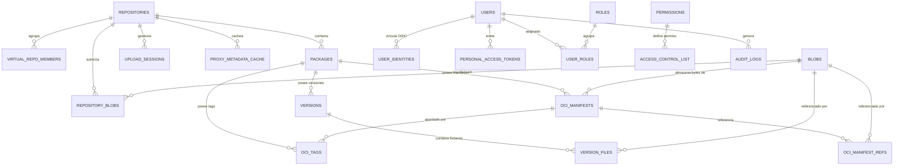

# 06. Modelo de Datos, Esquema Relacional y Metadatos JSONB

## 1. Arquitectura de Persistencia y Metadatos

La capa de metadatos de Kinara Registry combina la integridad referencial y las transacciones ACID de una base de datos relacional (**PostgreSQL** en producción y despliegues multi-réplica; **SQLite** en modo WAL para instancia única en desarrollo/edge) con la flexibilidad semi-estructurada de campos JSON.



---

## 2. Definición del Esquema DDL (Referencia PostgreSQL)

El siguiente DDL emplea el dialecto de PostgreSQL como referencia canónica. Las equivalencias para SQLite y la estrategia de migraciones duales se detallan en el §3.

### 2.1. Repositorios, Miembros Virtuales y Espacios Reservados

```sql
-- Repositorios lógicos del sistema
CREATE TABLE repositories (
    id VARCHAR(36) PRIMARY KEY,
    name VARCHAR(128) NOT NULL UNIQUE,
    description TEXT,
    repo_type VARCHAR(16) NOT NULL CHECK (repo_type IN ('LOCAL', 'PROXY', 'VIRTUAL')),
    format VARCHAR(16) NOT NULL CHECK (format IN ('OCI', 'PYPI', 'NUGET', 'CARGO', 'GO')),
    upstream_url VARCHAR(512),                     -- Obligatorio si repo_type = 'PROXY'
    virtual_default_target_id VARCHAR(36) REFERENCES repositories(id),
    config JSONB NOT NULL DEFAULT '{}'::jsonb,     -- TTLs proxy, cuotas, retención, presigned_redirects
    is_active BOOLEAN NOT NULL DEFAULT TRUE,
    created_at TIMESTAMP WITH TIME ZONE NOT NULL DEFAULT CURRENT_TIMESTAMP,
    updated_at TIMESTAMP WITH TIME ZONE NOT NULL DEFAULT CURRENT_TIMESTAMP,
    CONSTRAINT chk_proxy_upstream CHECK (
        (repo_type = 'PROXY' AND upstream_url IS NOT NULL) OR
        (repo_type IN ('LOCAL', 'VIRTUAL') AND upstream_url IS NULL)
    )
);

-- Miembros ordenados de un repositorio VIRTUAL (mismo formato validado en capa de aplicación/trigger)
CREATE TABLE virtual_repo_members (
    virtual_repo_id VARCHAR(36) NOT NULL REFERENCES repositories(id) ON DELETE CASCADE,
    member_repo_id VARCHAR(36) NOT NULL REFERENCES repositories(id) ON DELETE CASCADE,
    priority INT NOT NULL CHECK (priority >= 0),
    PRIMARY KEY (virtual_repo_id, member_repo_id),
    CONSTRAINT uq_virtual_member_priority UNIQUE (virtual_repo_id, priority),
    CONSTRAINT chk_no_self_member CHECK (virtual_repo_id <> member_repo_id)
);

-- Prefijos/patrones de nombres reservados para mitigar Dependency Confusion
CREATE TABLE reserved_namespaces (
    id VARCHAR(36) PRIMARY KEY,
    format VARCHAR(16) NOT NULL CHECK (format IN ('OCI', 'PYPI', 'NUGET', 'CARGO', 'GO')),
    pattern VARCHAR(256) NOT NULL,                 -- ej. 'corp-*', 'github.com/mi-empresa/*'
    owner_repo_id VARCHAR(36) REFERENCES repositories(id) ON DELETE SET NULL,
    created_at TIMESTAMP WITH TIME ZONE NOT NULL DEFAULT CURRENT_TIMESTAMP,
    CONSTRAINT uq_reserved_format_pattern UNIQUE (format, pattern)
);
```

### 2.2. Catálogo de Paquetes y Versiones (PyPI, NuGet, Cargo, Go)

```sql
-- Paquetes lógicos dentro de un repositorio
CREATE TABLE packages (
    id VARCHAR(36) PRIMARY KEY,
    repo_id VARCHAR(36) NOT NULL REFERENCES repositories(id) ON DELETE CASCADE,
    name VARCHAR(256) NOT NULL,                    -- Nombre original tal como se publicó
    normalized_name VARCHAR(256) NOT NULL,         -- Normalizado según reglas del formato (§5)
    latest_version_id VARCHAR(36),                 -- FK diferida a versions(id), actualizada bajo bloqueo
    description TEXT,
    created_at TIMESTAMP WITH TIME ZONE NOT NULL DEFAULT CURRENT_TIMESTAMP,
    updated_at TIMESTAMP WITH TIME ZONE NOT NULL DEFAULT CURRENT_TIMESTAMP,
    CONSTRAINT uq_repo_package UNIQUE (repo_id, normalized_name)
);

-- Versiones inmutables de un paquete (para formatos basados en semántica de versiones)
CREATE TABLE versions (
    id VARCHAR(36) PRIMARY KEY,
    package_id VARCHAR(36) NOT NULL REFERENCES packages(id) ON DELETE CASCADE,
    version_string VARCHAR(128) NOT NULL,          -- ej. 1.0.0, 2.1.0-beta.1, v0.0.0-20260101...
    is_yanked BOOLEAN NOT NULL DEFAULT FALSE,      -- Revocación lógica (Cargo yank, PyPI yank, NuGet unlist)
    metadata JSONB NOT NULL DEFAULT '{}'::jsonb,   -- Metadatos declarativos + dependency_names normalizados
    created_at TIMESTAMP WITH TIME ZONE NOT NULL DEFAULT CURRENT_TIMESTAMP,
    updated_at TIMESTAMP WITH TIME ZONE NOT NULL DEFAULT CURRENT_TIMESTAMP,
    CONSTRAINT uq_package_version UNIQUE (package_id, version_string)
);

ALTER TABLE packages
    ADD CONSTRAINT fk_packages_latest_version
    FOREIGN KEY (latest_version_id) REFERENCES versions(id) ON DELETE SET NULL;

-- Ficheros completos que componen una versión (ej. .whl + .tar.gz + .metadata en PyPI; .zip + .mod + .info en Go)
CREATE TABLE version_files (
    id VARCHAR(36) PRIMARY KEY,
    version_id VARCHAR(36) NOT NULL REFERENCES versions(id) ON DELETE CASCADE,
    filename VARCHAR(512) NOT NULL,                -- Nombre de fichero expuesto al cliente
    blob_sha256 VARCHAR(64) NOT NULL REFERENCES blobs(sha256),
    file_type VARCHAR(32) NOT NULL CHECK (file_type IN (
        'WHEEL', 'SDIST', 'PEP658_METADATA',
        'NUPKG', 'SNUPKG',
        'CRATE',
        'GO_ZIP', 'GO_MOD', 'GO_INFO'
    )),
    metadata JSONB NOT NULL DEFAULT '{}'::jsonb,   -- ej. requires_python o hashes adicionales por fichero
    created_at TIMESTAMP WITH TIME ZONE NOT NULL DEFAULT CURRENT_TIMESTAMP,
    CONSTRAINT uq_version_filename UNIQUE (version_id, filename)
);
```

### 2.3. Capa CAS, Autorización por Repositorio y Sesiones de Subida

```sql
-- Blobs físicos únicos direccionados por el SHA-256 del fichero completo
CREATE TABLE blobs (
    sha256 VARCHAR(64) PRIMARY KEY,                -- Digest SHA-256 en hexadecimal minúsculas (64 chars)
    size_bytes BIGINT NOT NULL CHECK (size_bytes >= 0),
    storage_key VARCHAR(512) NOT NULL,             -- Clave en el backend: blobs/sha256/aa/bb/aabb...
    created_at TIMESTAMP WITH TIME ZONE NOT NULL DEFAULT CURRENT_TIMESTAMP,
    last_referenced_at TIMESTAMP WITH TIME ZONE NOT NULL DEFAULT CURRENT_TIMESTAMP, -- Lease contra carreras de GC
    last_accessed_at TIMESTAMP WITH TIME ZONE NOT NULL DEFAULT CURRENT_TIMESTAMP,   -- Actualizado en lotes
    access_count BIGINT NOT NULL DEFAULT 1
);

-- Vínculo de autorización: qué repositorios tienen derecho a conocer/servir cada blob
CREATE TABLE repository_blobs (
    repo_id VARCHAR(36) NOT NULL REFERENCES repositories(id) ON DELETE CASCADE,
    blob_sha256 VARCHAR(64) NOT NULL REFERENCES blobs(sha256) ON DELETE CASCADE,
    linked_at TIMESTAMP WITH TIME ZONE NOT NULL DEFAULT CURRENT_TIMESTAMP,
    PRIMARY KEY (repo_id, blob_sha256)
);

-- Sesiones de subida en curso (soporta subidas OCI fragmentadas entre múltiples réplicas)
CREATE TABLE upload_sessions (
    id VARCHAR(36) PRIMARY KEY,
    repo_id VARCHAR(36) NOT NULL REFERENCES repositories(id) ON DELETE CASCADE,
    user_id VARCHAR(36),
    expected_digest VARCHAR(64),                   -- Si se conoce de antemano (protege el blob frente al GC)
    bytes_received BIGINT NOT NULL DEFAULT 0,
    hash_state BYTEA,                              -- Estado binario serializado del hash SHA-256 en curso
    backend_upload_id VARCHAR(256),                -- UploadId de S3 Multipart Upload (NULL en FS local)
    staging_key VARCHAR(512) NOT NULL,             -- Clave/ruta de staging
    expires_at TIMESTAMP WITH TIME ZONE NOT NULL,
    created_at TIMESTAMP WITH TIME ZONE NOT NULL DEFAULT CURRENT_TIMESTAMP
);
```

> [!NOTE]
> El **Hot Tier** NVMe (Fase 4) mantiene su propio índice y cola de prioridad GDSF en el disco local de cada nodo del Data Plane ([`03`](file:///home/cesar/Projects/Kinara-Registry/Planification/03-estrategia-almacenamiento-cas.md) §2.2), por lo que no utiliza una tabla global en la base de datos compartida.

### 2.4. Modelo Nativo OCI (Manifests, Índices Multi-Arquitectura, Referrers y Tags)

A diferencia de los paquetes con versiones inmutables, en OCI las **etiquetas (`tags`) son mutables** (`latest` cambia de manifest continuamente), existen **índices multi-arquitectura** (manifest lists) que apuntan a otros manifests, y la especificación **OCI v1.1 Referrers** vincula firmas (Cosign/Notation) y SBOMs a un manifest mediante el campo `subject`:

```sql
-- Manifests e Image Indexes OCI (sus bytes crudos también residen en 'blobs')
CREATE TABLE oci_manifests (
    repo_id VARCHAR(36) NOT NULL REFERENCES repositories(id) ON DELETE CASCADE,
    package_id VARCHAR(36) NOT NULL REFERENCES packages(id) ON DELETE CASCADE,
    digest VARCHAR(64) NOT NULL REFERENCES blobs(sha256),
    media_type VARCHAR(256) NOT NULL,              -- ej. application/vnd.oci.image.manifest.v1+json
    schema_version INT NOT NULL DEFAULT 2,
    config_digest VARCHAR(64) REFERENCES blobs(sha256),  -- NULL en image indexes
    subject_digest VARCHAR(64),                    -- Para API OCI 1.1 Referrers (/v2/<name>/referrers/<digest>)
    artifact_type VARCHAR(256),                    -- artifactType para filtrado de referrers
    total_size BIGINT NOT NULL DEFAULT 0,          -- Suma de tamaños del manifest + config + capas
    metadata JSONB NOT NULL DEFAULT '{}'::jsonb,   -- Annotations, plataforma, etc.
    created_at TIMESTAMP WITH TIME ZONE NOT NULL DEFAULT CURRENT_TIMESTAMP,
    PRIMARY KEY (repo_id, digest)
);

-- Grafo dirigido de referencias de un manifest a sus capas, config o sub-manifests (usado por el GC)
CREATE TABLE oci_manifest_refs (
    repo_id VARCHAR(36) NOT NULL,
    parent_digest VARCHAR(64) NOT NULL,
    child_digest VARCHAR(64) NOT NULL REFERENCES blobs(sha256),
    ref_type VARCHAR(16) NOT NULL CHECK (ref_type IN ('CONFIG', 'LAYER', 'MANIFEST')),
    position INT NOT NULL DEFAULT 0,
    PRIMARY KEY (repo_id, parent_digest, child_digest, ref_type, position),
    FOREIGN KEY (repo_id, parent_digest) REFERENCES oci_manifests(repo_id, digest) ON DELETE CASCADE
);

-- Etiquetas OCI mutables (apuntan a un manifest dentro de un paquete/imagen)
CREATE TABLE oci_tags (
    package_id VARCHAR(36) NOT NULL REFERENCES packages(id) ON DELETE CASCADE,
    tag_name VARCHAR(128) NOT NULL,                -- ej. 'latest', 'v1.4.2-alpine'
    repo_id VARCHAR(36) NOT NULL,
    manifest_digest VARCHAR(64) NOT NULL,
    updated_at TIMESTAMP WITH TIME ZONE NOT NULL DEFAULT CURRENT_TIMESTAMP,
    PRIMARY KEY (package_id, tag_name),
    FOREIGN KEY (repo_id, manifest_digest) REFERENCES oci_manifests(repo_id, digest) ON DELETE CASCADE
);
```

### 2.5. Caché de Metadatos Proxy y Registro de Auditoría

```sql
-- Caché con TTL de metadatos mutables obtenidos de upstreams públicos
CREATE TABLE proxy_metadata_cache (
    repo_id VARCHAR(36) NOT NULL REFERENCES repositories(id) ON DELETE CASCADE,
    cache_key VARCHAR(512) NOT NULL,               -- ej. 'simple/requests', 'mod/golang.org/x/sync/@v/list'
    status VARCHAR(16) NOT NULL CHECK (status IN ('HIT', 'NEGATIVE')),
    blob_sha256 VARCHAR(64) REFERENCES blobs(sha256), -- NULL si status = 'NEGATIVE' (404 cacheado)
    content_type VARCHAR(128),
    etag VARCHAR(256),
    expires_at TIMESTAMP WITH TIME ZONE NOT NULL,
    updated_at TIMESTAMP WITH TIME ZONE NOT NULL DEFAULT CURRENT_TIMESTAMP,
    PRIMARY KEY (repo_id, cache_key)
);

-- Trazabilidad de operaciones administrativas y de escritura
CREATE TABLE audit_logs (
    id BIGSERIAL PRIMARY KEY,
    user_id VARCHAR(36),
    action VARCHAR(64) NOT NULL,                   -- ej. pkg:upload, pkg:delete, repo:create, acl:update
    resource_type VARCHAR(32) NOT NULL,            -- GLOBAL, REPOSITORY, PACKAGE, VERSION, USER
    resource_id VARCHAR(256) NOT NULL,
    ip_address VARCHAR(45) NOT NULL,               -- IPv4 / IPv6
    user_agent TEXT,
    details JSONB NOT NULL DEFAULT '{}'::jsonb,
    timestamp TIMESTAMP WITH TIME ZONE NOT NULL DEFAULT CURRENT_TIMESTAMP
);
```

---

## 3. Compatibilidad Dual: PostgreSQL y SQLite

Dado que algunos tipos y operadores de PostgreSQL no existen en SQLite, Kinara mantiene dos árboles de migraciones SQL (`internal/database/migrations/postgres/` y `internal/database/migrations/sqlite/`) bajo una misma interfaz de repositorio en Go:

| Concepto | PostgreSQL (Producción / Multi-Réplica) | SQLite WAL (Modo Simple / Instancia Única) |
| :--- | :--- | :--- |
| Documentos JSON | `JSONB` con valor por defecto `'{}'::jsonb` | `TEXT` validado con `CHECK (json_valid(col))` y defecto `'{}'` |
| Búsqueda en JSON | Operador `@>` con índice `GIN` | Función `json_each()` / `json_extract()` en la capa de repositorio |
| Autoincremental | `BIGSERIAL PRIMARY KEY` | `INTEGER PRIMARY KEY AUTOINCREMENT` |
| Estado binario | `BYTEA` | `BLOB` |
| Fechas y horas | `TIMESTAMP WITH TIME ZONE` | `TEXT` en formato ISO-8601 UTC (`YYYY-MM-DDTHH:MM:SS.sssZ`) |
| Bloqueo de fila | `SELECT ... FOR UPDATE` | Transacción `BEGIN IMMEDIATE` (escritor único serializado) |
| Elección de líder | `pg_try_advisory_lock(key)` | No requerido (instancia única por restricción de arquitectura) |

---

## 4. Diseño de Metadatos en `JSONB`

### 4.1. Heterogeneidad de Formatos y Normalización de Dependencias
Cada ecosistema posee metadatos propios que se almacenan en `versions.metadata` (o `oci_manifests.metadata`):
* **OCI / Docker:** `annotations`, `architecture`, `os`, `os.version`.
* **PyPI:** `requires_dist`, `requires_python`, `classifiers`, `summary`, `license`.
* **Cargo:** `authors`, `edition`, `dependencies`, `features`, `links`, `rust_version`.
* **NuGet:** `targetFrameworks`, `dependencies`, `releaseNotes`, `authors`.
* **Go Modules:** `go_version`, `require`, `replace`, `retract`.

Las cadenas crudas de dependencias incluyen restricciones de versión (p. ej. `"numpy>=1.20,<2.0; python_version>='3.10'"`), por lo que una consulta JSON de igualdad sobre `requires_dist` no encontraría `"numpy"`. Para permitir búsquedas inversas rápidas, todos los extractores de metadatos rellenan además un array canónico `dependency_names` con los nombres ya normalizados:

```json
{
  "requires_python": ">=3.10",
  "requires_dist": ["numpy>=1.20,<2.0", "pydantic>=2.0"],
  "dependency_names": ["numpy", "pydantic"]
}
```

De este modo, la consulta por índice GIN en PostgreSQL es exacta:
```sql
SELECT package_id, version_string
FROM versions
WHERE metadata @> '{"dependency_names": ["numpy"]}';
```
*(En SQLite la capa de repositorio traduce esta consulta a `EXISTS (SELECT 1 FROM json_each(versions.metadata, '$.dependency_names') WHERE value = 'numpy')`).*

---

## 5. Normalización de Nombres y Ordenación de Versiones

### 5.1. Reglas de `normalized_name` por Formato
La normalización se aplica siempre antes de insertar en `packages.normalized_name` y antes de ejecutar la comprobación *Local-First*:

| Formato | Regla de Normalización (`normalized_name`) | Ejemplo Entrada $\rightarrow$ Normalizado |
| :--- | :--- | :--- |
| **PYPI** | PEP 503: minúsculas y cualquier secuencia de `-`, `_` o `.` reemplazada por un único `-` | `My_Pkg.Core` $\rightarrow$ `my-pkg-core` |
| **CARGO** | Minúsculas y todos los `-` reemplazados por `_` (equivalencia de crates.io) | `serde-json` $\rightarrow$ `serde_json` |
| **NUGET** | Conversión a minúsculas invariante (UTF-8) | `Newtonsoft.Json` $\rightarrow$ `newtonsoft.json` |
| **OCI** | Minúsculas (la especificación OCI ya exige nombres en minúsculas) | ` team/app ` $\rightarrow$ `team/app` |
| **GO** | **Sensible a mayúsculas (sin pasar a minúsculas)**. La codificación `!letra` del protocolo GOPROXY se decodifica al nombre canónico del módulo al guardar. | `github.com/!azure/sdk` $\rightarrow$ `github.com/Azure/sdk` |

### 5.2. Comparadores de Versión y Actualización de `latest_version_id`
* Una comparación lexicográfica en SQL (`'1.10.0' < '1.9.0'`) es incorrecta. Cada adaptador implementa el comparador oficial de su ecosistema en Go: **PEP 440** (Python), **SemVer 2.0** (Cargo y Go, incluyendo pseudo-versiones) y **NuGet Versioning** (.NET).
* Al publicar o revocar (*yank*) una versión, el Control Plane bloquea la fila del paquete (`SELECT ... FROM packages WHERE id = $1 FOR UPDATE` en PostgreSQL; `BEGIN IMMEDIATE` en SQLite), evalúa las versiones no revocadas con el comparador del formato y actualiza `packages.latest_version_id` en la misma transacción.

---

## 6. Índices y Amortiguación de Escrituras en Descargas

### 6.1. Índices Clave

```sql
-- Resolución de paquetes, versiones y ficheros
CREATE INDEX idx_packages_repo_norm ON packages(repo_id, normalized_name);
CREATE INDEX idx_versions_package ON versions(package_id);
CREATE INDEX idx_version_files_version ON version_files(version_id);
CREATE INDEX idx_version_files_blob ON version_files(blob_sha256);

-- Autorización de blobs, OCI y Referrers
CREATE INDEX idx_repo_blobs_blob ON repository_blobs(blob_sha256);
CREATE INDEX idx_oci_manifests_pkg ON oci_manifests(package_id);
CREATE INDEX idx_oci_manifests_subject ON oci_manifests(repo_id, subject_digest) WHERE subject_digest IS NOT NULL;
CREATE INDEX idx_oci_manifest_refs_child ON oci_manifest_refs(child_digest);
CREATE INDEX idx_oci_tags_manifest ON oci_tags(repo_id, manifest_digest);

-- GC, sesiones y auditoría
CREATE INDEX idx_blobs_last_referenced ON blobs(last_referenced_at);
CREATE INDEX idx_upload_sessions_expires ON upload_sessions(expires_at);
CREATE INDEX idx_upload_sessions_digest ON upload_sessions(expected_digest) WHERE expected_digest IS NOT NULL;
CREATE INDEX idx_proxy_meta_blob ON proxy_metadata_cache(blob_sha256) WHERE blob_sha256 IS NOT NULL;
CREATE INDEX idx_audit_logs_timestamp ON audit_logs(timestamp DESC);
```

### 6.2. Escrituras Diferidas (*Write Batching*) en el Camino de Descarga
Actualizar `blobs.last_accessed_at`, `blobs.access_count` e insertar filas en `audit_logs` de manera síncrona en cada petición `GET` de descarga convertiría todas las lecturas en escrituras, saturando el único escritor de SQLite y degradando PostgreSQL durante picos de CI/CD:
1. **Agregación en Memoria:** Cada nodo acumula en un mapa concurrente los contadores de descargas y la última marca de tiempo por `blob_sha256`, y los vuelca a la base de datos en un único lote periódico (p. ej. cada 30 segundos o al apagar ordenadamente el proceso).
2. **Auditoría Enfocada en Mutaciones:** Por defecto, `audit_logs` registra operaciones de escritura, borrado, autenticación y cambios de permisos (`pkg:upload`, `pkg:delete`, `repo:*`, `acl:*`). La auditoría individual de descargas (`pkg:download`) es opcional por repositorio para entornos regulados y se escribe a través de un búfer asíncrono. Las entradas antiguas de `audit_logs` son purgadas o archivadas por el worker de retención según la ventana configurada.
