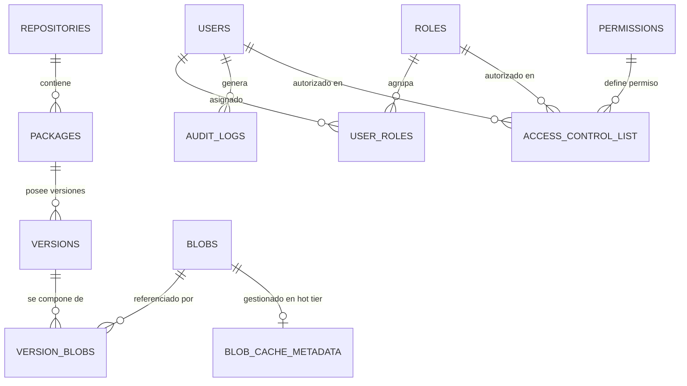

# 06. Modelo de Datos, Esquema Relacional y Metadatos JSONB

## 1. Arquitectura de Persistencia y Metadatos

La capa de metadatos de Kinara Registry está diseñada para combinar la integridad referencial y las transacciones ACID de una base de datos relacional (PostgreSQL en producción, SQLite en desarrollo/edge) con la flexibilidad semi-estructurada de campos **`JSONB`**.



---

## 2. Definición del Esquema DDL (SQL)

A continuación se detalla la estructura física de las tablas del sistema:

### 2.1. Gestión de Repositorios y Catálogo de Paquetes

```sql
-- Repositorios lógicos del sistema
CREATE TABLE repositories (
    id VARCHAR(36) PRIMARY KEY,
    name VARCHAR(128) NOT NULL UNIQUE,
    description TEXT,
    repo_type VARCHAR(16) NOT NULL CHECK (repo_type IN ('LOCAL', 'PROXY', 'VIRTUAL')),
    format VARCHAR(16) NOT NULL CHECK (format IN ('OCI', 'PYPI', 'NUGET', 'CARGO', 'GO')),
    upstream_url VARCHAR(512),                     -- NULL si es LOCAL o VIRTUAL
    virtual_default_target_id VARCHAR(36) REFERENCES repositories(id),
    is_active BOOLEAN NOT NULL DEFAULT TRUE,
    created_at TIMESTAMP WITH TIME ZONE DEFAULT CURRENT_TIMESTAMP,
    updated_at TIMESTAMP WITH TIME ZONE DEFAULT CURRENT_TIMESTAMP
);

-- Paquetes lógicos dentro de un repositorio
CREATE TABLE packages (
    id VARCHAR(36) PRIMARY KEY,
    repo_id VARCHAR(36) NOT NULL REFERENCES repositories(id) ON DELETE CASCADE,
    name VARCHAR(256) NOT NULL,
    normalized_name VARCHAR(256) NOT NULL,         -- Para búsquedas agnósticas (minúsculas, guiones)
    description TEXT,
    created_at TIMESTAMP WITH TIME ZONE DEFAULT CURRENT_TIMESTAMP,
    updated_at TIMESTAMP WITH TIME ZONE DEFAULT CURRENT_TIMESTAMP,
    CONSTRAINT uq_repo_package UNIQUE (repo_id, normalized_name)
);

-- Versiones específicas de un paquete
CREATE TABLE versions (
    id VARCHAR(36) PRIMARY KEY,
    package_id VARCHAR(36) NOT NULL REFERENCES packages(id) ON DELETE CASCADE,
    version_string VARCHAR(128) NOT NULL,          -- ej. 1.0.0, 2.1.0-beta.1
    is_yanked BOOLEAN NOT NULL DEFAULT FALSE,       -- Soporte de revocación (Cargo, PyPI, NuGet)
    is_latest BOOLEAN NOT NULL DEFAULT FALSE,
    metadata JSONB NOT NULL DEFAULT '{}'::jsonb,   -- Metadatos nativos flexibles
    created_at TIMESTAMP WITH TIME ZONE DEFAULT CURRENT_TIMESTAMP,
    updated_at TIMESTAMP WITH TIME ZONE DEFAULT CURRENT_TIMESTAMP,
    CONSTRAINT uq_package_version UNIQUE (package_id, version_string)
);
```

### 2.2. Almacenamiento Direccionable por Contenido (Capa CAS)

```sql
-- Bloques físicos únicos almacenados
CREATE TABLE blobs (
    sha256 VARCHAR(64) PRIMARY KEY,                -- Hash SHA-256 en minúsculas (64 caracteres)
    size_bytes BIGINT NOT NULL,
    storage_tier VARCHAR(16) NOT NULL DEFAULT 'WARM' CHECK (storage_tier IN ('HOT', 'WARM', 'COLD')),
    storage_path VARCHAR(512) NOT NULL,            -- Ruta física en S3/MinIO o PVC local
    compression VARCHAR(16) DEFAULT 'NONE' CHECK (compression IN ('NONE', 'GZIP', 'ZSTD')),
    created_at TIMESTAMP WITH TIME ZONE DEFAULT CURRENT_TIMESTAMP,
    last_accessed_at TIMESTAMP WITH TIME ZONE DEFAULT CURRENT_TIMESTAMP
);

-- Asociación Many-to-Many entre versiones y sus bloques o capas OCI
CREATE TABLE version_blobs (
    version_id VARCHAR(36) NOT NULL REFERENCES versions(id) ON DELETE CASCADE,
    blob_sha256 VARCHAR(64) NOT NULL REFERENCES blobs(sha256),
    chunk_order INT NOT NULL DEFAULT 0,            -- Orden de ensamble o índice de capa OCI
    logical_path VARCHAR(512) NOT NULL,            -- Nombre de archivo original o descriptor OCI
    part_type VARCHAR(32) NOT NULL DEFAULT 'LAYER' CHECK (part_type IN ('MANIFEST', 'CONFIG', 'LAYER', 'SOURCE', 'BINARY')),
    PRIMARY KEY (version_id, blob_sha256, logical_path)
);

-- Metadatos del Hot Tier (Caché Local NVMe) y control de evicción GDSF
CREATE TABLE blob_cache_metadata (
    blob_sha256 VARCHAR(64) PRIMARY KEY REFERENCES blobs(sha256) ON DELETE CASCADE,
    local_cache_path VARCHAR(512) NOT NULL,
    priority_score DOUBLE PRECISION NOT NULL DEFAULT 0.0,
    access_count BIGINT NOT NULL DEFAULT 1,
    last_accessed_at TIMESTAMP WITH TIME ZONE DEFAULT CURRENT_TIMESTAMP,
    cached_at TIMESTAMP WITH TIME ZONE DEFAULT CURRENT_TIMESTAMP
);
```

### 2.3. Auditoría de Operaciones

```sql
-- Trazabilidad de seguridad y cumplimiento normativo
CREATE TABLE audit_logs (
    id BIGSERIAL PRIMARY KEY,
    user_id VARCHAR(36),
    action VARCHAR(64) NOT NULL,                   -- ej. pkg:upload, pkg:download, repo:create
    resource_type VARCHAR(32) NOT NULL,            -- REPO, PACKAGE, VERSION, SYSTEM
    resource_id VARCHAR(256) NOT NULL,
    ip_address VARCHAR(45) NOT NULL,               -- Compatible con IPv4 e IPv6
    user_agent TEXT,
    details JSONB DEFAULT '{}'::jsonb,
    timestamp TIMESTAMP WITH TIME ZONE DEFAULT CURRENT_TIMESTAMP
);
```

---

## 3. Decisión de Diseño: Metadatos Nativos en Columnas `JSONB`

### 3.1. El Reto de la Heterogeneidad de Formatos
Cada formato de artefacto posee especificaciones de metadatos radicalmente distintas:
* **OCI / Docker:** `architecture`, `os`, `features`, `config.Env`, `RootFS.DiffIDs`.
* **PyPI (pip):** `requires_dist`, `classifiers`, `author_email`, `license`, `entry_points`.
* **Cargo (Rust):** `authors`, `edition`, `dependencies[].features`, `links`, `badges`.
* **NuGet (.NET):** `frameworkAssemblies`, `targetFramework`, `releaseNotes`.
* **Go Modules:** `go_version`, `require`, `replace`, `retract`.

### 3.2. Ventajas de `JSONB` sobre Tablas Relacionales Especializadas
1. **Evita Migraciones Traumáticas:** Si un ecosistema añade un nuevo campo en su especificación (como `retract` en Go 1.16 o PEP 658 en Python), Kinara no necesita alterar el esquema DDL de la base de datos con comandos `ALTER TABLE`.
2. **Consultas Indexadas con Índices GIN:**
   PostgreSQL permite crear índices **GIN** (*Generalized Inverted Index*) sobre la columna `metadata`:
   ```sql
   CREATE INDEX idx_versions_metadata_gin ON versions USING gin (metadata);
   ```
   Esto permite realizar búsquedas directas dentro del JSON en milisegundos:
   ```sql
   -- Buscar paquetes PyPI que dependan de 'numpy'
   SELECT * FROM versions 
   WHERE metadata @> '{"requires_dist": ["numpy"]}';
   ```
3. **Simplicidad en la Capa ORM / Repositorio:** El motor del registro serializa y deserializa structs fuertemente tipados en Go/Rust directamente al JSONB, acelerando el desarrollo y reduciendo la complejidad del código.

---

## 4. Estrategia de Índices para Rendimiento de Consulta

Para garantizar tiempos de respuesta inferiores a $5\text{ ms}$ en la resolución de paquetes:

```sql
-- Índices para resolución de consultas en API Gateways
CREATE INDEX idx_packages_normalized ON packages(repo_id, normalized_name);
CREATE INDEX idx_versions_package_latest ON versions(package_id, is_latest);
CREATE INDEX idx_version_blobs_version ON version_blobs(version_id);
CREATE INDEX idx_version_blobs_blob ON version_blobs(blob_sha256);

-- Índice para el recolector de basura (GC) y algoritmos de evicción
CREATE INDEX idx_blobs_last_accessed ON blobs(last_accessed_at);
CREATE INDEX idx_blob_cache_score ON blob_cache_metadata(priority_score ASC);
```
