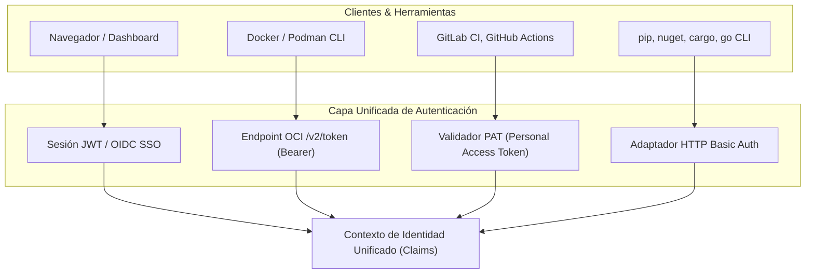
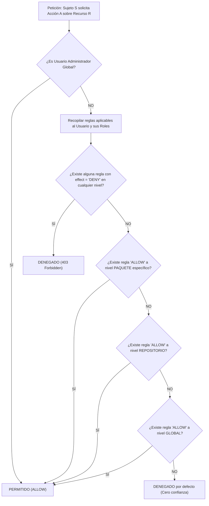

# 07. Seguridad, Autenticación y Control de Acceso Granular (ACL)

## 1. Modelo de Identidad y Autenticación

En un registro privado empresarial, conviven diversos tipos de consumidores con necesidades dispares: desarrolladores humanos mediante navegador web, agentes automatizados de CI/CD, y herramientas CLI nativas con protocolos de autenticación históricos (Basic Auth, Bearer Token, OCI challenge).

Kinara Registry proporciona una capa unificada de autenticación que soporta múltiples credenciales:



### 1.1. Personal Access Tokens (PAT)
* Diseñados para pipelines de CI/CD y uso en archivos de configuración de desarrollador (`.npmrc`, `pip.conf`).
* **Seguridad Criptográfica:** El token en texto plano (`knr_pat_xxxxxxxx`) sólo se muestra una vez al usuario al ser generado. En la base de datos se almacena únicamente su resumen criptográfico SHA-256.
* **Granularidad:** Cada PAT puede tener una fecha de caducidad estricta y un subconjunto delimitado de permisos (*scopes*).

### 1.2. Protocolo OCI Auth Challenge (`/v2/token`)
* Conforme a la especificación *Docker Registry HTTP API V2*.
* Cuando un cliente CLI ejecuta `docker login` o `docker pull`, el servidor responde inicialmente con `401 Unauthorized` y la cabecera:
  `Www-Authenticate: Bearer realm="https://registry.kinara.internal/v2/token",service="kinara-registry",scope="repository:mi-imagen:pull"`
* El cliente solicita el token en dicho endpoint aportando sus credenciales, y Kinara emite un JWT firmado temporal (ej. 1 hora de validez).

---

## 2. Esquema DDL para Control de Acceso Granular (ACL)

```sql
-- Usuarios del sistema
CREATE TABLE users (
    id VARCHAR(36) PRIMARY KEY,
    username VARCHAR(64) NOT NULL UNIQUE,
    email VARCHAR(255) NOT NULL UNIQUE,
    password_hash VARCHAR(255) NOT NULL,          -- Hashing con Argon2id
    is_active BOOLEAN NOT NULL DEFAULT TRUE,
    is_admin BOOLEAN NOT NULL DEFAULT FALSE,
    created_at TIMESTAMP WITH TIME ZONE DEFAULT CURRENT_TIMESTAMP,
    updated_at TIMESTAMP WITH TIME ZONE DEFAULT CURRENT_TIMESTAMP
);

-- Tokens de Acceso Personal (PAT)
CREATE TABLE personal_access_tokens (
    id VARCHAR(36) PRIMARY KEY,
    user_id VARCHAR(36) NOT NULL REFERENCES users(id) ON DELETE CASCADE,
    name VARCHAR(128) NOT NULL,
    token_hash VARCHAR(64) NOT NULL UNIQUE,        -- SHA-256 del token plano
    scopes JSONB NOT NULL DEFAULT '["*"]'::jsonb,
    expires_at TIMESTAMP WITH TIME ZONE,
    last_used_at TIMESTAMP WITH TIME ZONE,
    created_at TIMESTAMP WITH TIME ZONE DEFAULT CURRENT_TIMESTAMP
);

-- Roles del sistema
CREATE TABLE roles (
    id VARCHAR(36) PRIMARY KEY,
    name VARCHAR(64) NOT NULL UNIQUE,              -- ej. Developer, CI-Runner, Auditor, Reader
    description TEXT
);

-- Asignación de roles a usuarios
CREATE TABLE user_roles (
    user_id VARCHAR(36) NOT NULL REFERENCES users(id) ON DELETE CASCADE,
    role_id VARCHAR(36) NOT NULL REFERENCES roles(id) ON DELETE CASCADE,
    PRIMARY KEY (user_id, role_id)
);

-- Catálogo maestro de permisos del sistema
CREATE TABLE permissions (
    id VARCHAR(36) PRIMARY KEY,
    code VARCHAR(64) NOT NULL UNIQUE,              -- ej. pkg:download, pkg:upload, repo:admin
    description TEXT NOT NULL
);

-- Lista de Control de Acceso Granular (ACL)
CREATE TABLE access_control_list (
    id VARCHAR(36) PRIMARY KEY,
    subject_type VARCHAR(16) NOT NULL CHECK (subject_type IN ('USER', 'ROLE')),
    subject_id VARCHAR(36) NOT NULL,
    resource_type VARCHAR(16) NOT NULL CHECK (resource_type IN ('GLOBAL', 'REPOSITORY', 'PACKAGE')),
    resource_id VARCHAR(36),                       -- NULL si el recurso es GLOBAL
    permission_id VARCHAR(36) NOT NULL REFERENCES permissions(id) ON DELETE CASCADE,
    effect VARCHAR(8) NOT NULL DEFAULT 'ALLOW' CHECK (effect IN ('ALLOW', 'DENY')),
    created_at TIMESTAMP WITH TIME ZONE DEFAULT CURRENT_TIMESTAMP,
    CONSTRAINT uq_acl_rule UNIQUE (subject_type, subject_id, resource_type, resource_id, permission_id)
);
```

---

## 3. Algoritmo de Evaluación de Permisos (Deny-First)

Cuando un cliente intenta realizar una acción sobre un artefacto, Kinara evalúa los privilegios siguiendo el algoritmo **Deny-First Jerárquico**:



### Reglas Clave:
1. **Regla de Denegación Explícita (*Explicit Deny*):** Si cualquier rol asignado al usuario contiene un `DENY` para el recurso, la acción queda terminantemente denegada, sobreescribiendo cualquier `ALLOW`.
2. **Jerarquía de Especificidad:** La regla más específica prevalece:
   $$\text{Paquete} \succ \text{Repositorio} \succ \text{Global}$$
3. **Principio de Mínimo Privilegio:** Si no se encuentra ninguna coincidencia explícita de `ALLOW`, el acceso se deniega por defecto (*Implicit Deny*).

---

## 4. Matriz de Permisos del MVP

| Código del Permiso | Ámbito Típico | Descripción Operativa |
| :--- | :--- | :--- |
| `pkg:download` | Repositorio / Paquete | Permite descargar binarios (`pull`, `install`, `go get`). |
| `pkg:upload` | Repositorio / Paquete | Permite publicar nuevas versiones o paquetes (`push`, `publish`). |
| `pkg:delete` | Paquete / Versión | Permite revocar (*yank*) o eliminar versiones registradas. |
| `repo:read` | Repositorio | Permite listar el catálogo e índices de paquetes de un repositorio. |
| `repo:write` | Repositorio | Permite modificar la configuración o upstream de un repositorio. |
| `repo:admin` | Repositorio | Permite asignar permisos ACL dentro de ese repositorio específico. |
| `system:admin` | Global | Control total sobre la instancia, usuarios, nodos y almacenamiento. |
| `audit:read` | Global | Acceso de lectura al registro de auditoría (*Audit Logs*). |
