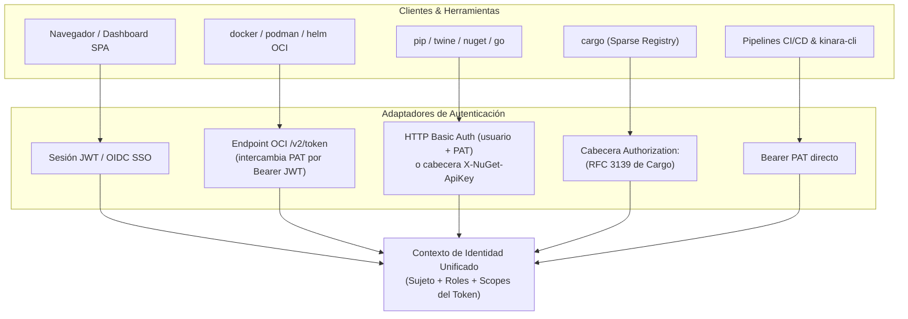
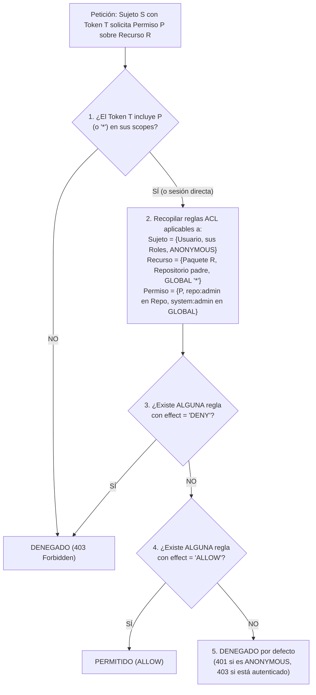

# 07. Seguridad, Autenticación y Control de Acceso Granular (ACL)

## 1. Modelo de Identidad y Autenticación

En un registro privado empresarial conviven consumidores con protocolos de autenticación dispares: desarrolladores humanos en el navegador web, agentes automatizados de CI/CD (cuentas de servicio) y herramientas CLI nativas.

Kinara Registry proporciona una capa unificada de autenticación que traduce cada protocolo al mismo contexto de identidad y alcances (*scopes*):



### 1.1. Personal Access Tokens (PAT) y Cuentas de Servicio
* Diseñados para archivos de configuración de clientes (`pip.conf`, `.docker/config.json`, `nuget.config`, `.cargo/config.toml`, `.netrc`) y pipelines de CI/CD.
* **Formato y Verificación Rápida:** El token (`knr_pat_<32 bytes aleatorios en base62>`) posee 256 bits de entropía criptográfica y sólo se muestra una vez al crearse. En la base de datos se almacena únicamente su resumen **SHA-256** (`token_hash`), lo que permite validarlo en microsegundos en cada petición HTTP sin coste de CPU ni memoria.
* **Cuentas de Servicio (*Service Accounts*):** Los pipelines de CI/CD se asocian a cuentas con `account_type = 'SERVICE'` (sin contraseña interactiva), de modo que sus tokens y permisos no dependan del ciclo de vida de un empleado concreto.
* **Intersección de Alcances (*Scopes*):** Cada PAT define un subconjunto de permisos (p. ej. `["pkg:download", "pkg:upload"]`) y una fecha de caducidad obligatoria o configurable. Un token **nunca** puede otorgar más privilegios de los que posee su titular en el ACL.

### 1.2. Contraseñas Interactivas y Protección frente a DoS por Argon2id
* Las contraseñas de usuarios humanos se almacenan con **Argon2id** ($t=3$, $m=64\text{ MB}$, $p=4$).
* **Separación estricta:** Verificar un hash Argon2id consume $\sim 50\text{ ms}$ y $64\text{ MB}$ de RAM; ejecutarlo en cada petición de `pip`, `cargo` o `go` convertiría cualquier pipeline de CI/CD en un vector de denegación de servicio (DoS). Por ello:
  * Argon2id **sólo** se ejecuta en los endpoints de inicio de sesión interactivo (`POST /api/v1/auth/login` y `GET /v2/token` cuando el usuario hace `docker login`), protegidos con limitación de tasa (*rate limiting*).
  * Los endpoints de datos de paquetes exigen un **PAT** (verificado con SHA-256) o un **JWT temporal** emitido tras el login.

### 1.3. Protocolo OCI Auth Challenge (`/v2/token`) y Claves Multi-Réplica
* Cuando `docker` o `podman` accede a `/v2/` sin credenciales, Kinara responde `401 Unauthorized` con:
  `WWW-Authenticate: Bearer realm="https://<host>/v2/token",service="kinara-registry",scope="repository:<repo>/<imagen>:pull,push"`
* El cliente se autentica contra `/v2/token` (aportando su PAT) y recibe un JWT firmado de corta duración (p. ej. 15–60 minutos) con los *claims* de acceso autorizados.
* **Claves compartidas entre réplicas:** Los pares de claves asimétricas (Ed25519 / ECDSA P-256) usados para firmar y verificar JWTs se almacenan en la tabla `signing_keys` (con la clave privada cifrada mediante AES-GCM usando la clave maestra `KINARA_MASTER_KEY`) e identificados por su cabecera `kid`. Así, un token emitido por la réplica A es válido inmediatamente en la réplica B y permite rotación sin caída.

### 1.4. Módulos Privados de Go (`GOPRIVATE` / `GONOSUMDB`)
* Para que el cliente `go` envíe credenciales (`.netrc` con PAT) y no intente consultar la base de datos pública `sum.golang.org` al descargar módulos internos, el asistente "Set Me Up" configura:
  * `GOPROXY=https://<host>/go/<repo-virtual>,direct`
  * `GONOSUMDB=github.com/mi-empresa/*` (coincidiendo con los prefijos internos registrados en `reserved_namespaces`).
* Para los módulos públicos servidos a través del proxy, Kinara reenvía las consultas de `/go/<repo>/sumdb/sum.golang.org/...` para preservar la verificación criptográfica oficial.

---

## 2. Esquema DDL de Identidad y Control de Acceso (ACL)

```sql
-- Usuarios humanos y cuentas de servicio (CI/CD)
CREATE TABLE users (
    id VARCHAR(36) PRIMARY KEY,
    username VARCHAR(64) NOT NULL UNIQUE,
    email VARCHAR(255) UNIQUE,                     -- NULL permitido en cuentas de servicio
    account_type VARCHAR(16) NOT NULL DEFAULT 'HUMAN' CHECK (account_type IN ('HUMAN', 'SERVICE')),
    password_hash VARCHAR(255),                    -- Argon2id; NULL en cuentas OIDC-only o SERVICE
    is_active BOOLEAN NOT NULL DEFAULT TRUE,
    created_at TIMESTAMP WITH TIME ZONE NOT NULL DEFAULT CURRENT_TIMESTAMP,
    updated_at TIMESTAMP WITH TIME ZONE NOT NULL DEFAULT CURRENT_TIMESTAMP
);

-- Vínculo con proveedores de identidad externos (OIDC / SSO)
CREATE TABLE user_identities (
    provider VARCHAR(64) NOT NULL,                 -- ej. 'oidc:okta', 'oidc:keycloak'
    subject VARCHAR(255) NOT NULL,                 -- claim 'sub' del IdP
    user_id VARCHAR(36) NOT NULL REFERENCES users(id) ON DELETE CASCADE,
    email VARCHAR(255),
    created_at TIMESTAMP WITH TIME ZONE NOT NULL DEFAULT CURRENT_TIMESTAMP,
    PRIMARY KEY (provider, subject)
);

-- Tokens de Acceso Personal (PAT)
CREATE TABLE personal_access_tokens (
    id VARCHAR(36) PRIMARY KEY,
    user_id VARCHAR(36) NOT NULL REFERENCES users(id) ON DELETE CASCADE,
    name VARCHAR(128) NOT NULL,
    token_prefix VARCHAR(16) NOT NULL,             -- Primeros caracteres para identificación visual
    token_hash VARCHAR(64) NOT NULL UNIQUE,        -- SHA-256 del token completo
    scopes JSONB NOT NULL DEFAULT '["*"]'::jsonb,  -- Lista de códigos de permiso autorizados al token
    expires_at TIMESTAMP WITH TIME ZONE,
    last_used_at TIMESTAMP WITH TIME ZONE,
    created_at TIMESTAMP WITH TIME ZONE NOT NULL DEFAULT CURRENT_TIMESTAMP
);

-- Claves de firma JWT compartidas entre réplicas
CREATE TABLE signing_keys (
    kid VARCHAR(64) PRIMARY KEY,
    algorithm VARCHAR(16) NOT NULL DEFAULT 'EdDSA',
    public_key BYTEA NOT NULL,
    encrypted_private_key BYTEA NOT NULL,          -- Cifrada con AES-256-GCM bajo KINARA_MASTER_KEY
    is_active BOOLEAN NOT NULL DEFAULT TRUE,
    created_at TIMESTAMP WITH TIME ZONE NOT NULL DEFAULT CURRENT_TIMESTAMP
);

-- Roles y equipos (un rol agrupa usuarios y recibe reglas ACL)
CREATE TABLE roles (
    id VARCHAR(36) PRIMARY KEY,
    name VARCHAR(64) NOT NULL UNIQUE,              -- ej. 'Platform-Admins', 'Team-Payments', 'CI-ReadOnly'
    description TEXT
);

CREATE TABLE user_roles (
    user_id VARCHAR(36) NOT NULL REFERENCES users(id) ON DELETE CASCADE,
    role_id VARCHAR(36) NOT NULL REFERENCES roles(id) ON DELETE CASCADE,
    PRIMARY KEY (user_id, role_id)
);

-- Catálogo maestro de permisos del sistema
CREATE TABLE permissions (
    id VARCHAR(36) PRIMARY KEY,
    code VARCHAR(64) NOT NULL UNIQUE,              -- ej. pkg:download, pkg:upload, system:admin
    description TEXT NOT NULL
);

-- Lista de Control de Acceso Granular (ACL)
-- Nota: Para evitar que NULL en columnas de la restricción UNIQUE permita duplicados en SQL,
-- se emplea el valor centinela '*' tanto para subject_id (cuando subject_type = 'ANONYMOUS')
-- como para resource_id (cuando resource_type = 'GLOBAL').
CREATE TABLE access_control_list (
    id VARCHAR(36) PRIMARY KEY,
    subject_type VARCHAR(16) NOT NULL CHECK (subject_type IN ('USER', 'ROLE', 'ANONYMOUS')),
    subject_id VARCHAR(36) NOT NULL DEFAULT '*',   -- ID de usuario/rol, o '*' si es ANONYMOUS
    resource_type VARCHAR(16) NOT NULL CHECK (resource_type IN ('GLOBAL', 'REPOSITORY', 'PACKAGE')),
    resource_id VARCHAR(36) NOT NULL DEFAULT '*',  -- ID de repo/paquete, o '*' si es GLOBAL
    permission_id VARCHAR(36) NOT NULL REFERENCES permissions(id) ON DELETE CASCADE,
    effect VARCHAR(8) NOT NULL DEFAULT 'ALLOW' CHECK (effect IN ('ALLOW', 'DENY')),
    created_at TIMESTAMP WITH TIME ZONE NOT NULL DEFAULT CURRENT_TIMESTAMP,
    CONSTRAINT uq_acl_rule UNIQUE (subject_type, subject_id, resource_type, resource_id, permission_id),
    CONSTRAINT chk_acl_anonymous CHECK (
        (subject_type = 'ANONYMOUS' AND subject_id = '*') OR
        (subject_type IN ('USER', 'ROLE') AND subject_id <> '*')
    ),
    CONSTRAINT chk_acl_global CHECK (
        (resource_type = 'GLOBAL' AND resource_id = '*') OR
        (resource_type IN ('REPOSITORY', 'PACKAGE') AND resource_id <> '*')
    )
);
```

> [!IMPORTANT]
> Se elimina la columna booleana `users.is_admin`. La condición de administrador global se representa de una única forma en todo el sistema: poseer el permiso `system:admin` con ámbito `GLOBAL` (`resource_id = '*'`), asignado directamente al usuario o a través de un rol.

---

## 3. Algoritmo de Evaluación de Permisos (Deny-Overrides)

Para evitar ambigüedades entre jerarquía de especificidad y denegación explícita, Kinara adopta un modelo determinista **Deny-Overrides sobre la Cadena de Recursos** combinado con **Intersección de Scopes del Token**:

$$\text{Permiso Efectivo} = \text{Scopes}(\text{Token}) \cap \text{ACL}(\text{Sujeto}, \{\text{Paquete}, \text{Repositorio}, \text{Global}\})$$



### Reglas Invariantes del Evaluador:
1. **Techo de Scopes del Token:** Un PAT o JWT nunca puede ejecutar una acción fuera de sus `scopes`, incluso si el usuario titular posee `system:admin`.
2. **Prioridad Absoluta de `DENY` (*Deny-Overrides*):** Un `DENY` explícito en cualquier nivel aplicable (Global, Repositorio o Paquete) o en cualquiera de los roles del usuario prevalece siempre sobre cualquier `ALLOW`. Si se desea conceder acceso únicamente a un paquete concreto dentro de un repositorio restringido, basta con **no** otorgar `ALLOW` a nivel de repositorio (la ausencia de regla ya deniega por defecto) y otorgar `ALLOW` únicamente sobre ese paquete.
3. **Herencia de `ALLOW` hacia Abajo:** En ausencia de un `DENY`, un `ALLOW` otorgado a nivel `GLOBAL` habilita todos los repositorios, y un `ALLOW` a nivel `REPOSITORY` habilita todos los paquetes de ese repositorio. Asimismo, `system:admin` en `GLOBAL` implica todos los permisos, y `repo:admin` en un repositorio implica todos los permisos dentro de dicho repositorio.
4. **Acceso Público / Anónimo:** Si una petición llega sin credenciales, se evalúa únicamente el sujeto `ANONYMOUS` (`subject_id = '*'`). Esto permite configurar repositorios de lectura pública otorgando `ALLOW` de `repo:read` y `pkg:download` a `ANONYMOUS` sobre ese repositorio.

### 3.1. Evaluación de Permisos en Repositorios Virtuales
Un repositorio virtual no almacena paquetes propios; agrupa repositorios miembros:
* **Lectura (`pkg:download`, `repo:read`):** El solicitante debe tener permiso en el **repositorio virtual** **y** en el **repositorio miembro** que finalmente sirve el paquete.
* **Interacción con la protección *Local-First*:** La comprobación de si un paquete existe en algún miembro local ([`04`](file:///home/cesar/Projects/Kinara-Registry/Planification/04-tipos-de-repositorios.md) §4.2) se ejecuta **sin filtrar por los permisos del solicitante**. Si el paquete existe en un miembro local al que el solicitante no tiene acceso, Kinara **bloquea igualmente la consulta a los proxies** y devuelve `403`/`404`, impidiendo que la falta de permisos provoque la descarga de un paquete homónimo público.
* **Escritura (`pkg:upload`):** El solicitante debe tener `pkg:upload` tanto en el repositorio virtual como en su repositorio local destino (`virtual_default_target_id`).

### 3.2. Autorización de Blobs en el CAS Global
Dado que el CAS deduplica físicamente entre todos los repositorios:
* Ninguna operación de lectura o comprobación de existencia de un blob (`GET` o `HEAD /v2/<repo>/<name>/blobs/<digest>`) consulta únicamente la tabla física `blobs`: exige permiso `pkg:download` sobre `<repo>` (o sobre el paquete) **y** la existencia del vínculo `(repo_id, blob_sha256)` en `repository_blobs`.
* El montaje cruzado de capas en OCI (`POST /v2/<repo-destino>/<name>/blobs/uploads/?mount=<digest>&from=<repo-origen>`) exige `pkg:upload` en `<repo-destino>`, `pkg:download` en `<repo-origen>` y que el blob esté vinculado a `<repo-origen>` en `repository_blobs`. Si no se cumple, Kinara no revela si el digest existe y responde `202 Accepted` iniciando una subida normal.

---

## 4. Matriz de Permisos del Sistema

| Código del Permiso | `resource_type` Válido | Descripción Operativa |
| :--- | :--- | :--- |
| `pkg:download` | `GLOBAL`, `REPOSITORY`, `PACKAGE` | Descargar artefactos, manifests y capas (`pull`, `install`, `go get`, `cargo fetch`). |
| `pkg:upload` | `GLOBAL`, `REPOSITORY`, `PACKAGE` | Publicar nuevas versiones, etiquetas o paquetes (`push`, `publish`). |
| `pkg:delete` | `GLOBAL`, `REPOSITORY`, `PACKAGE` | Revocar (*yank*) o eliminar versiones/etiquetas de un paquete o repositorio. |
| `repo:read` | `GLOBAL`, `REPOSITORY` | Consultar índices, listados de paquetes y metadatos del repositorio. |
| `repo:write` | `GLOBAL`, `REPOSITORY` | Crear o modificar la configuración, miembros o upstream de un repositorio. |
| `repo:admin` | `GLOBAL`, `REPOSITORY` | Gestionar reglas ACL y políticas de retención dentro de ese repositorio. |
| `system:admin` | `GLOBAL` | Control total sobre la instancia, usuarios, roles, espacios reservados y almacenamiento. |
| `audit:read` | `GLOBAL`, `REPOSITORY` | Consultar el registro de auditoría (`audit_logs`). |
