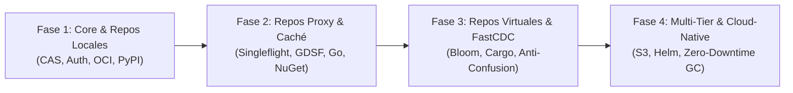

# 08. Hoja de Ruta de Desarrollo e Hitos de Ingeniería

## 1. Estrategia de Implementación

Para asegurar un desarrollo ordenado y mitigar riesgos técnicos, el proyecto **Kinara Registry** se estructura en cuatro fases incrementales. Cada fase construye sobre la anterior, garantizando entregables funcionales desde la primera etapa.

---

## 2. Desglose de Fases e Hitos Técnicos

### Fase 1: Cimientos del Core y Repositorios Locales (MVP Base)
* **Objetivo:** Establecer la infraestructura base, el almacenamiento inmutable CAS y la capacidad de alojar paquetes privados internos.
* **Entregables de Ingeniería:**
  1. **Persistencia y Migraciones:** Implementación de esquemas DDL en PostgreSQL y SQLite para las tablas principales (`repositories`, `packages`, `versions`, `blobs`, `version_blobs`, `users`, `permissions`, `acl`).
  2. **Motor CAS Primario:** Implementación del pipeline de subida atómica con cálculo incremental de SHA-256 en streaming.
  3. **Módulo de Autenticación:** Generación y validación de tokens de acceso personal (PAT) y Basic Auth.
  4. **Adaptador OCI v2 Básico:** Soporte de las rutas `/v2/` para subida (`docker push`) y descarga (`docker pull`) de imágenes y artefactos.
  5. **Adaptador PyPI Básico:** Implementación de la API de repositorio simple (PEP 503) y endpoints de subida para archivos Wheel (`.whl`) y sdist.
* **Criterio de Aceptación (DoD):** Un desarrollador puede ejecutar `docker push/pull` y `pip install/twine upload` contra un repositorio local de Kinara.

---

### Fase 2: Repositorios Proxy y Algoritmos de Aceleración de Caché
* **Objetivo:** Permitir que Kinara actúe como un acelerador y espejo seguro de dependencias públicas externas con tolerancia a caídas de red.
* **Entregables de Ingeniería:**
  1. **Motor de Repositorio Proxy:** Cliente HTTP upstream resiliente con reintentos y retroceso exponencial (*exponential backoff*).
  2. **Request Coalescing (Singleflight):** Eliminación de estampidas de solicitudes concurrentes hacia el mismo artefacto.
  3. **Cut-Through Streaming:** Tubería de transmisión concurrente entre el upstream, el cliente y el CAS.
  4. **Evicción Inteligente GDSF:** Implementación del algoritmo *GreedyDual-Size with Frequency* con cola de prioridad para gestionar la cuota de disco local.
  5. **Adaptadores Go & NuGet:** Soporte para Go Module Proxy Protocol (`@v/list`, `.mod`, `.zip`) y NuGet Server API v3.
* **Criterio de Aceptación (DoD):** Construir una imagen de Docker o compilar un proyecto Go/C# apuntando a Kinara Proxy descarga las dependencias y las sirve desde caché en subsiguientes ejecuciones sin tocar internet.

---

### Fase 3: Repositorios Virtuales, Deduplicación FastCDC y Seguridad Avanzada
* **Objetivo:** Unificar la experiencia del desarrollador bajo endpoints agregados únicos, optimizar el uso de disco y blindar contra ataques de seguridad.
* **Entregables de Ingeniería:**
  1. **Enrutador de Repositorios Virtuales:** Mecanismo de agrupación lógica con orden de precedencia y resolución de dependencias.
  2. **Filtros de Bloom en Memoria RAM:** Validación de presencia de paquetes en sub-repositorios en $< 0.05\text{ ms}$.
  3. **Blindaje contra Dependency Confusion:** Política estricta *Local-First* y control de prefijos corporativos reservados.
  4. **Deduplicación por Bloques Variables (FastCDC):** Integración de Gear Rolling Hash para sub-chunking de artefactos grandes.
  5. **Adaptador Cargo (Rust):** Implementación del protocolo Sparse Registry y publicación de crates.
* **Criterio de Aceptación (DoD):** Un solo endpoint virtual sirve paquetes locales y externos con deduplicación transparente y bloqueo garantizado de nombres colisionados maliciosos.

---

### Fase 4: Producción, Alta Disponibilidad y Resiliencia Cloud-Native
* **Objetivo:** Preparar la plataforma para despliegues empresariales masivos, automatización de ciclo de vida e integración en la nube.
* **Entregables de Ingeniería:**
  1. **Multi-Tier Storage:** Integración activa con AWS S3, MinIO y Cloudflare R2 con soporte para redirección a Presigned URLs.
  2. **Zero-Downtime Garbage Collection:** Servicio en segundo plano de dos fases (Mark-and-Sweep) con período de gracia de 24h para eliminación de bloques huérfanos.
  3. **Despliegue Zero-Config:**
     * `docker-compose.yml` de un comando con persistencia configurada.
     * Helm Chart de Kubernetes con StatefulSets/Deployments, Ingress y escalado horizontal (HPA).
  4. **Dashboard Web SPA & "Set Me Up":** Interfaz de usuario para gestión visual de repositorios, métricas de deduplicación y generador de comandos de configuración rápida.
  5. **Auditoría y Telemetría:** Exportador de métricas Prometheus y trazas OpenTelemetry.
* **Criterio de Aceptación (DoD):** Despliegue verificado en un clúster Kubernetes con Helm, superando pruebas de carga de 10,000 req/s con cero degradación de datos.

---

## 3. Matriz de Definición de Terminado (Definition of Done - DoD)

Para considerar completada cualquier tarea o funcionalidad del roadmap, debe cumplir con los siguientes requisitos:

* [ ] **Código y Arquitectura:** Implementado respetando la separación entre Plano de Control y Plano de Datos.
* [ ] **Pruebas Automatizadas:** Cobertura de pruebas unitarias $\ge 80\%$ y pruebas de integración de extremo a extremo (E2E) con clientes CLI oficiales (`docker`, `pip`, `cargo`, etc.).
* [ ] **Idempotencia e Integridad:** Verificación de hashes SHA-256 en subidas y atomicidad en base de datos.
* [ ] **Métricas y Logs:** Registro estructurado de eventos en `audit_logs` e instrumentación de métricas de latencia.
* [ ] **Documentación:** Actualización de guías operativas y asistentes "Set Me Up".
