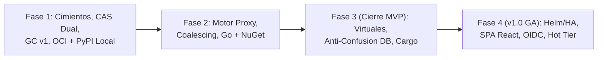

# 08. Hoja de Ruta de Desarrollo e Hitos de Ingeniería

## 1. Estrategia de Implementación

El desarrollo de **Kinara Registry** se organiza en cuatro fases incrementales diseñadas para que ninguna funcionalidad dependa de cimientos planificados en una fase posterior:
* **MVP = Fases 1 a 3:** Cubre los 5 formatos (OCI, PyPI, Go, NuGet, Cargo) en sus tres tipos de repositorio (Local, Proxy, Virtual) con seguridad completa, recolección de basura y despliegue con un comando.
* **v1.0 (GA) = Fase 4:** Añade alta disponibilidad multi-réplica en Kubernetes, Dashboard Web SPA completo, SSO corporativo (OIDC), Hot Tier NVMe y redirecciones con URLs prefirmadas.

> [!NOTE]
> La hoja de ruta define el orden de dependencias técnicas y los criterios de aceptación verificables por fase, sin fijar estimaciones de calendario a priori hasta dimensionar el equipo asignado a cada fase.

---

## 2. Desglose de Fases e Hitos Técnicos

### Fase 1: Cimientos del Core, Almacenamiento Dual y Repositorios Locales (OCI + PyPI)
* **Objetivo:** Establecer el modelo de datos definitivo, la abstracción de almacenamiento (disco local y S3), la seguridad base, el recolector de basura sin carreras y el alojamiento local de contenedores y paquetes Python ejecutables con `docker compose up -d`.
* **Entregables de Ingeniería:**
  1. **Persistencia y Migraciones Duales:** Árboles de migraciones para PostgreSQL (`migrations/postgres/`) y SQLite WAL (`migrations/sqlite/`) cubriendo el esquema base completo ([`06`](file:///home/cesar/Projects/Kinara-Registry/Planification/06-modelo-datos-y-esquema-db.md) y [`07`](file:///home/cesar/Projects/Kinara-Registry/Planification/07-seguridad-autenticacion-y-acl.md)): repositorios, paquetes, versiones, `version_files`, `blobs`, `repository_blobs`, `upload_sessions`, tablas nativas OCI, usuarios, PATs, `signing_keys`, ACL y `audit_logs`.
  2. **Interfaz `DataPlane` y Motor CAS de Fichero Completo:** Abstracción de almacenamiento con dos backends desde el primer día —sistema de ficheros local y S3-compatible (AWS S3, Cloudflare R2, Garage, MinIO, SeaweedFS)—, sesiones de subida reanudables con estado SHA-256 serializado y autorización de blobs por repositorio (`repository_blobs`).
  3. **Autenticación, Token Endpoint y ACL:**
     * Personal Access Tokens (PAT) verificados por SHA-256, cuentas de servicio y login interactivo con Argon2id y *rate limiting*.
     * Endpoint OCI `/v2/token` con claves firmantes compartidas en `signing_keys`.
     * Evaluador de permisos determinista **Deny-Overrides** con intersección de *scopes* del token.
  4. **Adaptador OCI v2 Local:** Subida de blobs monolítica y por fragmentos, montaje entre repositorios autorizado, etiquetas mutables (`oci_tags`), manifests e índices multi-arquitectura (`oci_manifests`, `oci_manifest_refs`) y `Range Requests` (RFC 9110).
  5. **Adaptador PyPI Local:** Simple Repository API (PEP 503 y JSON PEP 691), servicio de metadatos declarativos (PEP 658) y subida `legacy` compatible con `twine` / `uv publish`.
  6. **Garbage Collection v1 (con Leases):** Worker asíncrono con elección de líder, limpieza de `upload_sessions` caducadas y barrido atómico basado en `blobs.last_referenced_at` ([`05`](file:///home/cesar/Projects/Kinara-Registry/Planification/05-algoritmos-y-optimizaciones.md) §6).
  7. **Despliegue Zero-Config, API Admin, CLI Base y Observabilidad:**
     * `deploy/docker-compose/` funcional de un solo comando.
     * API REST de administración (`/api/v1/repos`, `/api/v1/users`, `/api/v1/pats`) y primera versión de `kinara-cli` (`login`, `repo create/list/delete`, `pat create`, `admin gc`).
     * Registro en `audit_logs`, amortiguación de escrituras de acceso en lotes y endpoint `/metrics` de Prometheus.
* **Criterio de Aceptación (DoD Fase 1):**
  * Levantar el entorno con `docker compose up -d` (tanto con SQLite + volumen local como con PostgreSQL + Garage/S3) y ejecutar con éxito `docker push`/`docker pull` (incluyendo una imagen multi-arquitectura) y `twine upload`/`pip install` contra repositorios locales.
  * Prueba automatizada de concurrencia que verifica que el GC no elimina un blob antiguo mientras una nueva subida lo reutiliza por deduplicación.

---

### Fase 2: Repositorios Proxy, Coalescing y Ecosistemas Go & NuGet
* **Objetivo:** Permitir que Kinara actúe como caché transparente y resiliente de registros públicos externos, e incorporar soporte completo (Local y Proxy) para Go y .NET.
* **Entregables de Ingeniería:**
  1. **Motor de Repositorio Proxy y Caché de Metadatos:** Cliente HTTP upstream con reintentos, credenciales upstream (`upstream_auth` para mitigar límites de tasa de Docker Hub), caché de metadatos con `metadata_ttl` y revalidación condicional (`ETag`), caché negativa (`negative_ttl`), modo `offline` y política `stale_if_error` (`proxy_metadata_cache`).
  2. **Coalescing de Descargas y Cut-Through Verificado:** `singleflight` para metadatos e **Inflight Registry sobre fichero de staging** para blobs ([`05`](file:///home/cesar/Projects/Kinara-Registry/Planification/05-algoritmos-y-optimizaciones.md) §4), donde lectores lentos y tardíos leen desde el offset 0 sin bloquearse entre sí y el blob sólo entra en el CAS tras verificar su SHA-256.
  3. **Worker de Retención y Cuotas:** Limpieza automática de blobs y metadatos de caché proxy según antigüedad de último acceso y cuota máxima por repositorio.
  4. **Adaptador Go Modules (Proxy + Local):**
     * Protocolo GOPROXY (`@v/list`, `.info`, `.mod`, `.zip`) y paso a través de `/sumdb/` hacia `sum.golang.org`.
     * Publicación de módulos internos en repositorios Go locales mediante API de Kinara y `kinara-cli go publish`.
  5. **Adaptador NuGet v3 (Local + Proxy):** Service Index (`index.json`), Registration SemVer 2.0, Package Content (`.nupkg`/`.snupkg`) y endpoints de publicación/borrado (`dotnet nuget push`/`delete`).
* **Criterio de Aceptación (DoD Fase 2):**
  * Construir una imagen Docker, instalar paquetes con `pip`, compilar un módulo Go (`GOPROXY`) y restaurar una solución .NET (`dotnet restore`) a través de repositorios Proxy; activar después `offline = true` (o cortar la salida a internet del contenedor) y repetir las descargas en frío desde el cliente con éxito íntegro desde la caché local.
  * Publicar y consumir un módulo Go interno y un paquete `.nupkg` interno en repositorios Locales.

---

### Fase 3: Repositorios Virtuales, Blindaje Anti-Confusion y Cargo (Cierre del MVP)
* **Objetivo:** Unificar el consumo y la publicación bajo endpoints virtuales únicos por formato, blindar la resolución frente a ataques de *Dependency Confusion* y completar el quinto ecosistema del MVP (Rust / Cargo).
* **Entregables de Ingeniería:**
  1. **Enrutador de Repositorios Virtuales:** Agrupación ordenada de repositorios locales y proxies del mismo formato (`virtual_repo_members`), resolución de primera coincidencia por paquete, evaluación de ACL por miembro y enrutamiento de subidas al `virtual_default_target_id`.
  2. **Blindaje contra Dependency Confusion:**
     * Normalización de nombres por formato ([`06`](file:///home/cesar/Projects/Kinara-Registry/Planification/06-modelo-datos-y-esquema-db.md) §5.1).
     * Comprobación *Local-First* autoritativa en base de datos acotada a los miembros locales del repositorio virtual (bloqueando la consulta a proxies incluso cuando el solicitante carece de permiso de lectura en el miembro local).
     * Gestión de prefijos corporativos en `reserved_namespaces`.
  3. **Adaptador Cargo Sparse Registry (Local + Proxy):**
     * Índice Sparse HTTP (`config.json` + ficheros por crate), descarga de `.crate`, API de publicación (`PUT /api/v1/crates/new`), revocación (`DELETE .../yank` y `unyank`) y autenticación nativa `Authorization: <PAT>` (RFC 3139).
     * Proxy caché del índice sparse de `index.crates.io` y descarga de crates desde `static.crates.io`.
  4. **Asistentes "Set Me Up" en API y CLI:** Generación automática de fragmentos de configuración para los 5 formatos (`kinara-cli setup [docker|pypi|nuget|go|cargo]`).
* **Criterio de Aceptación (DoD Fase 3 — Hito MVP Completo):**
  * Configurar cada uno de los 5 clientes oficiales (`docker`, `pip`, `dotnet`, `go`, `cargo`) contra un **único** endpoint virtual y verificar subida de paquetes internos y descarga transparente tanto de paquetes internos como públicos.
  * Suite de pruebas de seguridad automatizada que verifica el bloqueo de un paquete público con versión superior (`99.9.9`) cuando existe un homónimo (incluyendo variantes de guiones/mayúsculas) en un miembro local o coincide con un prefijo reservado.

---

### Fase 4: Producción Cloud-Native, Alta Disponibilidad y Dashboard Web (v1.0 GA)
* **Objetivo:** Preparar la plataforma para despliegues empresariales multi-réplica en Kubernetes, añadir el Dashboard Web SPA e integrar capacidades avanzadas de rendimiento y gobierno.
* **Entregables de Ingeniería:**
  1. **Helm Chart Oficial (`deploy/helm/kinara`) y Alta Disponibilidad Multi-Réplica:**
     * Despliegue con `HPA` en pods de API/Data Plane, integración con PgBouncer, continuidad de subidas OCI fragmentadas entre réplicas sobre S3 Multipart Upload y elección de líder en workers.
  2. **URLs Prefirmadas y Hot Tier NVMe (GDSF):**
     * Redirección opcional `307 Temporary Redirect` hacia URLs prefirmadas de S3 por repositorio (`presigned_redirects`).
     * Caché opcional en disco NVMe local por nodo del Data Plane gestionada con el algoritmo **GDSF** ([`05`](file:///home/cesar/Projects/Kinara-Registry/Planification/05-algoritmos-y-optimizaciones.md) §2).
  3. **Dashboard Web SPA (React 19 + TypeScript + Vite):**
     * Explorador y buscador facetado de repositorios, paquetes, versiones, capas OCI y dependencias.
     * Asistente interactivo "Set Me Up", gestión visual *drag-and-drop* de miembros de repositorios virtuales, administración de usuarios/roles/ACL/PATs y paneles de métricas de deduplicación y caché.
  4. **Gobierno Empresarial y Operación en Producción:**
     * Autenticación corporativa **OIDC / SSO** (`user_identities`).
     * Soporte de **OCI v1.1 Referrers API** (`/v2/<repo>/<name>/referrers/<digest>`) para adjuntar y descubrir firmas (`cosign`, `notation`) y SBOMs.
     * Limitación de tasa (*rate limiting*) configurable por IP/token, exportación de trazas **OpenTelemetry** y dashboards Grafana.
     * Procedimiento y herramientas de **Backup / Restore consistente** (snapshot de base de datos + backup del bucket S3 respetando la ventana de gracia del GC) y estrategia de **actualización sin caída** (migraciones de esquema *forward-only* compatibles con la versión $N-1$).
* **Criterio de Aceptación (DoD Fase 4 — v1.0 GA):**
  * Despliegue en un clúster Kubernetes mediante Helm con $\ge 3$ réplicas activas superando pruebas de caos (caída de una réplica a mitad de un `docker push` multiparte y durante una elección de líder de GC) sin pérdida ni corrupción de datos.
  * Superación del **Perfil de Carga de Referencia** (valores objetivo iniciales, sujetos a calibración con el hardware de referencia: 3 réplicas de `kinara` con 2 vCPU / 2 GB RAM cada una, PostgreSQL y S3):
    * **Carga de metadatos (80% lecturas de índices/tags cacheados, 20% resoluciones en DB):** $\ge 2,000\text{ req/s}$ sostenidas con latencia $p_{99} < 25\text{ ms}$ y $0\%$ de errores 5xx.
    * **Carga de transferencia de blobs:** saturación del enlace de red de los nodos ($\ge 10\text{ Gbps}$ agregados en streaming o $> 5,000\text{ redirecciones/s}$ con Presigned URLs) manteniendo el consumo de RAM por réplica por debajo de $512\text{ MB}$.

---

## 3. Matriz de Definición de Terminado (Definition of Done - DoD)

Cada entregable de una fase debe cumplir los siguientes requisitos antes de darse por completado:

* [ ] **Separación de Planos:** Toda operación sobre blobs se realiza exclusivamente a través de la interfaz interna `DataPlane` y verifica la autorización en `repository_blobs`.
* [ ] **Compatibilidad Dual de Base de Datos:** Migraciones y pruebas de repositorio ejecutadas en CI tanto contra **PostgreSQL** como contra **SQLite WAL**.
* [ ] **Pruebas Automatizadas:** Cobertura unitaria $\ge 80\%$ en los paquetes modificados y pruebas de integración E2E con los clientes CLI oficiales de los formatos incluidos hasta esa fase (`docker`/`pip` en F1; `+ go`/`dotnet` en F2; `+ cargo` en F3).
* [ ] **Integridad Criptográfica:** Verificación de SHA-256 en streaming antes de confirmar en el CAS y actualización atómica de `last_referenced_at`.
* [ ] **Observabilidad y Auditoría:** Eventos de mutación registrados en `audit_logs` y métricas Prometheus de latencia y errores expuestas desde la Fase 1.
* [ ] **Documentación:** Actualización de la documentación técnica y de las plantillas del asistente "Set Me Up".

---

## 4. Backlog Post-v1.0 (Fuera del Alcance Inicial)

Las siguientes capacidades quedan explícitamente fuera del MVP y de la versión 1.0 para proteger el foco de entrega:

1. **Replicación y Federación entre Instancias:** Replicación asíncrona push/pull de repositorios entre múltiples instancias geográficas de Kinara.
2. **Escaneo de Vulnerabilidades Integrado:** Integración mediante webhooks o workers con motores CVE (Trivy, Grype, OSV) sobre artefactos subidos. *(Nota: el verificador periódico incluido en el MVP comprueba la integridad SHA-256 de los blobs, no vulnerabilidades CVE).*
3. **Políticas de Admisión por Firma:** Bloqueo de descargas o despliegues si una imagen OCI no cuenta con una firma válida verificada mediante Referrers.
4. **Nuevos Ecosistemas de Paquetes:** npm / pnpm, Maven / Gradle, Helm clásico (`index.yaml`), Debian (APT), RPM (YUM/DNF) y RubyGems.
5. **Optimizaciones Experimentales de Almacenamiento:** Deduplicación sub-fichero con FastCDC para artefactos sin comprimir, Cold Tier con clases S3 de recuperación instantánea y pistas en memoria con Filtros de Bloom ([`05`](file:///home/cesar/Projects/Kinara-Registry/Planification/05-algoritmos-y-optimizaciones.md) §7).
