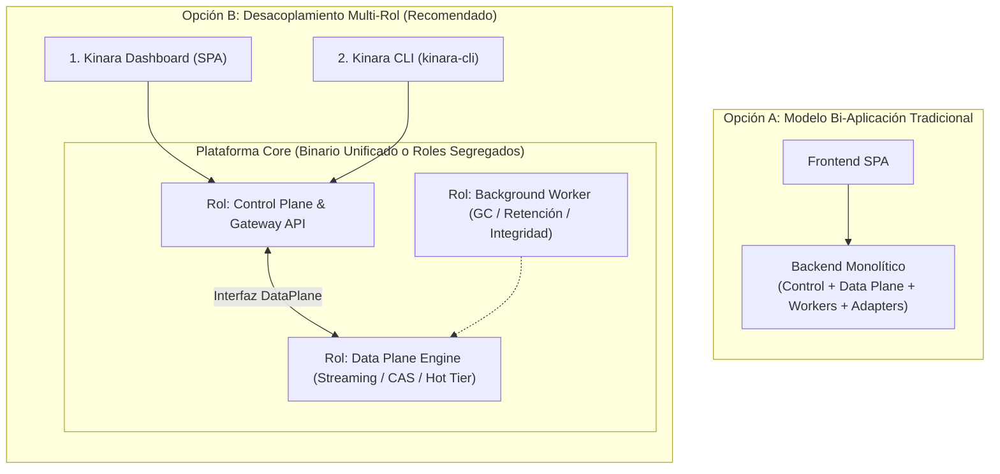
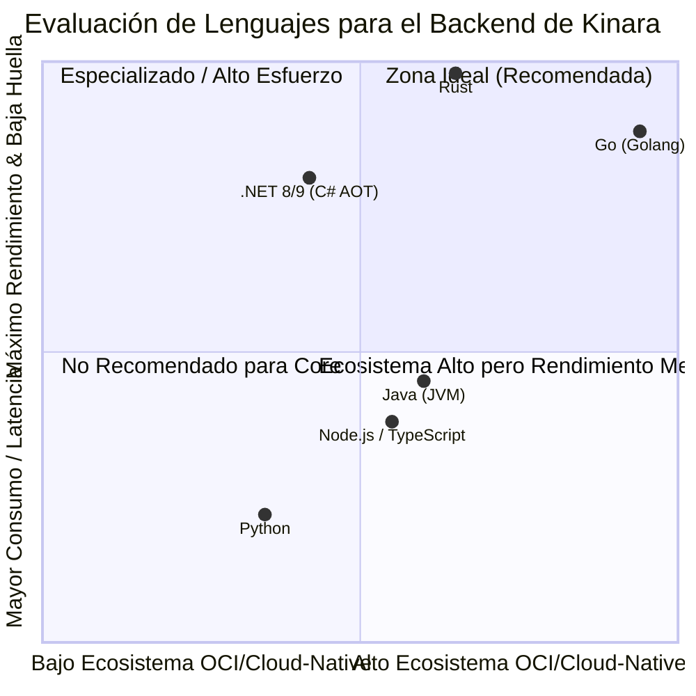
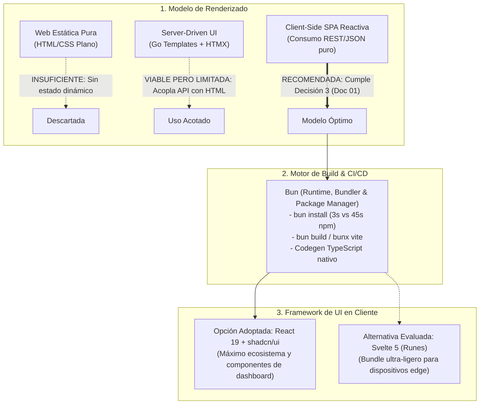
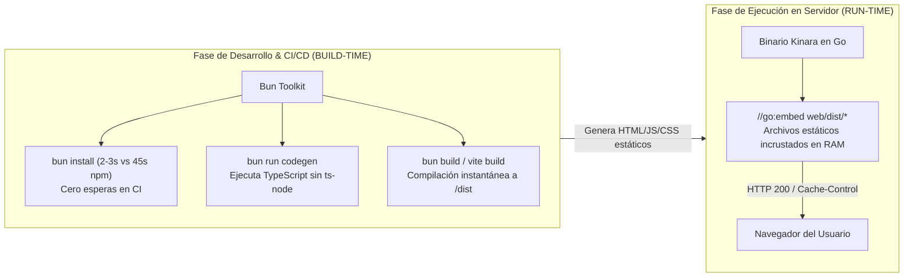

# 09. Investigación Arquitectónica: Desacoplamiento de Aplicaciones y Stack Tecnológico

## 1. Resumen Ejecutivo y Objeto del Estudio

El presente documento evalúa la viabilidad técnica, los compromisos de ingeniería (*trade-offs*) y las recomendaciones de tecnologías para la composición de aplicaciones en **Kinara Registry**.

La premisa inicial del proyecto planteaba una arquitectura clásica de dos componentes:
1. **Un Backend monolítico (API):** Encargado de la lógica de negocio, enrutamiento de protocolos, procesamiento de datos pesados y tareas en segundo plano.
2. **Un Frontend (Dashboard Web UI):** Encargado de la visualización del registro, exploración de paquetes y configuración del desarrollador.

Tras contrastar esta idea con los requisitos definidos en los documentos previos —especialmente la **Separación de Planos** ([`02-arquitectura-del-sistema.md`](file:///home/cesar/Projects/Kinara-Registry/Planification/02-arquitectura-del-sistema.md)), el almacenamiento **CAS de fichero completo**, el *coalescing* sobre fichero de staging y el recolector **Zero-Downtime GC con leases** ([`05-algoritmos-y-optimizaciones.md`](file:///home/cesar/Projects/Kinara-Registry/Planification/05-algoritmos-y-optimizaciones.md)) y los pilares de **Despliegue Zero-Config** y **Baja Huella de Recursos** ([`01-vision-y-alcance.md`](file:///home/cesar/Projects/Kinara-Registry/Planification/01-vision-y-alcance.md))—, se concluye que:

> [!IMPORTANT]
> Un monolito estricto de una sola aplicación backend corre el riesgo de degradar la experiencia de usuario y la estabilidad operativa al mezclar transferencia de datos masiva (*streaming I/O* de gigabytes) con la API transaccional de metadatos y tareas pesadas de mantenimiento en segundo plano. No obstante, fragmentar el sistema prematuramente en múltiples microservicios independientes destruiría el pilar de **Despliegue Zero-Config** (`docker compose up -d`).

Por ello, se propone una arquitectura de **Monolito Modular con Ejecución Multi-Rol (Unified Monorepo & Multi-Binary/Role Runtime)**, complementada por aplicaciones desacoplables según la escala del entorno.

---

## 2. Análisis de Topología: ¿2 Aplicaciones o Servicios Desacoplados?



### 2.1. Evaluación del Enfoque Inicial (2 Aplicaciones)

| Ventajas del Modelo Bi-Aplicación | Riesgos y Limitaciones Técnicas |
| :--- | :--- |
| **Simplicidad de despliegue:** Un único contenedor backend y un contenedor/servidor web para la UI (o incluso la UI embebida dentro del backend). | **Problema del "Vecino Ruidoso" (*Noisy Neighbor*):** El cálculo de hashes SHA-256 en streaming y la extracción de metadatos de una imagen Docker de $4\text{ GB}$ compiten por ciclos de CPU e I/O con las consultas de autenticación y navegación de la UI. |
| **Menor sobrecarga de CI/CD:** Solo dos pipelines de construcción y dos imágenes de contenedor que versionar. | **Incompatibilidad de escalado:** El Plano de Control (ligero, sensible a latencia) escala horizontalmente por peticiones HTTP/s, mientras que el Plano de Datos escala por throughput de red y discos NVMe locales. |
| **Desarrollo inicial acelerado:** Menor cantidad de repositorios, contratos de red internos o mecanismos de coordinación entre procesos. | **Riesgo de bloqueo en el ciclo de vida:** Tareas como el *Garbage Collection (Sweep)* de miles de blobs pueden degradar el pool de conexiones de la base de datos compartido con el API público. |

---

### 2.2. Oportunidades Clave de Desacoplamiento Standalone

Identificamos **tres componentes candidatos naturales** para ser desacoplados como aplicaciones o procesos independientes:

#### 1. Kinara Worker (Daemon de Tareas Asíncronas)
* **Responsabilidades:** Ejecución del ciclo de *Mark-and-Sweep* (GC) con *leases* (`last_referenced_at`) y período de gracia de 24h, limpieza de sesiones de subida caducadas, políticas de retención/cuotas de cachés proxy y verificación periódica de integridad criptográfica SHA-256, coordinados mediante elección de líder (*advisory lock* en PostgreSQL).
* **Por qué desacoplarlo:** Las operaciones de mantenimiento son intensivas en I/O, pero tolerantes a latencia. En entornos Kubernetes o clústeres de producción, corren como un `Deployment` independiente con elección de líder y límites de recursos (*resource limits*) estrictos para no restar capacidad al tráfico de usuarios.

#### 2. Kinara Storage / Data Plane (Motor de Streaming y CAS)
* **Responsabilidades:** Recepción de bytes en staging (sistema de ficheros local o S3 Multipart Upload), cálculo y verificación reanudable de SHA-256 en streaming, extracción de metadatos declarativos al vuelo, caché local opcional **Hot Tier** en NVMe (gestionada en el propio nodo mediante GDSF) y conexión con almacenamiento S3-compatible (AWS S3, Cloudflare R2, Garage, MinIO, SeaweedFS).
* **Por qué desacoplarlo:** Permite aislar los buffers de red y los procesos intensivos de streaming I/O detrás de la interfaz interna `DataPlane`. En despliegues distribuidos de alto volumen, múltiples nodos de Data Plane pueden situarse en nodos con discos NVMe dedicados o cerca del almacenamiento de objetos.

#### 3. Kinara CLI (`kinara-cli`)
* **Responsabilidades:** Autenticación rápida desde terminal, configuración automática de entornos de desarrollo (`kinara-cli setup [pypi|docker|cargo|nuget|go]`), publicación de módulos Go internos (`kinara-cli go publish`), gestión de repositorios/PATs y operaciones administrativas fuera del navegador.
* **Por qué desacoplarlo:** Aporta una experiencia de desarrollador de primer nivel (*DX First*), convirtiéndose en la herramienta de referencia para pipelines CI/CD y DevOps sin depender de una interfaz gráfica.

---

### 2.3. La Solución Óptima: "Monolito Modular con Ejecución Multi-Rol"

Para no renunciar al pilar **Zero-Config** (`docker compose up -d` inmediato) ni a la **Escalabilidad Cloud-Native**, la mejor decisión de arquitectura es adoptar el patrón **Single-Binary Multi-Role**:

* **Un único repositorio de código (*Monorepo*):** Todo el backend se construye como una unidad limpia y modular alrededor de la interfaz interna `DataPlane`.
* **Un único ejecutable de servidor (`kinara`):** El binario resultante puede ejecutarse en distintos modos mediante banderas o variables de entorno:
  * `kinara server --mode=all` (Por defecto: arranca Control Plane, Data Plane y Workers en el mismo proceso; ideal para desarrollo local, edge y CI efímero; en SQLite opera siempre con 1 réplica).
  * `kinara server --mode=api` (Solo Control Plane, API REST y Gateway de protocolos; requiere PostgreSQL).
  * `kinara server --mode=storage` (Solo Data Plane de alto rendimiento I/O y Hot Tier NVMe).
  * `kinara worker` (Solo el daemon de GC con *leases*, retención y verificador de integridad con elección de líder).
* **Frontend SPA independiente:** Se desarrolla y prueba de forma aislada, pero en producción sus artefactos estáticos pueden **embebérsele al binario del backend** o servirse mediante un Ingress/Nginx.

---

## 3. Matriz Comparativa y Recomendación de Lenguajes Backend

Para seleccionar el lenguaje del Backend (Control Plane, Data Plane y Workers), se evaluaron las opciones contra los requisitos críticos de Kinara:



### 3.1. Tabla Comparativa de Candidatos Backend

| Criterio de Selección | **Go (Golang)** | **Rust** | **.NET 8/9 (C#)** | **Node.js (TypeScript)** |
| :--- | :--- | :--- | :--- | :--- |
| **Huella de Memoria Base** | 🟢 **Ultra-baja** (15 - 30 MB en reposo) | 🟢 **Mínima** (5 - 15 MB en reposo) | 🟡 **Media** (40 - 90 MB con AOT) | 🔴 **Alta** (80 - 150 MB en reposo) |
| **Rendimiento I/O y Streaming** | 🟢 **Excelente:** Abstracciones `io.Reader/Writer`, `io.Pipe`, `io.TeeReader` nativas y zero-copy. | 🟢 **Insuperable:** Control de memoria manual, procesamiento asíncrono con `tokio` sin pausas GC. | 🟡 **Bueno:** `System.IO.Pipelines` de alto rendimiento, pero mayor complejidad de tuning. | 🔴 **Deficiente:** El event loop se satura al procesar flujos continuos de gigabytes y hashing simultáneo. |
| **Ecosistema OCI & Contenedores** | 🟢 **Estándar de la Industria:** Docker, Kubernetes, containerd, Harbor y Skopeo están en Go. Librerías OCI oficiales disponibles. | 🟡 **Emergente:** Existen crates como `oci-distribution`, pero requieren construir gran parte del protocolo a mano. | 🔴 **Muy limitado:** Prácticamente inexistente; requiere implementar la especificación OCI desde cero. | 🟡 **Moderado:** Existen paquetes comunitarios, pero con bajo mantenimiento para especificaciones modernas. |
| **Hashing SHA-256 & Operaciones Bitwise** | 🟢 **Muy Rápida:** Aceleración SHA-NI nativa en `crypto/sha256` (>1 GB/s por núcleo) y estado serializable (`BinaryMarshaler`). | 🟢 **Extrema:** Throughput de 2.5 - 4 GB/s aprovechando vectorización SIMD nativa. | 🟡 **Buena:** `Span<T>` y `Memory<T>` permiten alto throughput si se optimiza a bajo nivel. | 🔴 **Inadecuada:** Los tipos numéricos de JS y el paso por V8 penalizan el procesamiento continuo. |
| **Concurrencia Nativa** | 🟢 **Goroutines & Canales:** Patrones de concurrencia como `singleflight` (`golang.org/x/sync/singleflight`) incluidos en el ecosistema. | 🟢 **Fearless Concurrency:** Garantías estrictas de ausencia de data races en tiempo de compilación. | 🟡 **Async/Await con ThreadPool:** Robusto, pero más pesado en consumo de memoria por hilo. | 🔴 **Single-Threaded:** Depende de `worker_threads` pesados para tareas de cómputo intensivo. |
| **Tiempo de Compilación y DX** | 🟢 **Instantáneo:** Compilación en segundos, binario estático autocontenido sin dependencias externas (`CGO_ENABLED=0`). | 🔴 **Lento:** Tiempos de compilación largos con macros complejas; curva de aprendizaje pronunciada. | 🟡 **Moderado:** Compilación cruzada buena, pero Native AOT añade minutos al build. | 🟢 **Rápido:** No requiere compilación tradicional (JIT / esbuild / SWC). |

---

### 3.2. Veredicto Backend: Go (Golang) como Lenguaje Principal

> [!TIP]
> **Recomendación Definitiva para el Backend:** **Go (Golang)** es la elección óptima para el Core de Kinara Registry.
> 
> * **Justificación Estratégica:** Go es el lenguaje vehicular de todo el ecosistema nativo de la nube. Adoptar Go permite reutilizar directamente los paquetes canónicos de la Open Container Initiative (`github.com/opencontainers/image-spec`), reduciendo meses de ingeniería en los protocolos de contenedores.
> * **Justificación de Concurrencia y Streaming:** La biblioteca estándar de Go (`io.Reader`, `io.SectionReader`, `sync.Pool`, `crypto/sha256` con estado serializable) junto con `singleflight` (para metadatos) y el **Inflight Registry sobre fichero de staging** (para binarios) permiten implementar de forma limpia el **Cut-Through Verificado** y la **Supresión de Estampidas** descritos en [`05-algoritmos-y-optimizaciones.md`](file:///home/cesar/Projects/Kinara-Registry/Planification/05-algoritmos-y-optimizaciones.md).
> * **Preservación del Binario Estático (`CGO_ENABLED=0`):** Tanto el driver de SQLite (`modernc.org/sqlite`) como el resto del stack se eligen en Go puro para no requerir `libc` ni CGO. Si en el futuro un módulo experimental necesitase código externo en Rust, se integraría como módulo WebAssembly mediante **`wazero`** (runtime Wasm en Go puro sin CGO) o como proceso sidecar, nunca rompiendo la compilación estática.

---

## 4. Investigación Exhaustiva del Entorno UI: Runtimes, Reactividad y Tooling

La interfaz web de Kinara Registry es la cara visible de la plataforma para los desarrolladores y administradores. Este apartado analiza en profundidad el modelo de renderizado idóneo, evalúa si una web estática o soluciones minimalistas bastan, examina el papel disruptivo de **Bun** en la cadena de desarrollo y compara los frameworks de reactividad disponibles.



---

### 4.1. Análisis del Modelo de Renderizado: ¿Sirve una Web Estática?

Se entiende por **web estática pura** un sitio web compuesto exclusivamente de documentos HTML y estilos CSS pregenerados (o generados mediante generadores estáticos como Hugo o Astro en modo SSG), sin lógica de cliente compleja ni gestión de estado reactivo.

> [!CAUTION]
> **Conclusión del análisis:** Una web puramente estática **NO es viable** para Kinara Registry. 

Un registro de artefactos empresarial no es un sitio de documentación ni un blog informativo; es una **consola de operaciones de misión crítica** que requiere alta interactividad en los siguientes flujos funcionales:

1. **Generador Interactivo "Set Me Up":** No se limita a mostrar bloques de texto fijos. El usuario selecciona su sistema operativo (Linux, macOS, Windows), el formato deseado (Docker, pip, Cargo, NuGet, Go) y el repositorio (local, proxy o virtual). La interfaz debe generar en tiempo real los fragmentos de configuración (`pip.conf`, `.docker/config.json`, `nuget.config`, `.cargo/config.toml`, `GOPROXY`/`.netrc`), inyectando las URLs canónicas y tokens de sesión de un solo clic con botón de copiado al portapapeles.
2. **Explorador y Búsqueda Facetada en Tiempo Real:** En repositorios con miles de versiones, capas OCI y metadatos de dependencias, recargar la página completa en cada filtrado destruye la experiencia de desarrollo (DX). Se requiere filtrado instantáneo en cliente y paginación virtualizada.
3. **Telemetría y Métricas en Vivo:** El dashboard debe reflejar el estado del almacenamiento en tiempo real: ratio de deduplicación CAS (ahorro en GB), latencia de proxies remotos, tasa de aciertos de caché (*cache hit ratio*) y estado del recolector de basura (*GC Mark & Sweep*). Esto exige actualización continua y renderizado reactivo de gráficos.
4. **Gestión de Repositorios Virtuales (Drag & Drop):** Los repositorios virtuales agrupan repositorios locales y remotos con un orden de precedencia estricto para mitigar ataques de *Dependency Confusion* ([`04-tipos-de-repositorios.md`](file:///home/cesar/Projects/Kinara-Registry/Planification/04-tipos-de-repositorios.md)). Reordenar esta jerarquía (`virtual_repo_members.priority`) exige componentes visuales interactivos de arrastrar y soltar.
5. **Control de Acceso Granular (ACL) y Tokens PAT:** Creación interactiva de tokens de acceso personal con selección dinámica de alcances (*scopes*), cálculo de expiración al vuelo y visualización de matrices de permisos por repositorio.

Por tanto, Kinara Registry requiere imperativamente un **entorno reactivo con gestión de estado en el cliente**.

---

### 4.2. ¿Podría funcionar algo más simple que React? Evaluación del Espectro de Reactividad

Frente al peso habitual de React, se investigaron dos alternativas arquitectónicas: el enfoque *Server-Driven* y los frameworks *Ultraligeros sin Virtual DOM*.

#### Enfoque 1: Server-Driven UI (Go `html/template` + HTMX + Alpine.js)
* **Cómo opera:** El servidor Go renderiza el HTML. HTMX intercepta formularios y enlaces para reemplazar fragmentos del DOM vía AJAX. Alpine.js aporta micro-interactividad (modales, pestañas, menús desplegables).
* **Puntos Fuertes:**
  * **Cero compilación de JS:** El backend Go compila todo; no se requiere Node.js, npm ni Vite.
  * **Huella mínima:** HTMX pesa $\sim 14\text{ KB}$ y Alpine $\sim 15\text{ KB}$.
* **Por qué NO se recomienda para Kinara:**
  * **Violación de la Decisión 3 ([`01-vision-y-alcance.md`](file:///home/cesar/Projects/Kinara-Registry/Planification/01-vision-y-alcance.md)):** Obliga al backend en Go a mantener dos conjuntos de rutas: unas que devuelven JSON (para las herramientas CLI como Docker o Cargo) y otras que devuelven fragmentos HTML (para HTMX), duplicando la lógica de controladores y rompiendo el desacoplamiento estricto.
  * **Deficiencia en telemetría gráfica:** Las mejores librerías de visualización de métricas (gráficos interactivos de líneas, áreas de deduplicación y velocímetros de caché) operan nativamente con datos JSON reactivos; renderizarlas mediante swaps de HTML desde Go genera parpadeos y sobrecarga innecesaria de red.
  * **Falta de componentes de diseño listos:** En HTMX/Alpine no existen bibliotecas con la calidad y accesibilidad de `shadcn/ui`, obligando a diseñar y maquetar cada componente complejo a mano.

#### Enfoque 2: SPAs Ultraligeras (Svelte 5 / Preact / Solid.js)
* **Svelte 5 (con Runes):**
  * Elimina el *Virtual DOM*. El compilador de Svelte transforma los componentes en JavaScript imperativo puro de alta velocidad que actualiza quirúrgicamente el DOM.
  * La versión 5 introduce *Runes* (`$state`, `$derived`, `$effect`), simplificando la reactividad al máximo.
  * **Tamaño del bundle:** Una aplicación completa en Svelte suele pesar entre **$25\text{ KB}$ y $60\text{ KB}$ gzippeada**, frente a los $>150\text{ KB}$ de React.
  * **Idoneidad para Kinara:** Es el candidato ideal si la meta es que los assets embebidos en el binario Go ocupen el menor tamaño en disco posible sin perder reactividad moderna.
* **Preact:**
  * Ofrece la misma interfaz de programación (API) y compatibilidad con componentes React en solo **$3\text{ KB}$**. Permite usar hooks y la mayoría de utilidades de React con `preact/compat`.
* **Solid.js:**
  * Utiliza sintaxis JSX como React, pero implementa reactividad por señales de grano fino (*fine-grained signals*) sin Virtual DOM, logrando el mayor rendimiento de renderizado en navegadores según los benchmarks de JS Framework.

---

### 4.3. El Papel Disruptivo de Bun: Build-Time vs. Run-Time

**Bun** es un runtime de JavaScript/TypeScript, gestor de paquetes y bundler moderno escrito en Zig con el motor JavaScriptCore de WebKit. Para entender su valor en Kinara Registry, es imprescindible distinguir entre dos momentos operativos:



#### 1. En Tiempo de Ejecución en Producción (*Run-Time*): CERO Dependencias de JS
* Kinara Registry **NO ejecuta Bun ni Node.js en los servidores ni en los contenedores de producción**.
* El frontend se compila previamente a archivos estáticos planos (`index.html`, `app-[hash].js`, `style-[hash].css`).
* El compilador de Go incrusta estos ficheros directamente en el binario compilado usando la directiva nativa:
  ```go
  //go:embed web/dist/*
  var embeddedUI embed.FS
  ```
* **Ventaja Operativa:** El despliegue de Kinara en producción sigue siendo un único ejecutable sin dependencias externas, cumpliendo al 100% el pilar **Zero-Config**.

#### 2. En Tiempo de Construcción y CI/CD (*Build-Time*): El Valor Real de Bun
Donde Bun transforma la productividad del proyecto es en el ciclo de vida de desarrollo y en los pipelines de GitHub Actions / GitLab CI:
* **Instalación Ultrasónica (`bun install`):** Hasta **25 veces más rápido que `npm`** y **4-7 veces más rápido que `pnpm`**. Utiliza llamadas al sistema del kernel (`copy_file_range` en Linux) para clonar paquetes mediante *hardlinks*. Reduce el tiempo del pipeline de CI de 60 segundos a 3 segundos.
* **Ejecución Nativa de TypeScript:** Permite correr scripts `.ts` directamente sin configurar transpiladores (`tsc`) ni herramientas lentas como `ts-node`. Esto es idóneo para el script de **generación de clientes API tipados**:
  * Un script `scripts/generate-api-client.ts` lee la especificación OpenAPI generada por Go y genera los tipos y hooks de `TanStack Query` en $< 200\text{ ms}$ ejecutando `bun run scripts/generate-api-client.ts`.
* **Bundler Nativo de Alta Velocidad (`bun build`):** Puede empaquetar aplicaciones complejas en milisegundos con soporte nativo de JSX y TypeScript, o impulsar a Vite mediante `bunx --bun vite build`.

---

### 4.4. Matriz Comparativa Exhaustiva de Soluciones UI

| Criterio Técnico | **React 19 + Vite (con Bun)** | **Svelte 5 + Vite (con Bun)** | **Go Templates + HTMX** | **Vue 3 + Vite (con Bun)** |
| :--- | :--- | :--- | :--- | :--- |
| **Tamaño de Bundle (Gzipped)** | 🟡 $\sim 140 - 200\text{ KB}$ | 🟢 **$\sim 30 - 60\text{ KB}$** | 🟢 **$\sim 25\text{ KB}$** (HTMX + Alpine) | 🟢 $\sim 70 - 100\text{ KB}$ |
| **Ecosistema de Componentes Dashboard** | 🟢 **Líder absoluto:** `shadcn/ui`, `Tremor` (gráficos de analítica), `Radix UI`, `TanStack Table`. | 🟡 **Medio:** Existen ports como `shadcn-svelte`, pero menor variedad de analítica visual lista. | 🔴 **Muy escaso:** No hay kits prefabricados; requiere maquetación artesanal completa. | 🟡 **Bueno:** `PrimeVue`, `shadcn-vue`, soporte amplio de tablas. |
| **Arquitectura de API** | 🟢 **100% REST/JSON desacoplado** (conforme a Decisión 3). | 🟢 **100% REST/JSON desacoplado** (conforme a Decisión 3). | 🔴 **Acoplada:** El backend debe responder con HTML personalizado para cada vista. | 🟢 **100% REST/JSON desacoplado** (conforme a Decisión 3). |
| **Gestión de Telemetría en Tiempo Real** | 🟢 **Excelente:** `TanStack Query` maneja polling, WebSockets y sincronización de caché en cliente. | 🟢 **Excelente:** Runes nativos (`$state`) se sincronizan con WebSockets de forma trivial. | 🔴 **Torpe:** Requiere extensiones de SSE para HTMX y parcheado fragmentario de etiquetas HTML. | 🟢 **Muy buena:** Composition API reactiva nativa. |
| **Facilidad de Embeber en Binario Go** | 🟢 Ficheros estáticos en `dist/` vía `//go:embed`. | 🟢 Ficheros estáticos en `dist/` vía `//go:embed` (con menor impacto en bytes en el binario). | 🟢 Plantillas embebidas nativamente en Go. | 🟢 Ficheros estáticos en `dist/` vía `//go:embed`. |
| **Velocidad de Instalación y Build con Bun** | 🟢 $\sim 2.8\text{ s}$ en CI (`bun install` + build). | 🟢 **$\sim 1.9\text{ s}$ en CI** (`bun install` + build). | 🟢 Inmediata (sin paso de build de Node). | 🟢 $\sim 2.5\text{ s}$ en CI (`bun install` + build). |
| **Curva de Aprendizaje y Mantenibilidad** | 🟢 Familiar para la inmensa mayoría de ingenieros frontend. | 🟢 Sintaxis muy intuitiva y concisa (menos boilerplate que React). | 🟡 Fácil al inicio, pero compleja de escalar con interacciones ricas. | 🟢 Fácil y progresiva. |

---

### 4.5. Estrategia de Entrega y Empaquetado: "Dual Distribution"

Independientemente del framework reactivo elegido, la UI se empaqueta bajo una estrategia de doble modalidad:

1. **Modo Embebido (Por defecto / Zero-Config):**
   * En el `Makefile` del proyecto:
     ```makefile
     build:
     	cd web && bun install && bun run build
     	go build -ldflags="-s -w" -o bin/kinara ./cmd/kinara
     ```
   * El binario resultante contiene en su sección de datos los archivos de la UI. Cuando un usuario accede a `http://localhost:8080/`, el router en Go sirve los archivos estáticos con encabezados de caché `Cache-Control: public, max-age=31536000` y resuelve las rutas SPA devolviendo `index.html` ante peticiones no reconocidas.
2. **Modo Desacoplado (Clústeres Kubernetes de Alto Tráfico):**
   * La UI se construye como una imagen Docker basada en `nginx:alpine` de solo $15\text{ MB}$.
   * El tráfico se gestiona en el Ingress de Kubernetes, enrutando `/api/`, `/v2/`, `/pypi/`, `/nuget/`, `/go/` y `/cargo/` hacia los pods de `kinara-core` y la raíz `/` hacia el pod de Nginx o servidor de estáticos.

---

### 4.6. Decisión Adoptada y Alternativa Evaluada para la UI

#### Decisión Adoptada en el Repositorio (`web/`)
> **Stack: React 19 + TypeScript + Vite + Tailwind CSS + shadcn/ui (Gestionado con Bun)**
> 
> * **Por qué:** Kinara Registry necesita un dashboard que transmita confianza y madurez técnica similar a GitHub Packages o Harbor. La disponibilidad de `shadcn/ui` y componentes de analítica permite construir tablas de auditoría virtualizadas, exploradores de capas OCI, reordenación *drag-and-drop* de repositorios virtuales y gráficos de deduplicación con acabado profesional y rápido *time-to-market*.
> * **El rol de Bun:** Se utiliza **Bun** como gestor de paquetes exclusivo (`bun install`, con lockfile de texto `bun.lock`) y ejecutor de scripts en el monorepo, reduciendo los tiempos de CI/CD a segundos.

#### Alternativa Evaluada (Descartada para v1.0, documentada como referencia)
> **Stack: Svelte 5 (Runes) + TypeScript + Vite + Tailwind CSS + shadcn-svelte**
> 
> * **Trade-off:** Svelte 5 genera un bundle de apenas $30 - 60\text{ KB}$, pero cuenta con un ecosistema más reducido de componentes de dashboard empresariales listos para usar. El sobrecoste de $\sim 100\text{ KB}$ de React 19 embebido en un binario Go de decenas de megabytes es despreciable frente a la ganancia en velocidad de desarrollo.

---

## 5. Herramienta de Línea de Comandos: Kinara CLI (`kinara-cli`)

Para elevar la experiencia de desarrollo al nivel de herramientas modernas como `gh` (GitHub CLI) o `flyctl`, y evitar colisiones de nombre con el binario del servidor (`kinara`):

* **Nombre del Binario:** `kinara-cli` (compilado desde `./cmd/kinara-cli`).
* **Lenguaje:** **Go** (aprovechando `spf13/cobra` y `spf13/viper`).
* **Interfaz de Usuario de Terminal (TUI):** Utilización de `charmbracelet/bubbletea` y `lipgloss` para tablas, barras de progreso y asistentes interactivos.
* **Comandos Principales:**
  * `kinara-cli login https://registry.empresa.com`: Autentica al desarrollador y guarda el PAT en el almacén seguro del sistema operativo (`keyring`).
  * `kinara-cli setup [pypi|docker|cargo|nuget|go]`: Genera o inyecta la configuración del repositorio virtual/local en el proyecto actual.
  * `kinara-cli go publish`: Empaqueta y publica un módulo Go interno (`.zip`, `.mod`, `.info`) en un repositorio Go local de Kinara.
  * `kinara-cli repo [list|create|delete]` y `kinara-cli pat [list|create|revoke]`: Administración desde la consola y pipelines CI/CD.
  * `kinara-cli admin gc trigger` y `kinara-cli admin stats`: Ejecución bajo demanda del recolector de basura y consulta de métricas de ahorro en el CAS.

---

## 6. Matriz de Decisión Final y Arquitectura de Repositorio

### 6.1. Cuadro Resumen de Aplicaciones y Tecnologías

| Aplicación | Tipo / Rol | Lenguaje | Framework / Librerías Clave | Despliegue en Modo Simple | Despliegue en Modo Cloud-Native |
| :--- | :--- | :--- | :--- | :--- | :--- |
| **`kinara-core`** | Backend API & Control Plane | **Go (Golang)** | `chi` (`net/http` nativo, sin buffering de cuerpo), `pgx`, `modernc.org/sqlite`, `opencontainers/image-spec` | Embebido en binario `kinara` | `Deployment` de K8s con escalado horizontal (HPA) |
| **`kinara-data`** | Data Plane & Motor CAS | **Go (Golang)** | `io.Pipe`, `io.SectionReader`, `crypto/sha256`, `aws-sdk-go-v2`, GDSF Min-Heap local | Embebido en binario `kinara` | `Deployment` de K8s con NVMe local (Hot Tier) |
| **`kinara-worker`** | Daemon Asíncrono de Mantenimiento | **Go (Golang)** | Advisory Locks, Mark-and-Sweep GC con *leases*, retención de cachés proxy y verificador SHA-256 | Goroutines de fondo en `kinara` | `Deployment` independiente con elección de líder |
| **`kinara-ui`** | Dashboard Web SPA | **TypeScript** | `React 19`, `Vite` impulsado por `Bun`, `Tailwind CSS`, `shadcn/ui`, `TanStack Query` | Embebido vía `//go:embed` en el binario `kinara` | Pod Nginx independiente o embebido en `kinara` |
| **`kinara-cli`** | Herramienta CLI de Desarrollador | **Go (Golang)** | `cobra`, `viper`, `bubbletea`, `lipgloss` | Binario `kinara-cli` | Distribuido vía GitHub Releases, Homebrew, Scoop o `go install` |

> [!NOTE]
> Se elige **`go-chi/chi`** (sobre `net/http` estándar) y se descarta `Fiber` (`fasthttp`) porque `fasthttp` almacena por defecto los cuerpos de las peticiones en memoria antes de invocar al controlador, lo cual rompería el requisito de *streaming* con huella de RAM constante en subidas de varios gigabytes.

---

### 6.2. Estructura del Monorepo

El repositorio implementa la siguiente estructura alineada con los planos y componentes definidos:

```text
Kinara-Registry/
├── cmd/
│   ├── kinara/             # Servidor multi-rol (--mode=all|api|storage y subcomando worker)
│   └── kinara-cli/         # CLI independiente para desarrolladores y CI/CD
├── internal/
│   ├── config/             # Carga y validación de configuración
│   ├── controlplane/       # Enrutador HTTP (chi), Auth, ACL, Resolutores de Repositorios
│   ├── dataplane/          # Interfaz DataPlane, Inflight Coalescing, CAS (FS + S3) y Hot Tier GDSF
│   ├── worker/             # GC con leases, retención/cuotas y verificador de integridad
│   ├── adapters/           # Adaptadores por protocolo (oci, pypi, cargo, go, nuget)
│   └── database/           # Capa de datos dual (PostgreSQL / SQLite)
│       └── migrations/
│           ├── postgres/   # Esquema DDL para PostgreSQL
│           └── sqlite/     # Esquema DDL equivalente para SQLite WAL
├── web/                    # Frontend SPA (React 19 + TypeScript + Vite)
│   ├── src/
│   ├── package.json
│   ├── bun.lock            # Lockfile de texto de Bun (Bun >= 1.2)
│   └── vite.config.ts
├── deploy/
│   ├── docker-compose/     # Configuración Zero-Config para desarrollo y modo simple
│   └── helm/kinara/        # Chart oficial para Kubernetes
├── Planification/          # Documentación arquitectónica y diseño técnico (01-09)
├── Makefile                # Automatización de builds (bun + go build), tests y linters
└── go.mod
```

---

## 7. Conclusiones y Próximos Pasos

1. **Validación de la Arquitectura Multi-Rol:** Mantener una separación clara entre Frontend y Backend es necesaria, y dentro del Backend el desacoplamiento entre Control Plane, Data Plane y Workers mediante la interfaz interna `DataPlane` (definida desde la Fase 1) evita que el streaming de binarios pesados degrade las consultas de metadatos, sin renunciar al despliegue en un único binario.
2. **Selección Definitiva del Stack Tecnológico:**
   * **Backend, Streaming y CLI:** **Go (Golang)** con `net/http` + `chi`, `pgx`, `modernc.org/sqlite` y `aws-sdk-go-v2`, compilado de forma estática (`CGO_ENABLED=0`).
   * **Frontend y Reactividad:** **React 19 + TypeScript + Vite + Tailwind CSS + shadcn/ui**, consumiendo exclusivamente la API REST/JSON.
   * **Cadena de Herramientas UI:** **Bun** en tiempo de desarrollo y CI/CD (`bun install` + `bun run build`), manteniendo **cero dependencias de Node/Bun en producción** gracias a `//go:embed`.
3. **Impacto en el Roadmap:** Esta arquitectura permite que la **Fase 1** arranque con un único comando (`docker compose up -d`) soportando tanto disco local como S3, y que en la **Fase 4** los roles (`api`, `storage`, `worker`) escalen en despliegues separados de Kubernetes usando exactamente los mismos adaptadores y contratos internos.

