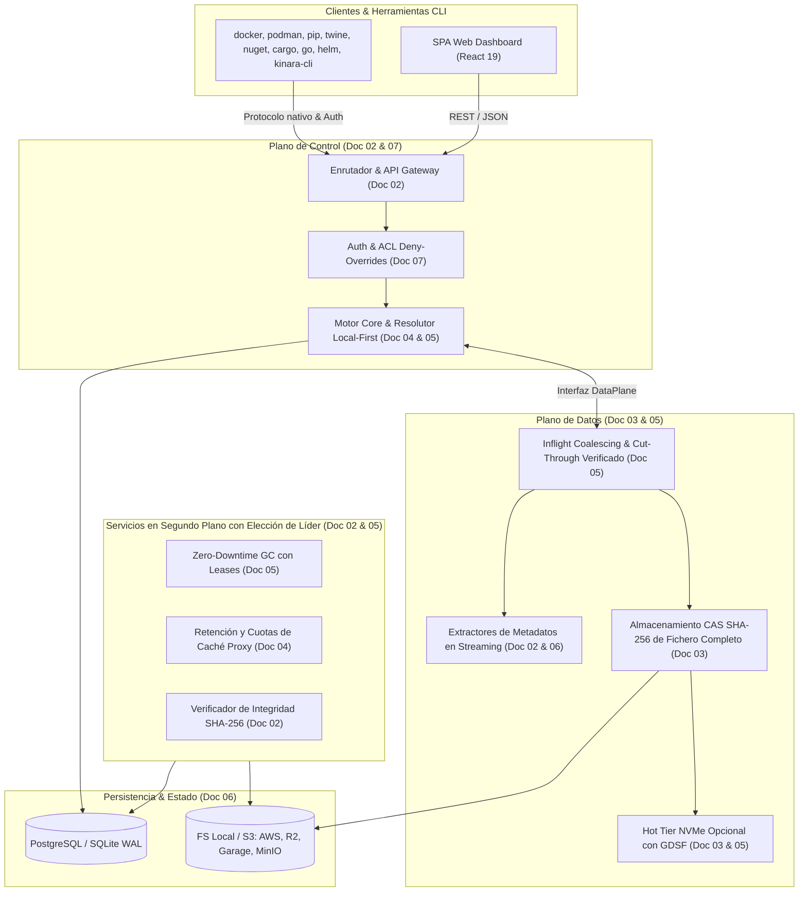

# Kinara Registry — Planificación Arquitectónica y Técnica

Bienvenido al directorio de planificación y diseño de ingeniería de **Kinara Registry**, una plataforma de registro de artefactos universal, autohosteable (*self-hosted*), ligera y de alto rendimiento optimizada para despliegues modernos en Docker y Kubernetes.

Este conjunto de documentos define la base técnica, los estándares de diseño, la estructura de datos, los algoritmos centrales y la hoja de ruta de implementación para el desarrollo de la aplicación.

---

## 🧭 Estructura de la Documentación

Los documentos se encuentran organizados de forma secuencial y modular para guiar a los ingenieros y desarrolladores en cada aspecto del sistema:

| Orden | Documento | Enfoque Principal |
| :---: | :--- | :--- |
| **01** | [`01-vision-y-alcance.md`](file:///home/cesar/Projects/Kinara-Registry/Planification/01-vision-y-alcance.md) | Visión del producto, pilares fundamentales, formatos soportados en el MVP (OCI, PyPI, NuGet, Go, Cargo) y análisis de valor frente a alternativas (Nexus/Artifactory). |
| **02** | [`02-arquitectura-del-sistema.md`](file:///home/cesar/Projects/Kinara-Registry/Planification/02-arquitectura-del-sistema.md) | Arquitectura global, interfaz interna entre el *Plano de Control* y el *Plano de Datos*, esquema de rutas, requisitos multi-réplica y modalidades de despliegue. |
| **03** | [`03-estrategia-almacenamiento-cas.md`](file:///home/cesar/Projects/Kinara-Registry/Planification/03-estrategia-almacenamiento-cas.md) | Modelo de almacenamiento basado en contenido (*CAS*) de fichero completo, autorización de blobs por repositorio, almacenamiento primario (FS/S3) y *Hot Tier* NVMe opcional. |
| **04** | [`04-tipos-de-repositorios.md`](file:///home/cesar/Projects/Kinara-Registry/Planification/04-tipos-de-repositorios.md) | Comportamiento y lógica operativa de repositorios Locales (*Hosted*), Proxy (*Remote/Cache*) y Virtuales (*Group*), caché de metadatos con TTL y prevención de *Dependency Confusion*. |
| **05** | [`05-algoritmos-y-optimizaciones.md`](file:///home/cesar/Projects/Kinara-Registry/Planification/05-algoritmos-y-optimizaciones.md) | Algoritmos clave y concurrencia: deduplicación CAS, evicción GDSF del Hot Tier, resolución indexada *Local-First*, *Inflight Coalescing* sobre fichero de staging y *Zero-Downtime GC* con *leases*. |
| **06** | [`06-modelo-datos-y-esquema-db.md`](file:///home/cesar/Projects/Kinara-Registry/Planification/06-modelo-datos-y-esquema-db.md) | Esquema relacional completo y compatibilidad dual (PostgreSQL / SQLite WAL), tablas nativas OCI, normalización por ecosistema y consultas sobre `JSONB`. |
| **07** | [`07-seguridad-autenticacion-y-acl.md`](file:///home/cesar/Projects/Kinara-Registry/Planification/07-seguridad-autenticacion-y-acl.md) | Modelo de identidad por protocolo, tokens PAT/JWT, claves firmantes compartidas, algoritmo determinista *Deny-Overrides* y matriz de permisos (*ACL*). |
| **08** | [`08-roadmap-y-fases-desarrollo.md`](file:///home/cesar/Projects/Kinara-Registry/Planification/08-roadmap-y-fases-desarrollo.md) | Hoja de ruta de ingeniería en 4 fases (Fases 1–3 = MVP; Fase 4 = v1.0 GA), criterios de aceptación verificables, perfil de carga y checklist de definición de terminado (*DoD*). |
| **09** | [`09-investigacion-aplicaciones-y-stack-tecnologico.md`](file:///home/cesar/Projects/Kinara-Registry/Planification/09-investigacion-aplicaciones-y-stack-tecnologico.md) | Arquitectura de aplicaciones (*Single-Binary Multi-Role* + `kinara-cli` + SPA), comparativa de lenguajes y selección definitiva del stack (Go, React 19, Bun). |

---

## 🗺️ Mapa de Relaciones del Sistema

El siguiente diagrama ilustra cómo interactúan los conceptos descritos a lo largo de estos documentos:

---

## 📖 Convenciones y Filosofía de Diseño

1. **Simplicidad Operativa sobre Complejidad:** Preferir despliegues autónomos que arranquen en un único binario o contenedor (`docker compose up -d`) antes que arquitecturas fragmentadas en múltiples microservicios obligatorios.
2. **Inmutabilidad e Integridad Byte a Byte:** Los blobs en el almacenamiento CAS son inmutables, nunca se recomprimen en el servidor y se identifican estrictamente por el hash criptográfico SHA-256 del fichero completo que verifica el cliente nativo.
3. **Flexibilidad con Rigor Relacional:** El catálogo de repositorios, permisos ACL, vínculos de autorización de blobs (`repository_blobs`) y referencias OCI es estrictamente relacional para garantizar integridad referencial, mientras que los metadatos declarativos propios de cada ecosistema se gestionan mediante columnas `JSONB`.
4. **Resiliencia y Huella de RAM Constante:** Las resoluciones de paquetes y barreras de seguridad (*Local-First*) se apoyan en consultas SQL indexadas ($\sim 1\text{ ms}$) siempre consistentes entre réplicas, mientras que la transferencia de binarios se realiza en streaming apoyándose en staging en disco/S3 sin cargar artefactos completos en memoria RAM.
