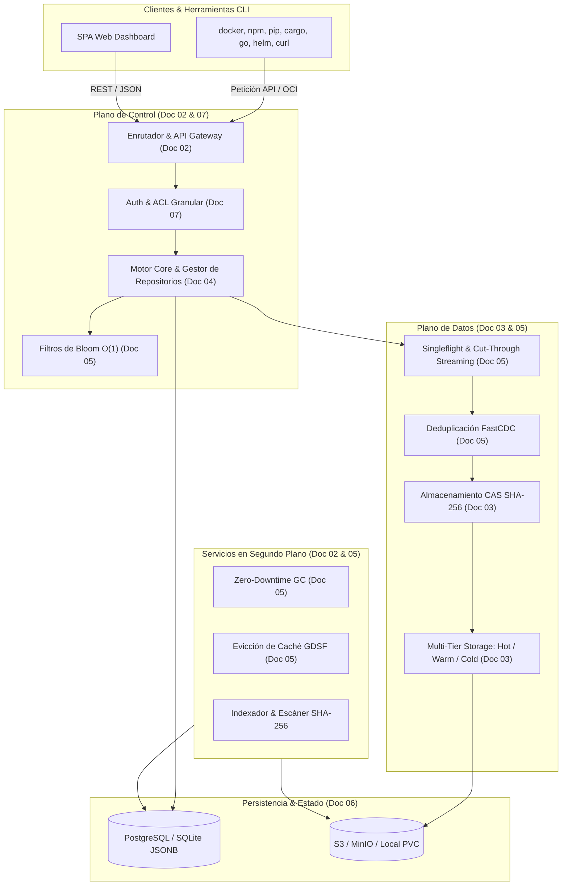

# Kinara Registry — Planificación Arquitectónica y Técnica

Bienvenido al directorio de planificación y diseño de ingeniería de **Kinara Registry**, una plataforma de registro de artefactos universal, autohosteable (*self-hosted*), ligera y de alto rendimiento optimizada para despliegues modernos en Docker y Kubernetes.

Este conjunto de documentos define la base técnica, los estándares de diseño, la estructura de datos, los algoritmos centrales y la hoja de ruta de implementación para el desarrollo de la aplicación.

---

## 🧭 Estructura de la Documentación

Los documentos se encuentran organizados de forma secuencial y modular para guiar a los ingenieros y desarrolladores en cada aspecto del sistema:

| Orden | Documento | Enfoque Principal |
| :---: | :--- | :--- |
| **01** | [`01-vision-y-alcance.md`](file:///home/cesar/Projects/Kinara-Registry/Planification/01-vision-y-alcance.md) | Visión del producto, pilares fundamentales, formatos soportados en el MVP y análisis de valor frente a alternativas (Nexus/Artifactory). |
| **02** | [`02-arquitectura-del-sistema.md`](file:///home/cesar/Projects/Kinara-Registry/Planification/02-arquitectura-del-sistema.md) | Arquitectura global, desacoplamiento entre el *Plano de Control* y el *Plano de Datos*, componentes principales y modalidades de despliegue. |
| **03** | [`03-estrategia-almacenamiento-cas.md`](file:///home/cesar/Projects/Kinara-Registry/Planification/03-estrategia-almacenamiento-cas.md) | Modelo de almacenamiento basado en contenido (*CAS*), durabilidad y jerarquía *Multi-Tier* (Hot, Warm y Cold tiers). |
| **04** | [`04-tipos-de-repositorios.md`](file:///home/cesar/Projects/Kinara-Registry/Planification/04-tipos-de-repositorios.md) | Comportamiento y lógica operativa de repositorios Locales (*Hosted*), Proxy (*Remote/Cache*) y Virtuales (*Group*), y prevención de *Dependency Confusion*. |
| **05** | [`05-algoritmos-y-optimizaciones.md`](file:///home/cesar/Projects/Kinara-Registry/Planification/05-algoritmos-y-optimizaciones.md) | Algoritmos clave y modelos matemáticos: FastCDC, evicción GDSF, Filtros de Bloom $O(1)$, Singleflight, Cut-Through Streaming y Zero-Downtime GC. |
| **06** | [`06-modelo-datos-y-esquema-db.md`](file:///home/cesar/Projects/Kinara-Registry/Planification/06-modelo-datos-y-esquema-db.md) | Esquema relacional completo (PostgreSQL/SQLite), tablas de metadatos, deduplicación y uso estratégico de columnas `JSONB`. |
| **07** | [`07-seguridad-autenticacion-y-acl.md`](file:///home/cesar/Projects/Kinara-Registry/Planification/07-seguridad-autenticacion-y-acl.md) | Modelo de identidad, tokens PAT/JWT, endpoints OCI, matriz de permisos y control de acceso granular (*ACL*). |
| **08** | [`08-roadmap-y-fases-desarrollo.md`](file:///home/cesar/Projects/Kinara-Registry/Planification/08-roadmap-y-fases-desarrollo.md) | Hoja de ruta de ingeniería en 4 fases, hitos de entrega, criterios de aceptación técnica y checklist de definición de terminado (*DoD*). |
| **09** | [`09-investigacion-aplicaciones-y-stack-tecnologico.md`](file:///home/cesar/Projects/Kinara-Registry/Planification/09-investigacion-aplicaciones-y-stack-tecnologico.md) | Análisis de arquitectura de aplicaciones, desacoplamiento (Control Plane, Data Plane, Workers, UI, CLI) y comparativa de lenguajes (Go, Rust, React). |

---

## 🗺️ Mapa de Relaciones del Sistema

El siguiente diagrama ilustra cómo interactúan los conceptos descritos a lo largo de estos documentos:

---

## 📖 Convenciones y Filosofía de Diseño

1. **Simplicidad Operativa sobre Complejidad:** Preferir despliegues autónomos que puedan arrancar en un único binario o contenedor antes que arquitecturas excesivamente fragmentadas que requieran decenas de microservicios.
2. **Inmutabilidad de Datos:** Los bloques en el almacenamiento CAS son inmutables. El contenido se identifica estrictamente por su hash criptográfico SHA-256.
3. **Flexibilidad con Rigor Relacional:** La estructura de repositorios y control de acceso es estrictamente relacional para garantizar integridad referencial, mientras que los metadatos propios de cada ecosistema se gestionan mediante esquemas semi-estructurados (`JSONB`).
4. **Resiliencia y Baja Latencia:** Se prioriza la entrega de datos en sub-milisegundos utilizando estructuras en memoria (Filtros de Bloom) y técnicas de streaming en tiempo real sin almacenamiento en búfer intermedio que sature la memoria RAM.
